{/* Source: Intercom article 13598396 - https://oloid.help/en/articles/13598396-tenant-admin-portal-how-to-configure-advanced-user-sync-for-entra-id-inbound */}
{/* Generated by intercom_to_mintlify.py - re-running overwrites this file. */}

## Introduction

This document describes how to configure Advanced User Sync for Microsoft Entra ID - Inbound in the Tenant Admin Portal.

## Prerequisites

- You must have admin access to the **Tenant Admin Portal**.
- An **Advanced User Sync profile for Entra ID (Inbound)** is already created. To create refer, [How to Create Data Mapper Table for Entra ID - Inbound in the Tenant Admin Portal](/platform/tenant-admin-portal/how-to-create-data-mapper-table-for-entra-id-inbound-in-the-tenant).
- Ensure Advanced User Sync for Microsoft Entra ID is configured in the Microsoft Entra ID Admin Console. To know more, refer [How to Configure Advanced User Sync in Microsoft Entra ID Admin Console](/integrations/entra-id/how-to-configure-advanced-user-sync-in-microsoft-entra-id-admin).
- A **Data Mapper Table** is created and available for user attribute mapping.
- A **Data Filter** table is created and available for mapping the Entra ID - Inbound.

## Steps to Configure Advanced User Sync for Entra ID - Inbound

1. Log in to the **Tenant Admin Portal**.
2. Go to **Agents > Advanced User Sync**.

   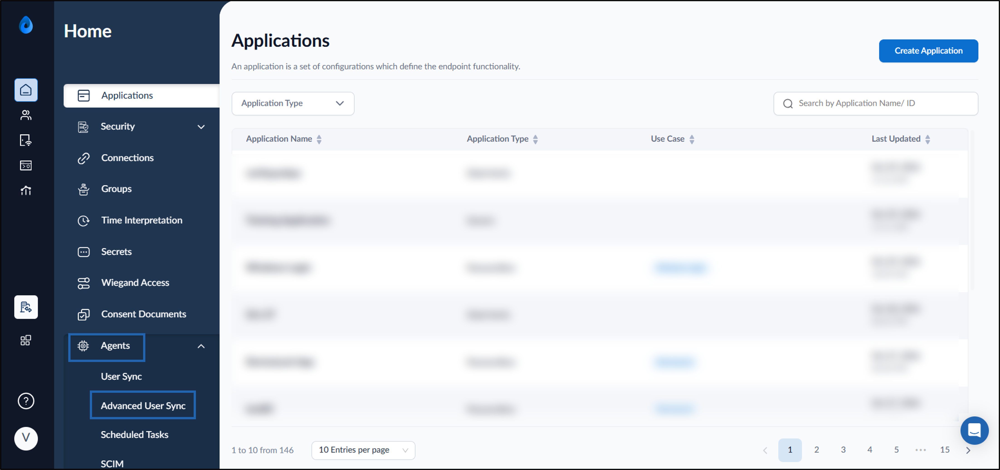

   The **Advanced User Sync** page is displayed.
3. Select the preferred Entra ID Advanced User Sync.

   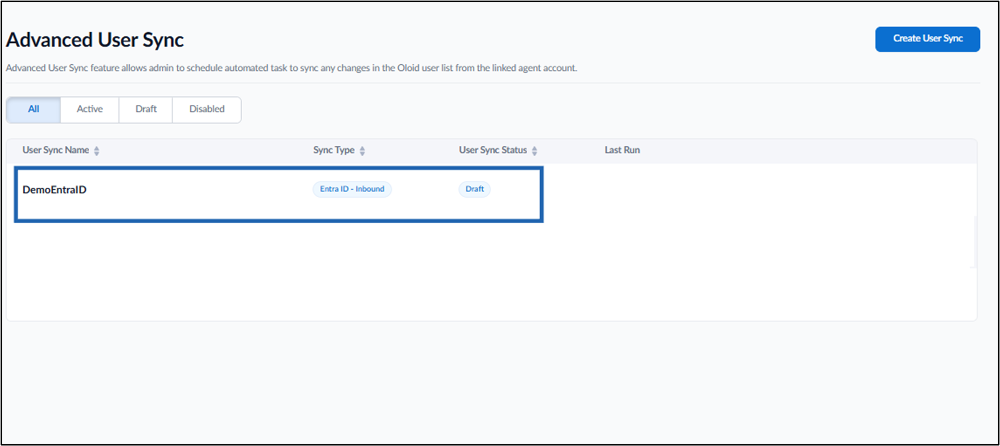

   The Advanced User Sync detail page is displayed.
4. Do the following:
   1. [Configure Details Tab](#configure-details-tab)
   2. [Setup Configuration Tab](#setup-configuration-tab)
   3. [Configure Account Tab](#configure-account-tab)
   4. [Configure Schedule Tab](#configure-schedule-tab)
   5. [Task Run Logs](#task-run-logs)
5. Click **Activate**.

   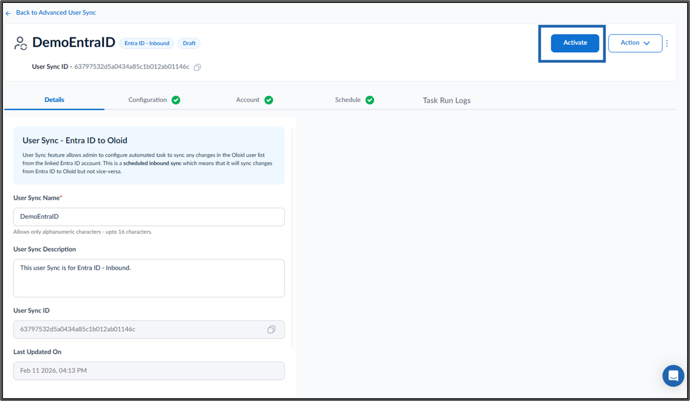

   The **Confirm Activation** pop-up box is displayed.
6. Click **Confirm**.

   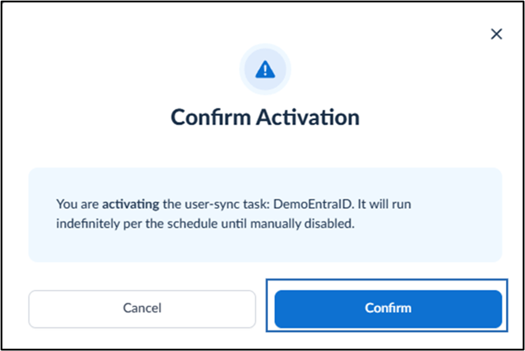

   The Advanced User Sync is configured and activated successfully.

   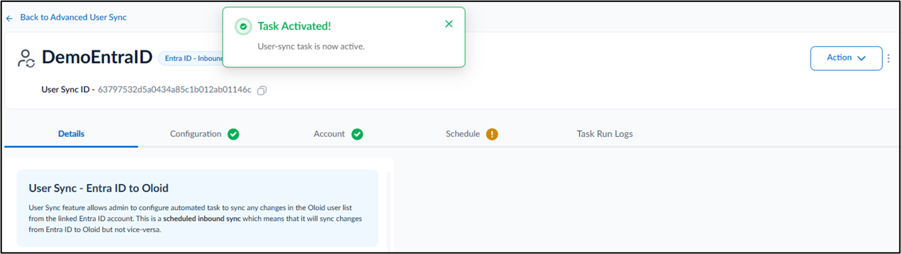

7. (Optional) Go to **Action > User Sync**.

   <Note>
     **Note:** Selecting **Sync Now** immediately triggers a manual synchronization.
   </Note>

   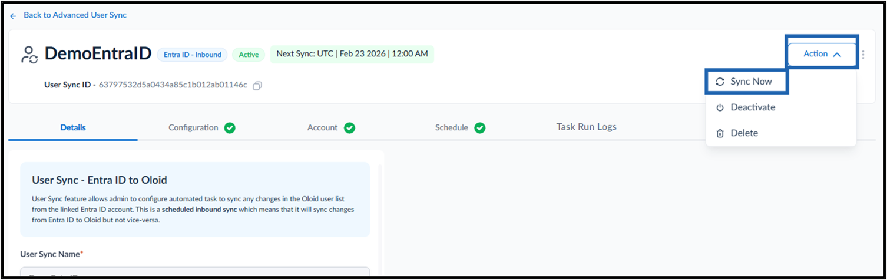

   The **Sync Now?** pop-up box is displayed.
8. Click **Confirm**.

   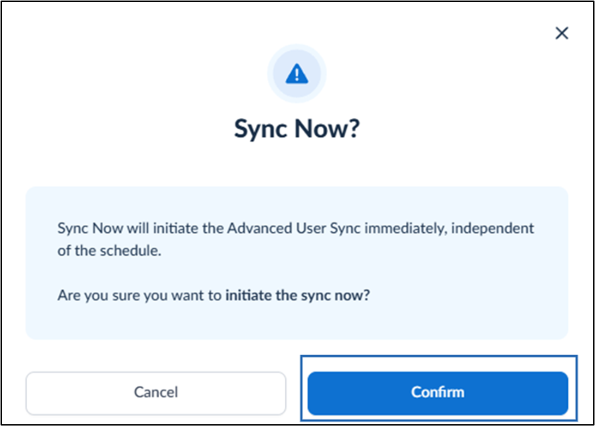

   The **Success** pop-up box is displayed.

   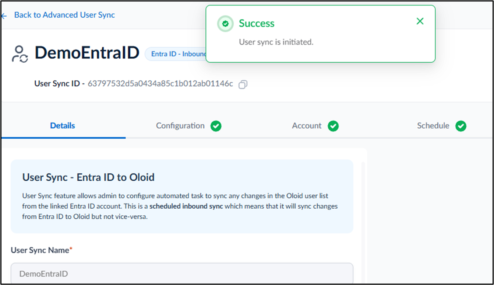

   The user sync completes successfully.

   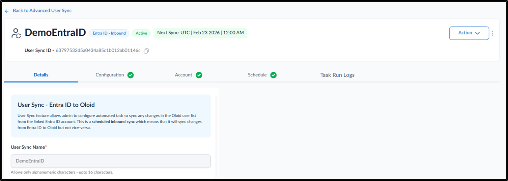

### Configure Details Tab

This tab is used to view and edit basic information about the Advanced User Sync.

Do the following:

1. Update the **User Sync Name** (Optional).
2. Enter the **User Sync Description** (Optional).
3. Click **Save**.

   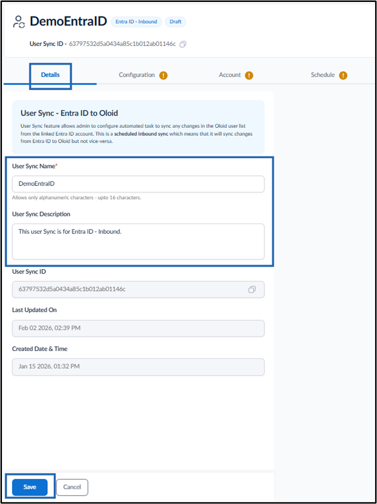

   The Details tab is configured successfully.

   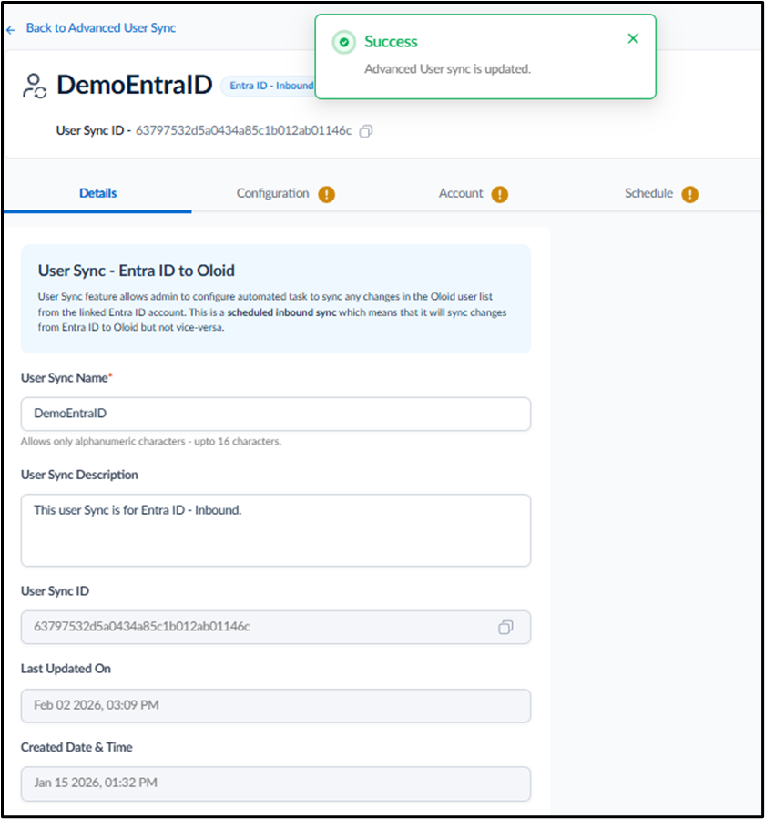

### Setup Configuration Tab

This tab is used to map user data from **Microsoft Entra ID** to **Oloid** and select the Oloid connection where users are added during the inbound user sync.

Do the following:

1. Select the data mapper table from the drop-down.

   <Note>
     **Note:** Click **View Tables** to review or create a data mapper table, if required.
   </Note>

2. On **Add Users to Selected Connection**, do one of the following:
   1. Select the **Connection** option, and then select the required **Connection** from the drop-down list.
      OR
   2. Select the **Data Filter Table** option, and then select the required **Data Filter Table** from the drop-down list.

      <Note>
        **Note:** Click **View Tables** to review or create a data filter table, if required.
      </Note>

3. Enable the **Sync FIDO2 Passkeys** toggle.

   <Note>
     **Note:**

     - Before you sync passkeys to the Tenant Admin Portal, make sure FIDO2 authentication is configured in the Azure portal. To configure, refer **[Enable FIDO2 Authentication in Azure Portal](/integrations/entra-id/how-to-configure-advanced-user-sync-in-microsoft-entra-id-admin)**.
     - Only one Microsoft Entra ID account can synchronize FIDO2 passkeys at a time. If another account is already synchronizing FIDO2 passkeys, this option is unavailable.
   </Note>

4. Click **Save**.

   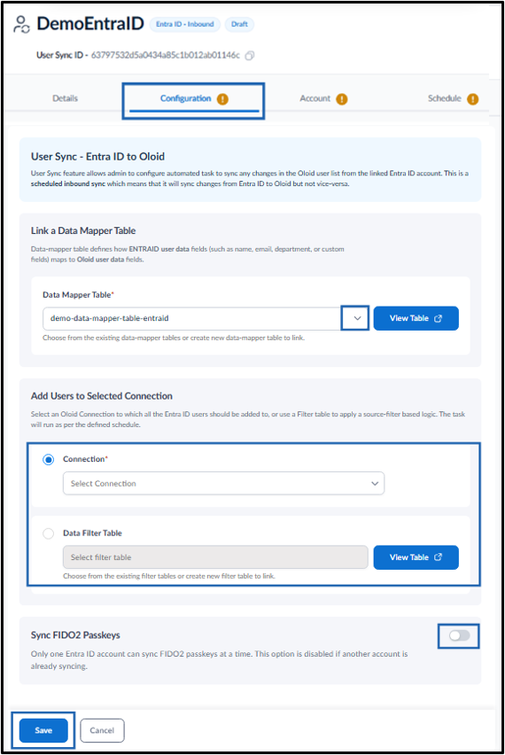

   The Configuration tab is setup successfully.

   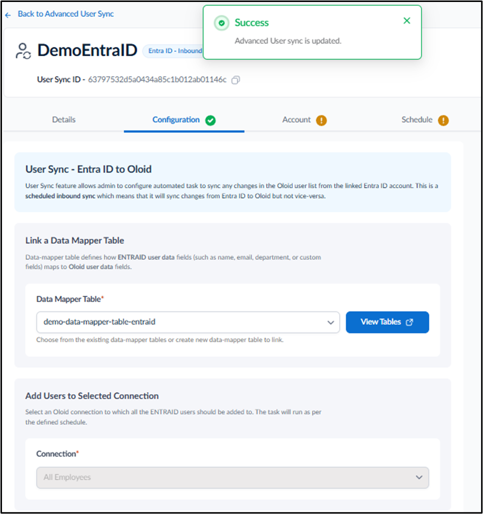

### Configure Account Tab

This tab is used to add and configure the **Microsoft Entra ID** account details required for inbound user synchronization with **Oloid**.

Do the following:

1. Enter **Account Name**.
2. Enter **API URL**.

   <Note>
     **Note:** The API URL must be set to `https://graph.microsoft.com/v1.0/users` for Microsoft Entra ID – Inbound user synchronization.
   </Note>

3. Enter **Directory ID**.
4. Enter **Client ID**.

   <Note>
     **Note:** You can find the **Directory (tenant) ID** and **Application (client) ID** on the **Overview** page of the application in the Microsoft Entra ID Admin Console.
   </Note>

   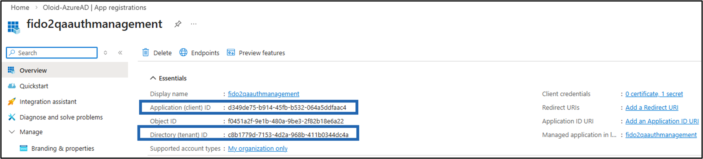

5. Enter **Client Secret**.

   <Note>
     **Note:** You can find the **Client Secret** on the **Certificates & secrets** page in the Microsoft Entra ID Admin Console.
   </Note>

   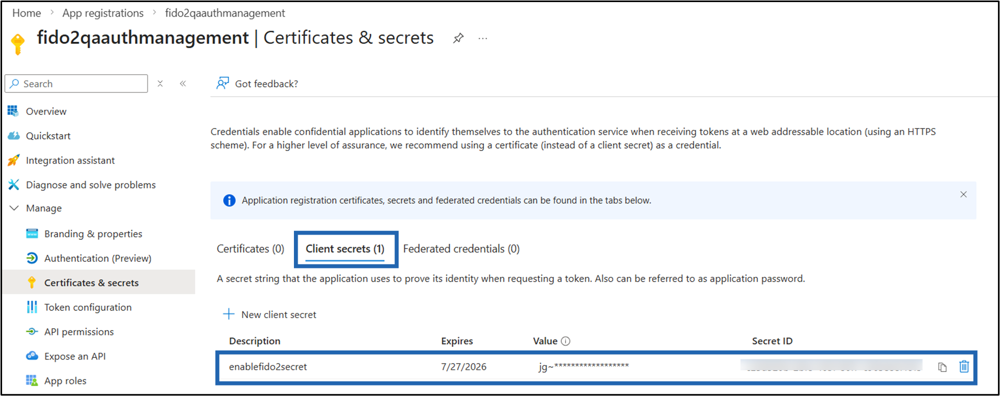

6. Enter the group name(s) in the **Group** field

   <Note>
     **Note:** To add multiple groups, separate each group name with a comma.
   </Note>

   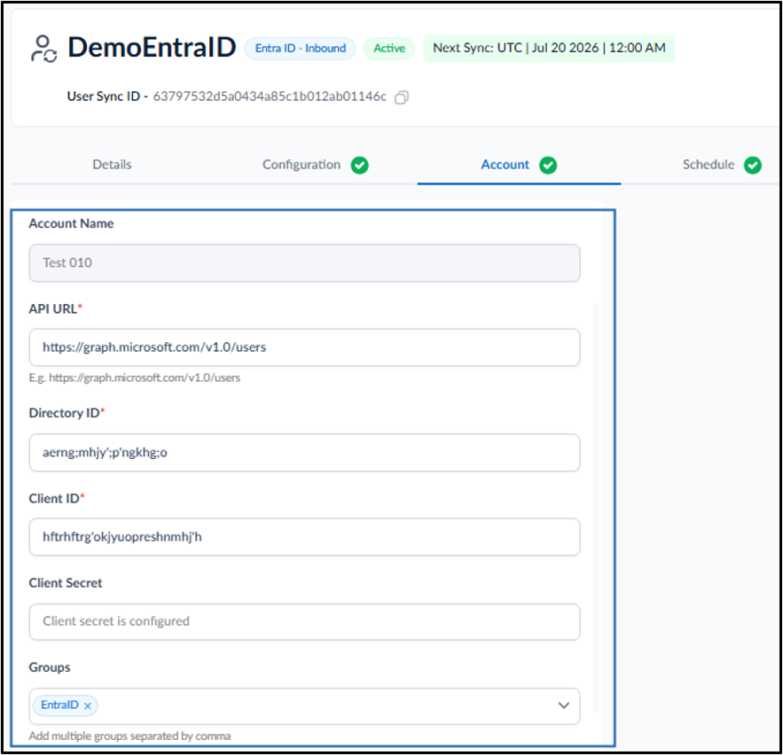

7. Select **Columns** from theSelected Columns drop-down list to select the Microsoft Entra ID user attributes to synchronize with Oloid.

   <Note>
     **Note:** Select one or more attributes.
   </Note>

8. In the **Filter Query** field, enter a Microsoft Graph filter expression to synchronize only the required user records.
   **Example:** accountEnabled eq true and department eq 'Engineering'.
9. In the **Expand Query** field, enter related attributes to retrieve additional user information during synchronization.
   **Example:** manager($select=displayName,mail,userPrincipalName).
10. In the **Max Records** field, specify the maximum number of user records to retrieve.
    **Note:**
    1. Enter a positive number to limit the number of records retrieved.
    2. Enter **0** or leave the field blank to retrieve all available records.
11. Click **Save**.

    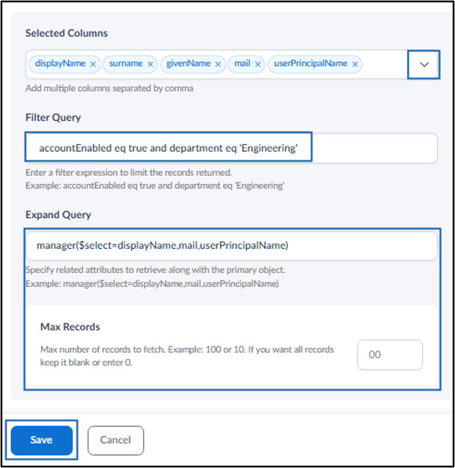

    The Account tab details section is configured successfully.
12. Click **Test**.

    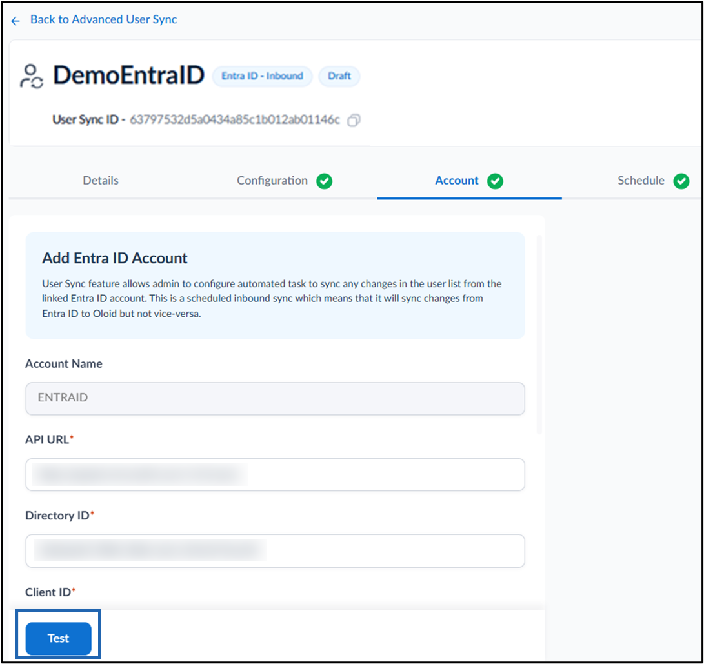

    The **Success** pop-up box is displayed.

    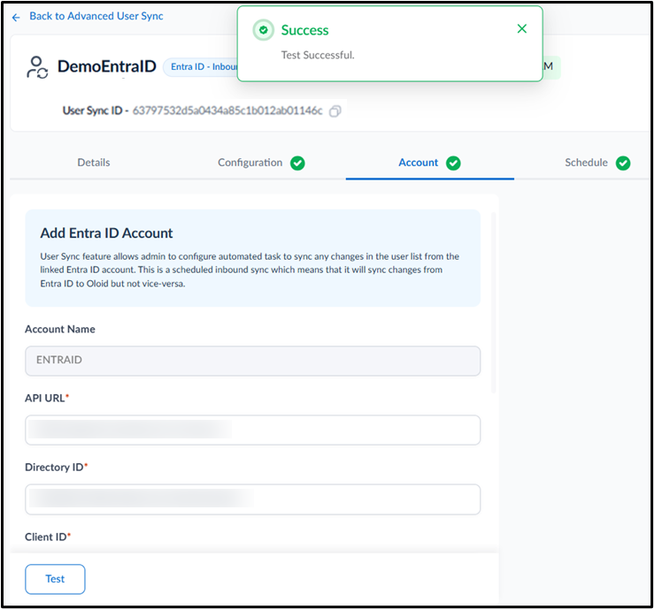

### Configure Schedule Tab

This tab is used to define when the **Entra ID – Inbound** user sync runs. You can configure the sync to run on a recurring schedule or run once when the sync is activated.

Do one of the following:

[Repeat Every](#repeat-every)

**OR**

[Run Once When Activated](#run-once-when-activated)

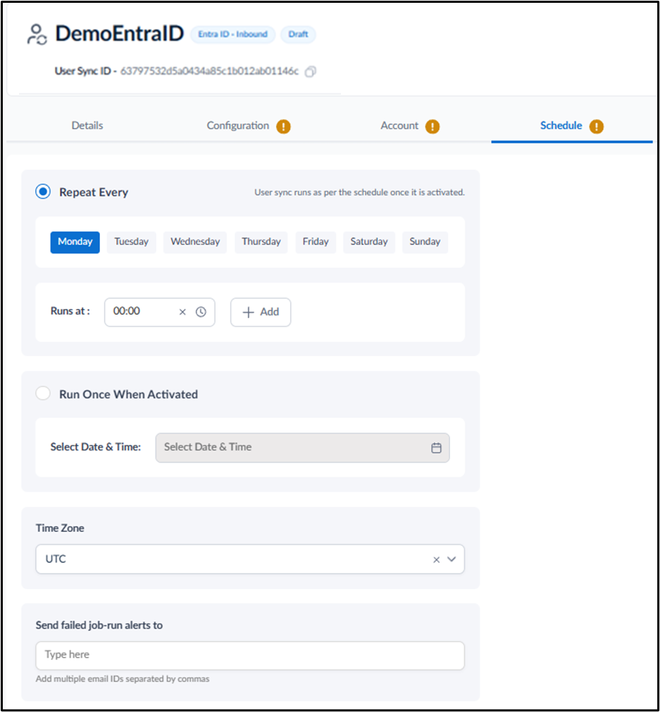

The Schedule tab is configured successfully.

#### Repeat Every

The **Repeat Every** section is used torun the user sync on selected days and times.

Do the following:

1. Select **Repeat Every**.
2. Select the required day(s).

   <Note>
     **Note:** You can select multiple days (if needed).
   </Note>

3. Select the run time in the **Runs at** field.

   <Note>
     **Note:** You can add multiple execution time. To do, click **+Add** to configure additional run times, if required.
   </Note>

4. Select **Time Zone** from the drop-down.
5. Enter email address(es) in the **Send failed job-run alerts to** field.

   <Note>
     **Note:** Separate multiple email addresses with commas.
   </Note>

6. Click **Save**.

   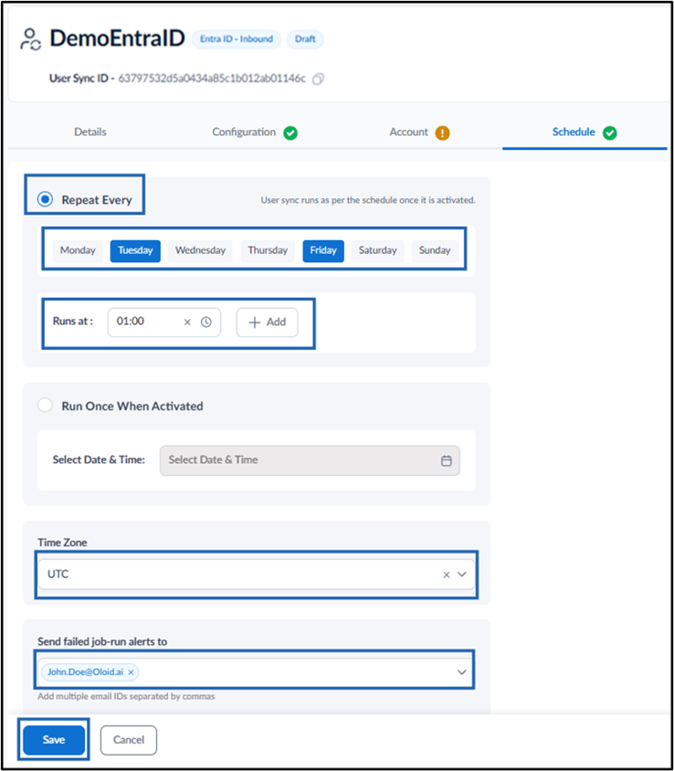

   The **Repeat Every** section is configured successfully.

   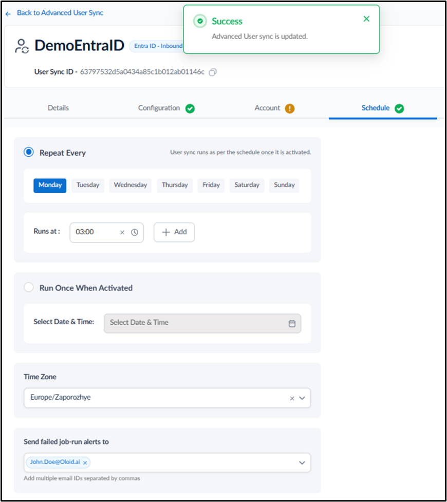

#### Run Once When Activated

The **Run Once When Activated** section is used to run the sync only once.

Do the following:

1. Select **Run Once When Activated**.
2. Select the date and time in the **Select Date & Time** field.
3. Select **Time Zone** from the drop-down.
4. Enter email address(es) in the **Send failed job-run alerts to** field.

   <Note>
     **Note:** Separate multiple email addresses with commas.
   </Note>

5. Click **Save**.

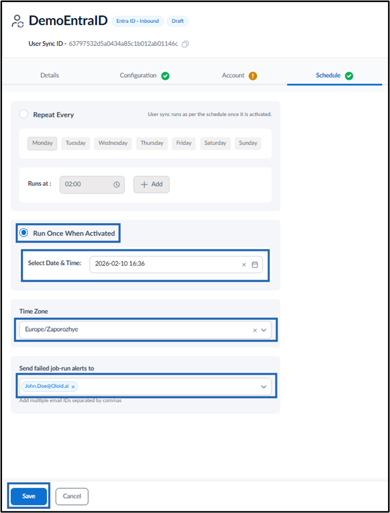

The **Run Once When Activated** section is configured successfully.

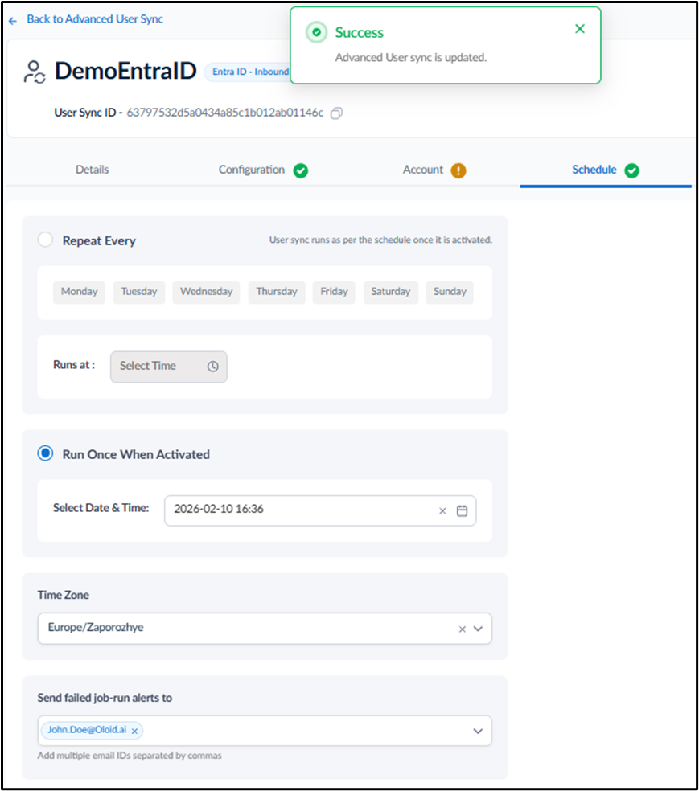

### Task Run Logs

This tab is used to view the run history of the **Entra ID – Inbound** user sync, including the status of each job run and the number of user records processed during synchronization.

<Note>
  **Note:** Task run logs are available only after the user sync has run at least once. If the user sync is in **Draft** status or has not run yet, **No Data** is displayed.
</Note>

Do the following:

1. Click the **Task Run Logs** tab.
   The **Task Run Logs** tab is displayed.
2. (Optional) Click **Select Dates** and select the required date range to filter the logs.
3. In the **Logs** column, click the **Download** icon to download the logs of the required job run.

   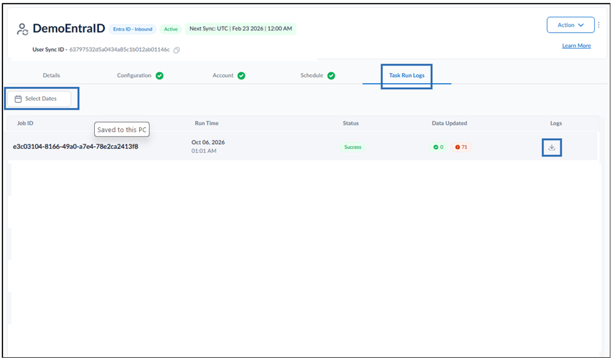

##### Related Articles

[How to Create Data Mapper Table for Entra ID - Inbound in the Tenant Admin Portal](/platform/tenant-admin-portal/how-to-create-data-mapper-table-for-entra-id-inbound-in-the-tenant)

[How to Configure Advanced User Sync in Microsoft Entra ID Admin Console](/integrations/entra-id/how-to-configure-advanced-user-sync-in-microsoft-entra-id-admin)
