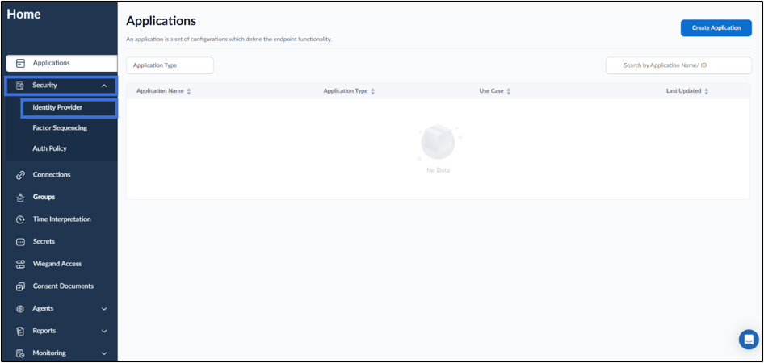
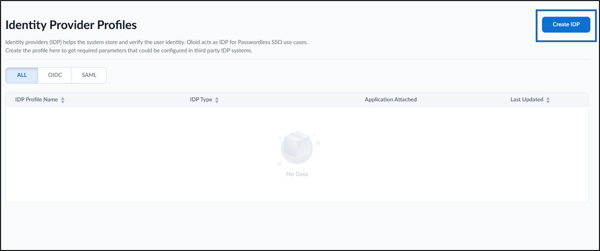
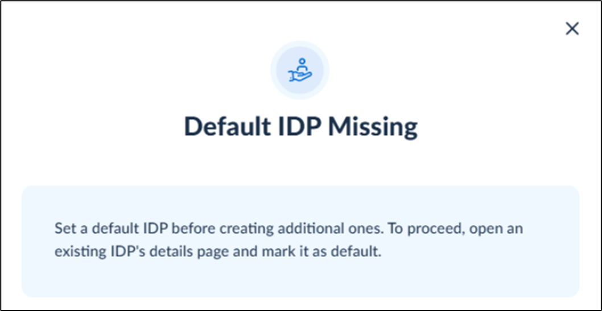
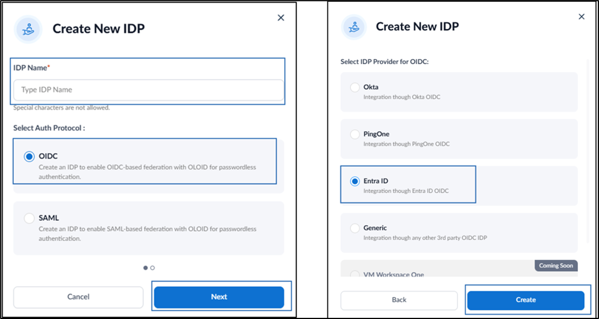

{/* Source: Intercom article 13349621 - https://oloid.help/en/articles/13349621-tenant-admin-portal-how-to-create-idp-profile-for-oidc-entra-id */}
{/* Generated by intercom_to_mintlify.py - re-running overwrites this file. */}

## Introduction

Identity Providers (IDPs) are used to manage and verify user identities for authentication. This document explains how to create an **Entra ID Identity Provider (IDP) profile** in the Tenant Admin Portal using **OIDC authentication**.

## Prerequisite

You must have access to the Tenant Admin Portal.

## Steps to Create Entra ID IDP Profile

1. Log in to the **Tenant Admin Portal**.
2. On the home page of the portal, select **Security** > **Identity Provider**.

   

   The **Identity Provider Profiles** page is displayed.
3. Click **Create IDP** in the top right corner.

   

   <Note>
     **Note:** You cannot create a new IDP unless a default IDP is already set. Please open an existing IDP and mark it as default before proceeding. For more details refer [How to make an IDP default](/platforms/web/webkey/webkey-how-to-link-webkey-with-an-identity-provider-idp-in-tenant).
   </Note>

   

   The **Create New IDP Profile** pop-up box is displayed.
4. Do the following:
   1. Enter **IDP Name**.
   2. Select **OIDC** asAuth Protocol.
   3. Click **Next**.
   4. Select **Entra ID** as IDP Provider for OIDC.
   5. Click **Create**.

      

      The IDP Profile for OIDC Entra ID is created successfully.

      

##### Related Articles

[Integrating Oloid as an EAM with Microsoft Entra ID](/integrations/entra-id/integrating-oloid-as-an-external-method-authentication-eam-with)

---

**Keywords**
| Entra ID IDP | Create Entra ID IDP Profile in Tenant Admin Portal |
