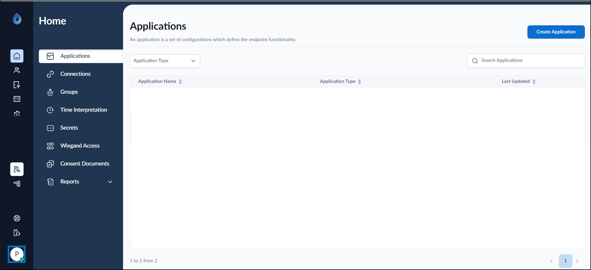
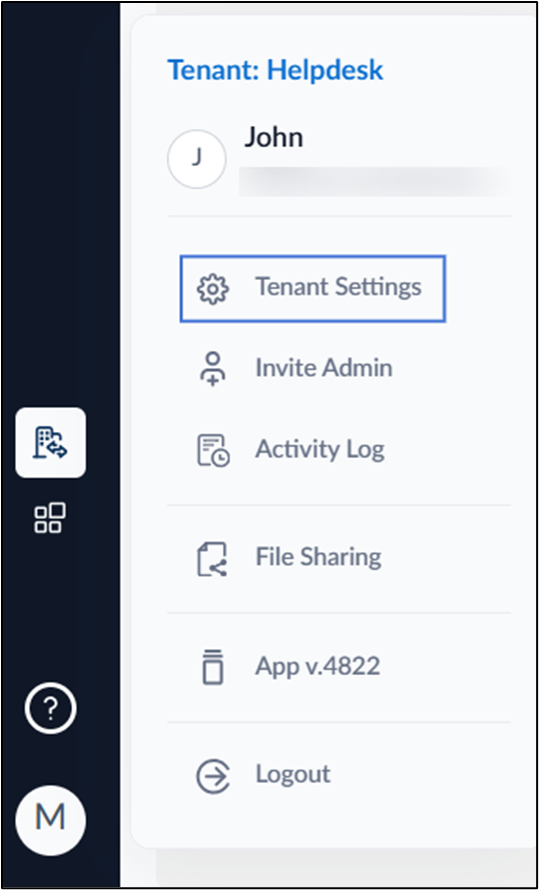
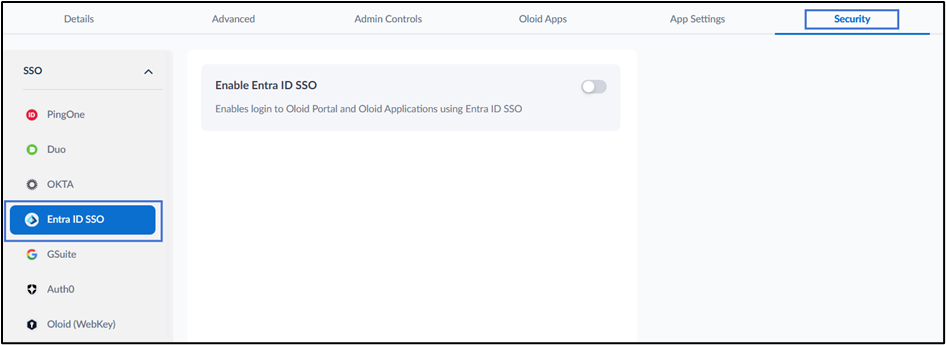
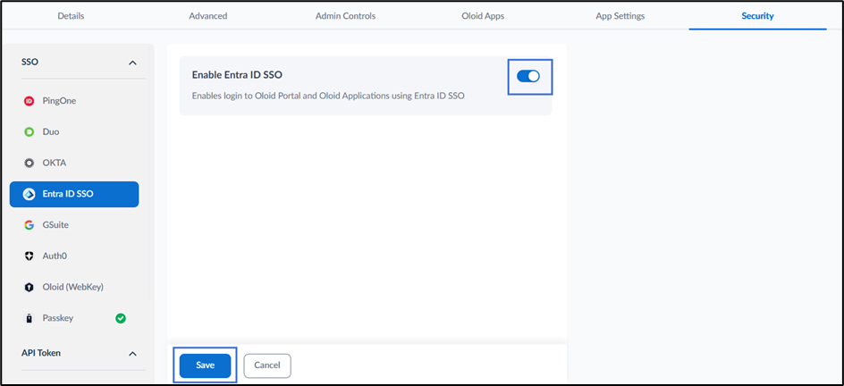
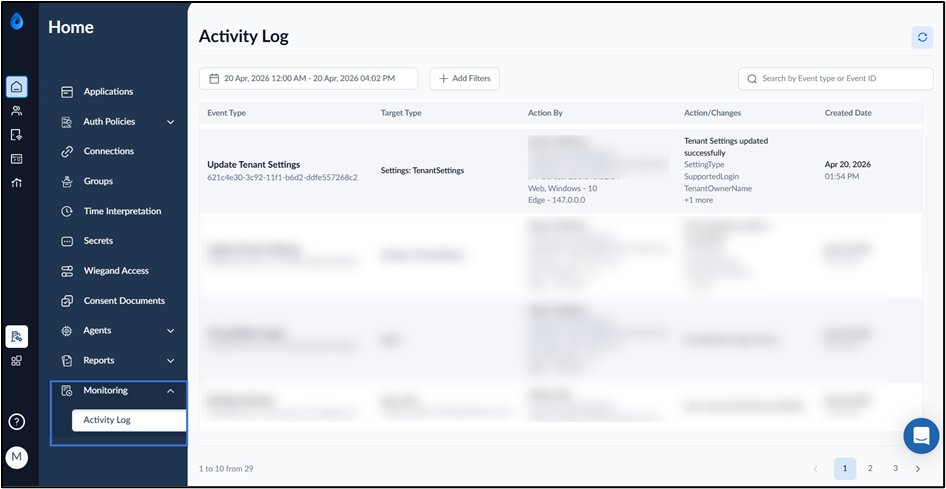

{/* Source: Intercom article 14663355 - https://oloid.help/en/articles/14663355-tenant-admin-portal-how-to-enable-entra-id-sso */}
{/* Generated by intercom_to_mintlify.py - re-running overwrites this file. */}

## Introduction

This document explains how to enable Microsoft Entra ID Single Sign-On (SSO) in the Tenant Admin Portal. Oloid supports SSO using OIDC, enabling secure and seamless user authentication. Once configured, users can sign in to the Oloid Platform through Entra ID. Oloid currently supports only OIDC for SSO authentication.

## Prerequisite

You must have access to the Tenant Admin Portal.

## Steps to Enable Entra ID SSO

1. Log in to the **Tenant Admin Portal**.
2. On the homepage of the portal, click **user profile icon** on the bottom left corner of the menu panel.

   

   The user profile menu is displayed.
3. Click **Tenant Settings**.

   

   The **Tenant Settings** page is displayed.
4. Go to **Security** tab > click **Entra ID SSO**.

   

5. Turn on **Enable Entra ID SSO** toggle.

Click **Save.**

The Entra ID SSO is enabled successfully.

<Note>
  **Note:** You can view the Activity Log in the Tenant Admin Portal. For More, refer to [How to view Activity Log in Tenant Admin Portal](/platform/tenant-admin-portal/how-to-view-activity-log-in-tenant-admin-portal)
</Note>

