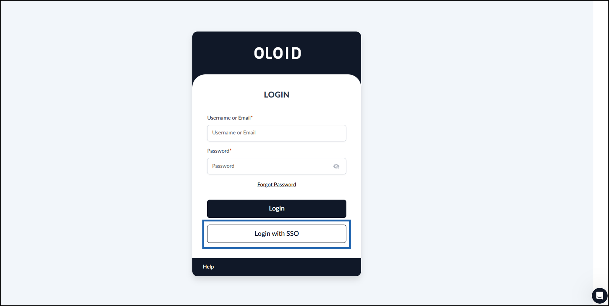
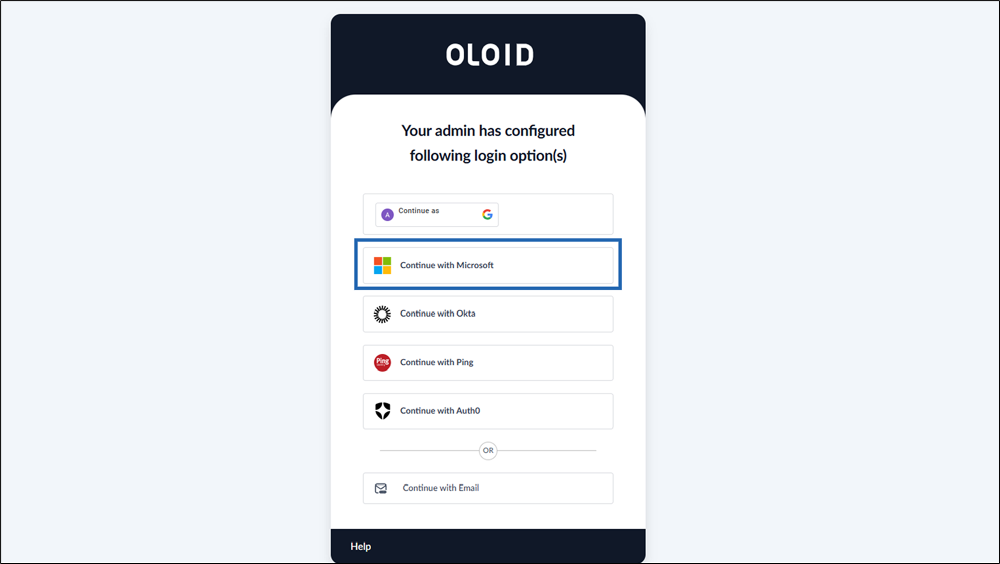
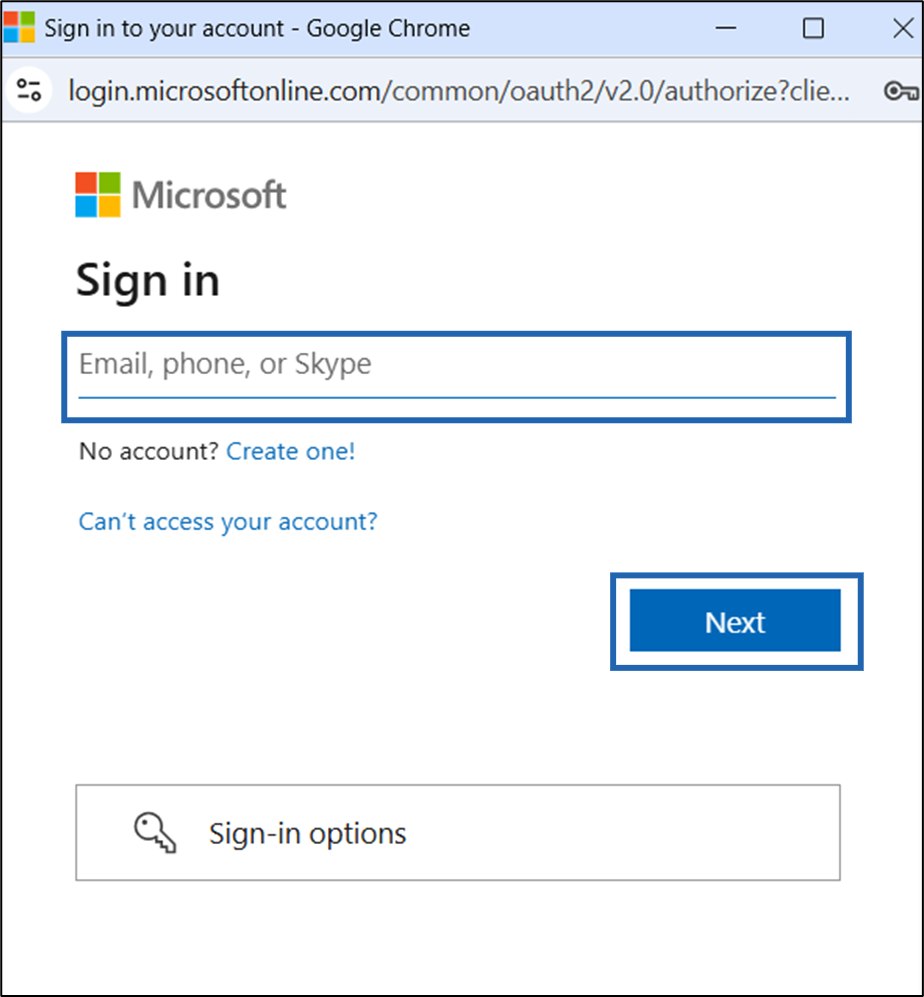
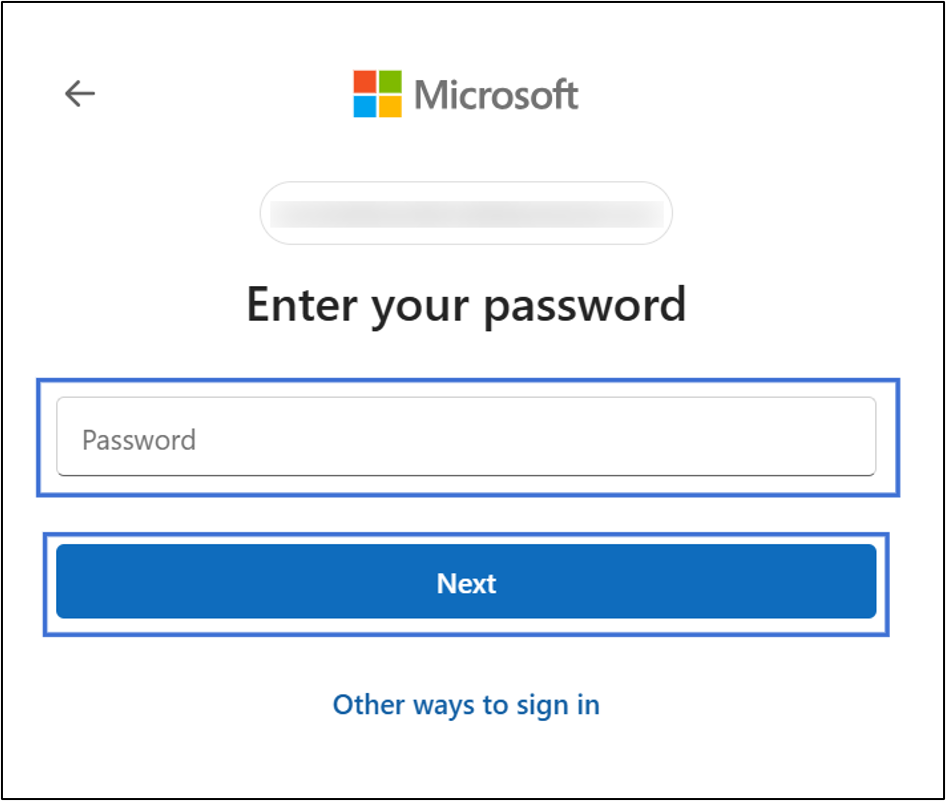
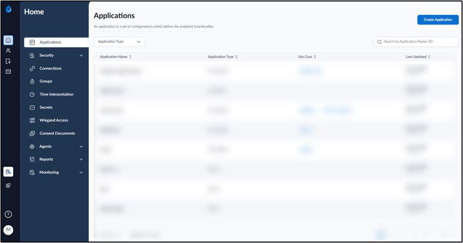

{/* Source: Intercom article 8727230 - https://oloid.help/en/articles/8727230-tenant-admin-portal-how-to-log-in-to-tenant-admin-portal-with-microsoft-sso */}
{/* Generated by intercom_to_mintlify.py - re-running overwrites this file. */}

## Introduction

This document provides step-by-step instructions to log in to the Tenant Admin Portal using the Microsoft SSO login option. Microsoft Single Sign-On (SSO) allows users to securely access the Tenant Admin Portal using their Microsoft credentials without requiring a separate Oloid password.

## Prerequisites

- You should be a user in the Tenant Admin Portal with **Admin/Supervisor** role.
- The Microsoft credential (user email ID) must be added to the user details page.

## Steps to Log in using Microsoft SSO

1. Launch your browser.
2. Enter the URL provided for you in the browser’s address bar > press **Enter** on your keyboard.
   The Oloid LOGIN page is displayed.
3. Click **Login with SSO.**

   

   The configured Log in options are displayed.
4. Click **Continue with Microsoft** to log in to Oloid Platform with Microsoft SSO.

   

   The **Sign in** pop-up box is displayed.
5. Enter your **Microsoft Email ID** > click **Next**.

   <Note>
     **Note:** If you have your UPN (**User Principal Name)**, enter your UPN to log in.
   </Note>

   

   **Enter your password** pop up box is displayed.
6. Enter **Password** in the Password field > Click **Next**.

   

   You are logged in to the Tenant Admin Portal using Microsoft SSO successfully.

   
