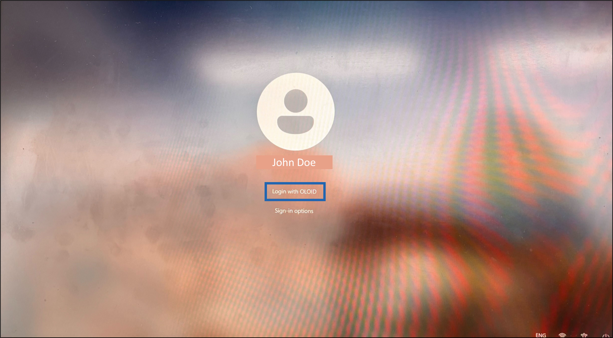
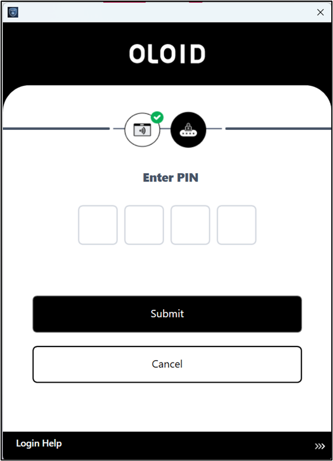
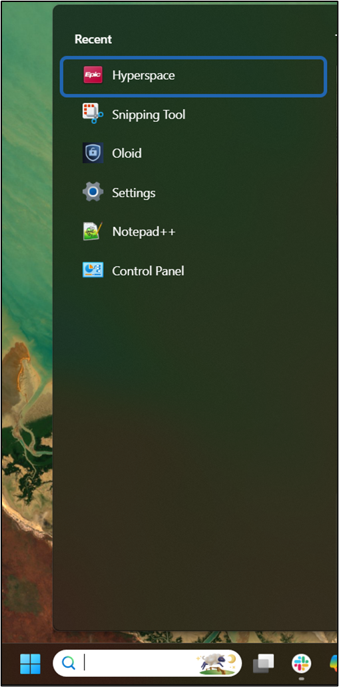
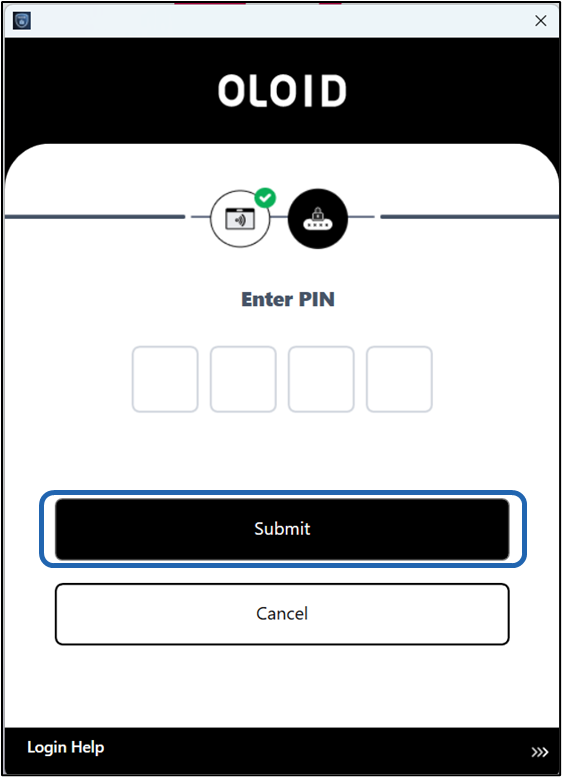
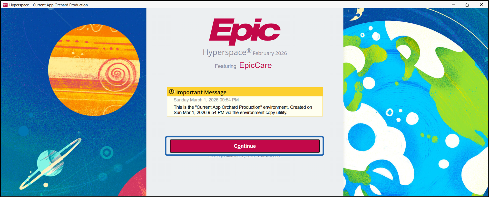

{/* Source: Intercom article 14780782 - https://oloid.help/en/articles/14780782-windows-login-healthcare-how-to-log-in-to-epic-hyperspace-using-badge-id-pin-when-epic-sso-is-not-enabled */}
{/* Generated by intercom_to_mintlify.py - re-running overwrites this file. */}

## Introduction

Logging into **Epic Hyperspace using Badge and PIN** provides a secure and efficient authentication method for accessing Epic applications on Windows devices. Users can authenticate by scanning their assigned badge and verifying their identity with a PIN or other configured second-factor methods.

## Prerequisites

- The Badge must be assigned to the user. Refer: **[How to assign Badge ID as credential to users](/platform/tenant-admin-portal/how-to-assign-badge-id-as-credential-to-users)**
- The badge reader must be connected to the Windows system.
- Ensure the Tray application is running in the background.
- Ensure the Supervisor app is closed.
- Ensure Epic SSO is disabled.
- **Epic Vault Password** must be created for the User. Refer: **[How to create Vault Password for a user](/platform/tenant-admin-portal/tenant-admin-portal-how-to-create-vault-password-for-a-user)**
- The PIN must be enabled and assigned to the user. Refer: **[Tenant Admin Portal - How to Configure PIN](/platform/tenant-admin-portal/tenant-admin-portal-how-to-configure-pin)**

## Steps to log in using Badge

1. On the Lock screen, select **Login with OLOID**.

   

   The **Scan Badge** screen is displayed.
   **Note:**
2. Tap the **Badge** on the **Badge Reader** to scan it.

   

   The **Enter PIN** screen is displayed.
3. Enter the **PIN**.

   

   The Windows homepage is displayed.

   

4. Launch the **Epic Hyperspace** application on your Windows machine.

   

   The **Scan Badge** screen is displayed.
5. Tap the **Badge** on the **Badge Reader** to scan it.

   <Note>
     **Note:** You will only see the authentication methods (Face, Badge and NFC/ID) enabled for you. Button names may vary based on configuration. Contact [Support](mailto:Support@oloid.ai) if no authentication method appears.
   </Note>

   

   The **Enter PIN** screen is displayed.

   <Note>
     **Note:** You will only see the second factor authentication methods (PIN, Duo, PingOne etc.) enabled for you. Button names may vary based on configuration. Contact [Support](mailto:Support@oloid.ai) if no authentication method appears.
   </Note>

6. Enter the **PIN** > click **Submit.**

   <Note>
     **Note:** The current user (the user already logged into Epic Hyperspace) must authenticate.
   </Note>

   

7. The **Login confirmation** screen is displayed. Click **Continue.**

User is successfully logged in to **Epic Hyperspace.**

