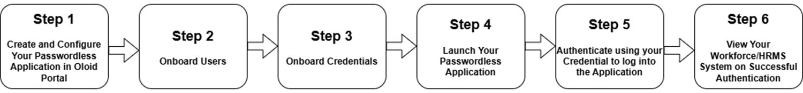
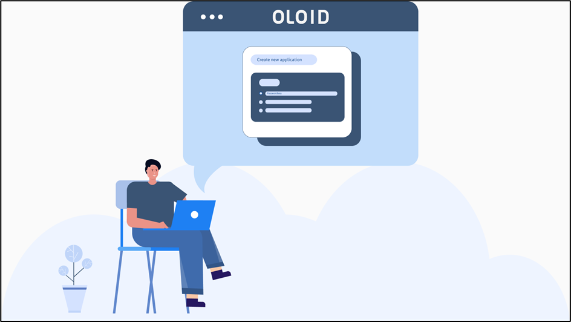
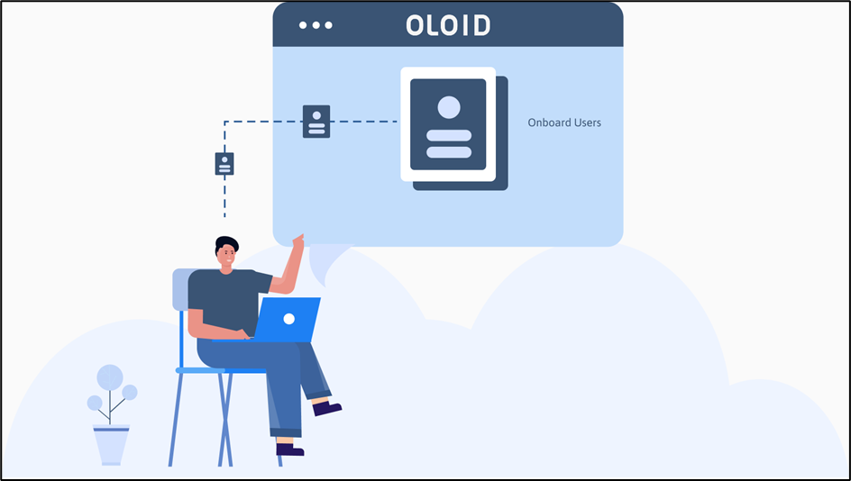
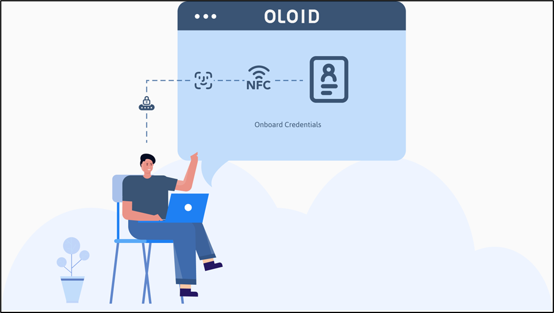
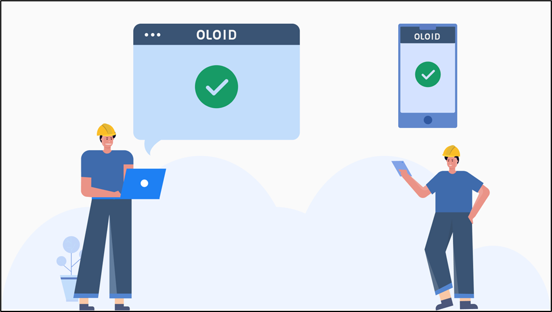
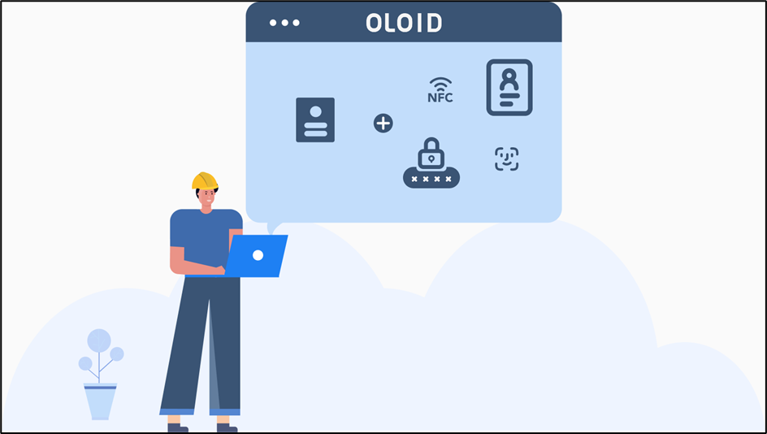
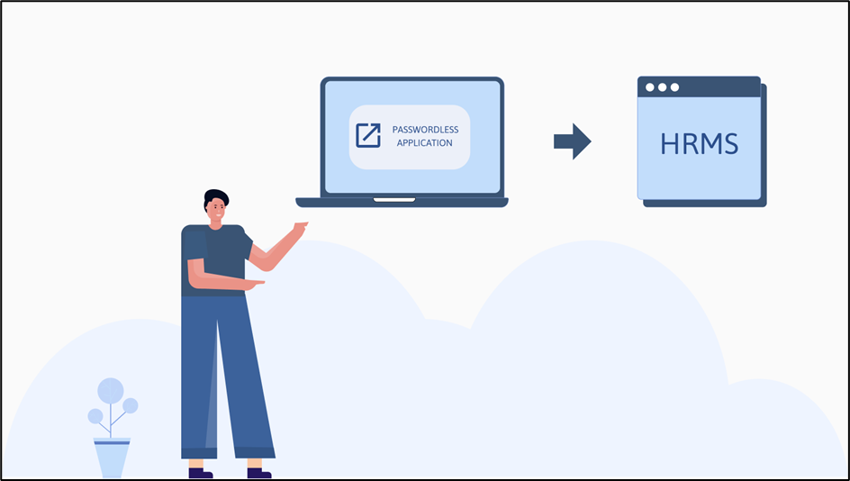

{/* Source: Intercom article 10575373 - https://oloid.help/en/articles/10575373-how-oloid-s-passwordless-authenticator-works */}
{/* Generated by intercom_to_mintlify.py - re-running overwrites this file. */}

**How Oloid's Passwordless Authenticator Works?**

Oloid's Passwordless Authenticator provides a seamless, secure, and scalable authentication experience by eliminating the need for usernames and passwords. It leverages physical identity factors like Face ID, Badge, NFC Tags, and PINs to enable secure multi-factor authentication.

**Oloid's Passwordless Authentication Process**

1. **Create and Configure Your Passwordless Application in Oloid Portal:**
   - Start by setting up your Passwordless Application in the Oloid Portal. Customize authentication methods and configure user access policies as per organizational requirements.

     

2. **Onboard Users:**
   - Onboard employees by linking their virtual identities with physical identity factors such as Face ID, Badge, NFC Tags, or PINs.

     

3. **Onboard Credentials:**
   - Register the necessary credentials for each user, ensuring that they are mapped to the appropriate identity factors for secure authentication.

     

4. **Launch Your Passwordless Application:**
   - Deploy the application on required devices (Windows Desktops/Laptops, Android Tablets, iPads) and integrate it with Workforce/HRMS Platforms like OKTA, VMware WorkspaceOne, Workday etc.

     

5. **Authenticate Using Your Credential to Log Into the Application:**
   - Employees can securely log into devices and Workforce/HRMS platforms using their registered identity factor (e.g., Face ID, Badge, NFC Tag, or PIN) without needing a username or password.

     

## View Your Workforce/HRMS System on Successful Authentication

- Upon successful authentication, employees gain secure access to their required devices and Workforce/HRMS systems, enhancing productivity and user experience.

  

Oloid's Passwordless Authenticator simplifies and secures the login process by leveraging physical identity factors for authentication. It eliminates the complexity of managing usernames and passwords while ensuring a secure and scalable authentication solution, especially beneficial for deskless and frontline workers.
