{/* Source: Intercom article 9899136 - https://oloid.help/en/articles/9899136-how-to-add-oloid-as-an-identity-provider-idp-in-pingfederate */}
{/* Generated by intercom_to_mintlify.py - re-running overwrites this file. */}

This guide will walk you through the process of integrating Oloid as an Identity Provider (IDP) in PingFederate using OpenID Connect for Single Sign-On (SSO). Following these steps will ensure a seamless connection between Oloid and PingFederate for secure and passwordless authentication.

**Prerequisites**

• Access to the PingFederate Admin Console.

• Client ID, Client Secret, and Issuer details provided by Oloid.

• Administrator privileges in PingFederate to configure IDP connections.

**Steps to Configure Oloid as an IDP**

**1. Login to PingFederate Admin Console**

Access the PingFederate admin panel with your credentials.

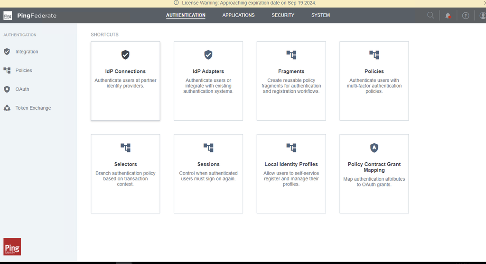

**2. Navigate to IDP Connections**

• Go to Authentication → IDP Connections → Create Connection.

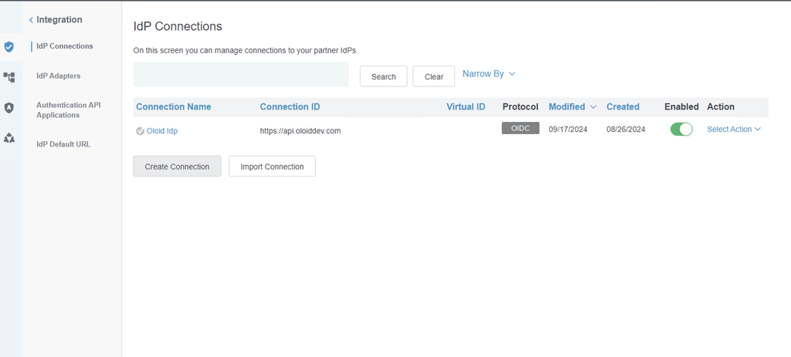

**3. Set Connection Type**

• On the “Connection Type” tab, check the **Browser SSO Profiles** box.

• From the **Protocol** dropdown, select **OpenID Connect**.

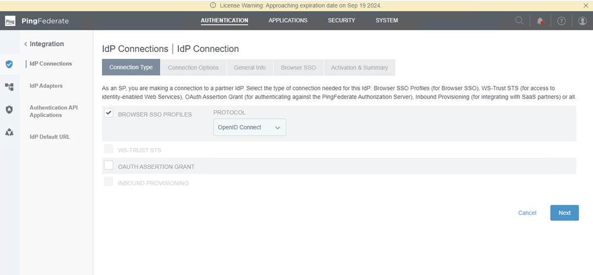

**4. General Information**

• On the “General Info” tab, provide the following details:

• **Issuer**: (Provided by Oloid)

• **Connection Name**: (Friendly name for the connection)

• **Client ID**: (Provided by Oloid)

• **Client Secret**: (Provided by Oloid)

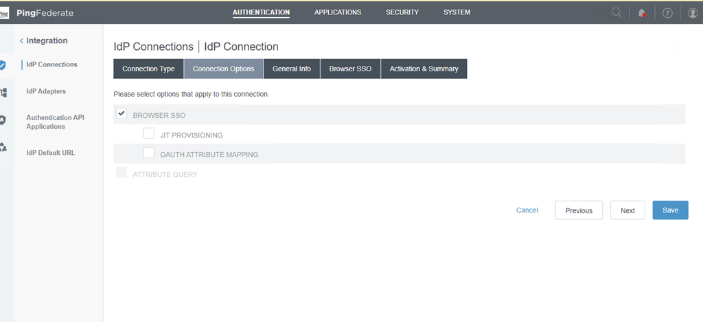

**5. Configure Browser SSO**

• Navigate to the “Browser SSO” tab.

• Click **Configure Browser SSO**.

**6. User-Session Creation**

• On the “User-Session Creation” tab, click **Configure User-Session Creation**.

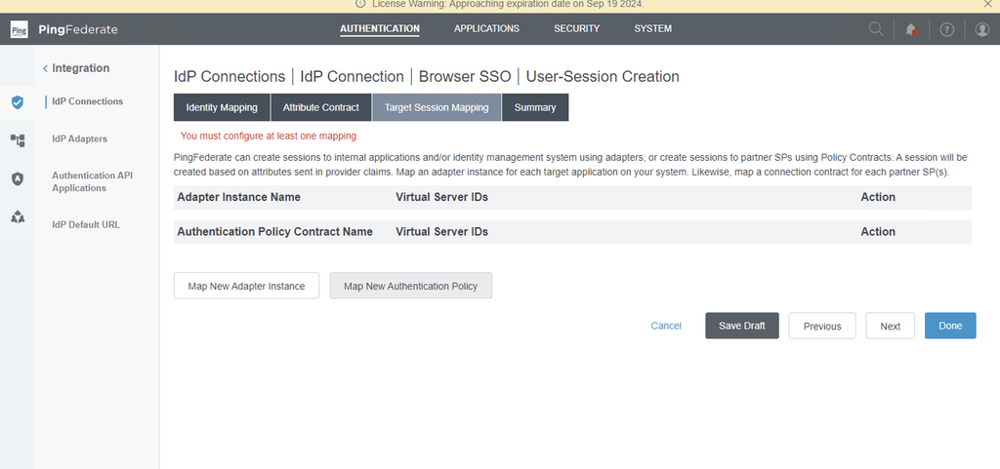

**7. Map New Authentication Policy**

• Go to the “Target Session Mapping” tab.

• Select **Map New Authentication Policy**.

**8. Create New Policy Contract**

• Click **Manage Policy Contracts** → **Create New Contract**.

• Provide a friendly policy name for the contract.

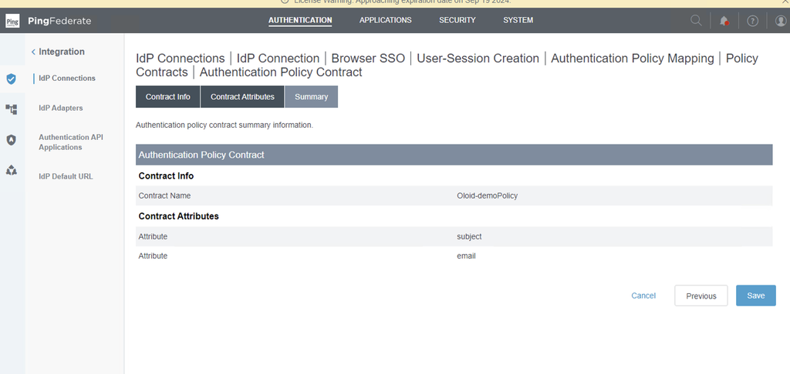

**9. Contract Attributes**

• On the “Contract Attributes” page, add a new contract attribute for **email**.

**10. Select Authentication Policy Contract**

• On the “Authentication Policy Contract” tab, select the newly created policy.

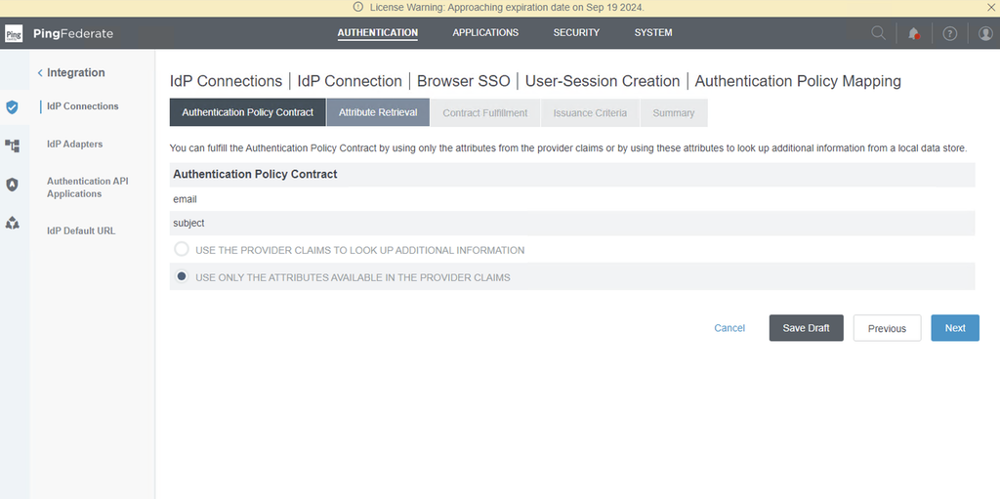

**11. Configure Contract Fulfillment**

• On the “Contract Fulfillment” tab, select the appropriate options according to your environment.

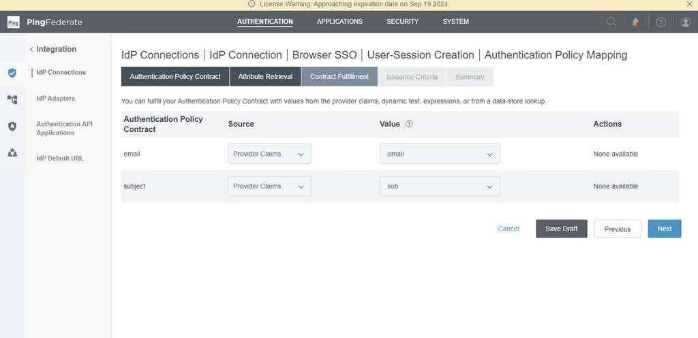

**12. Leave Issuance Criteria as Default**

• On the “Issuance Criteria” tab, leave the settings as default.

**13. Review and Complete Protocol Settings**

• Review the details in the “Protocol Settings” tab and ensure all configurations are correct.

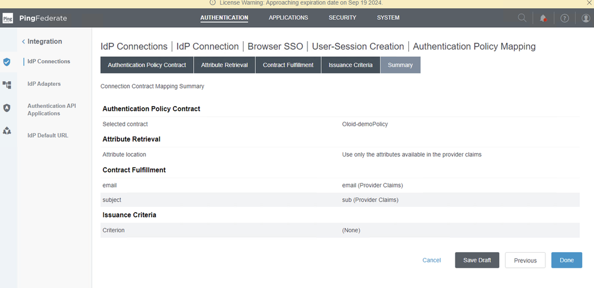

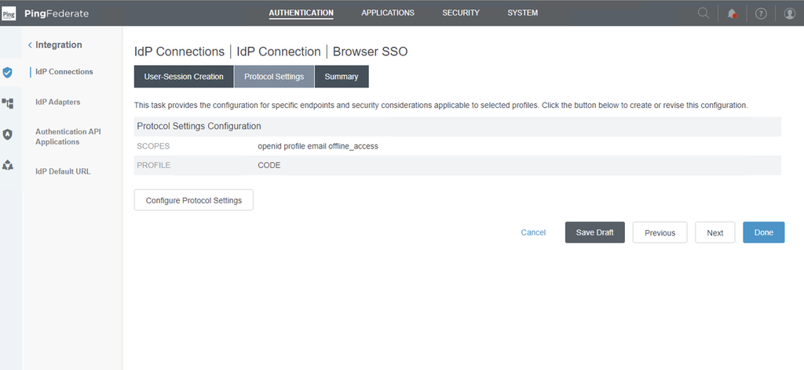

**14. Finalize and Enable the Connection**

• Review the summary page to confirm all settings.

• Click **Enable** to activate the connection.

**Testing the Connection**

Once the connection is enabled, you can test the integration using the **SSO Application Endpoint**.

**Final Step: Share Redirect URL with Oloid**

To complete the integration, share the **Redirect URL** with Oloid. This will allow Oloid to finalize the setup on their end and ensure the authentication flow works as expected.

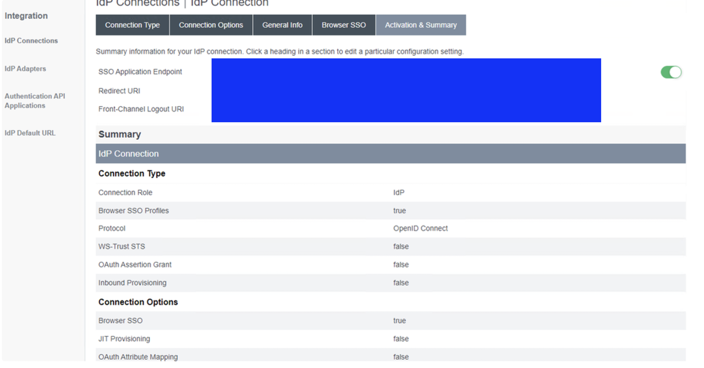
