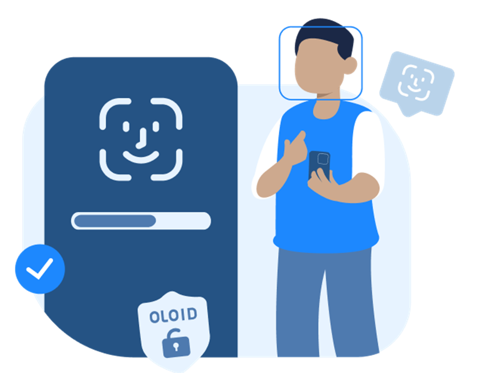

{/* Source: Intercom article 7201474 - https://oloid.help/en/articles/7201474-how-webkey-works */}
{/* Generated by intercom_to_mintlify.py - re-running overwrites this file. */}

OLOID's Passwordless Authenticator system provides a Facial Recognition solution with liveness detection, and a custom domain for the users to seamlessly log in to their Workforce Identity Platforms.

Passwordless Authenticator Process:

Step 1: [Onboard Users](#onboard-users)

Step 2: [Onboard User Faces](#onboard-user-faces)

Step 3: [Launch the URL](#launch-the-url)

Step 4: [Authentication](#authentication)

Step 5: [Log into the Workforce Identity platforms](#log-into-the-workforce-identity-platforms)

## Onboard Users

Onboard users in Oloid's Tenant Admin Portal with email address.

<Note>
  **Note:** Email address must be same as in the Workforce Identity platforms.
</Note>

## Onboard User Faces

Onboard user faces in Oloid's Tenant Admin Portal.

## Launch the URL

Launch the url in a browser.

## Authentication

User authenticates themselves using the set credentials (badge/pin/nfc/face).

## Log into the Workforce Identity platforms

On successful credential authentication , user is logged into the Workforce Identity platforms.

