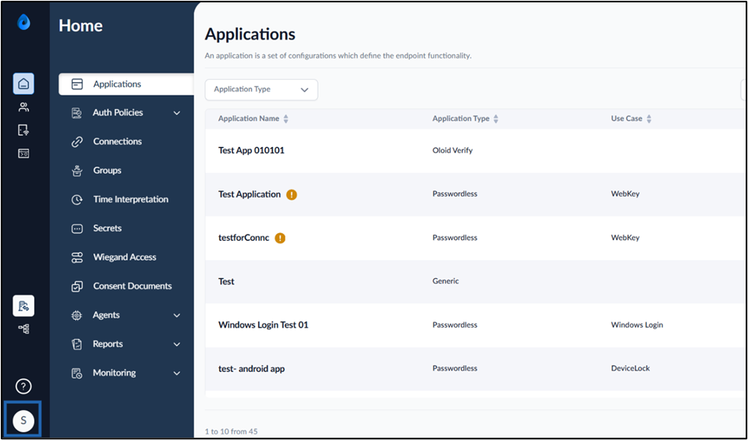
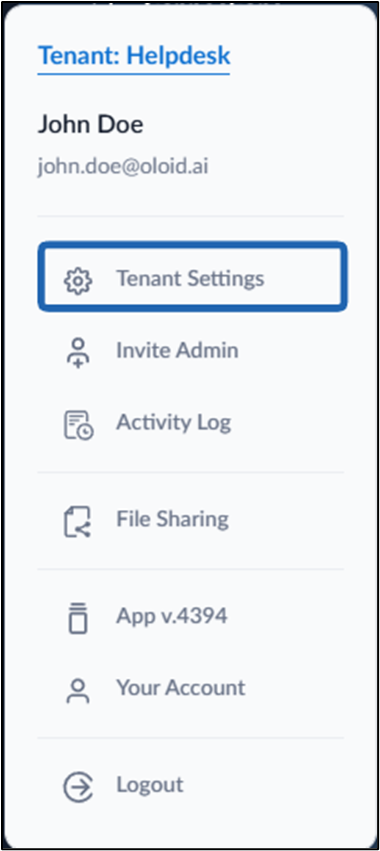
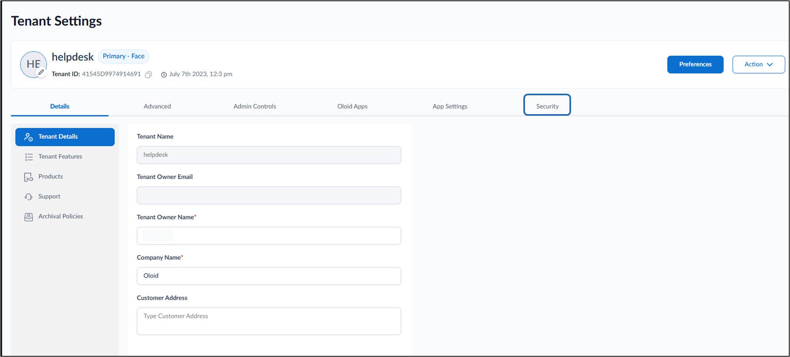
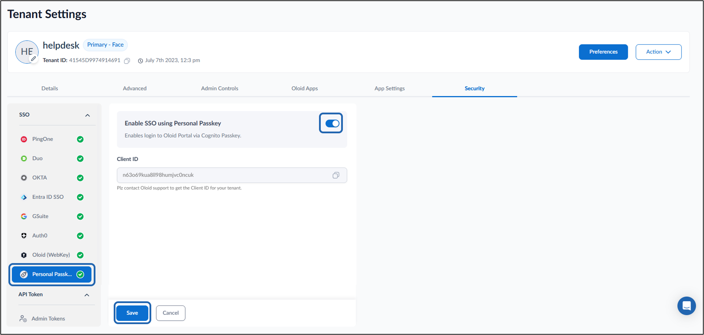
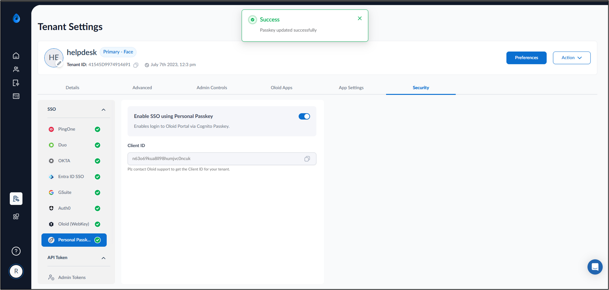

{/* Source: Intercom article 13856829 - https://oloid.help/en/articles/13856829-tenant-admin-portal-how-to-enable-sso-using-personal-passkey-in-the-tenant-admin-portal */}
{/* Generated by intercom_to_mintlify.py - re-running overwrites this file. */}

## Introduction

This document provides step-by-step instructions for enabling SSO using Personal Passkey in the Tenant Admin Portal.

## Prerequisites

- You must have a Tenant Admin account.
- OKTA IDP must be created for the application. To create, refer [How to create IDP Profile for OIDC-Okta in the Tenant Admin Portal](/platform/tenant-admin-portal/tenant-admin-portal-how-to-create-an-oidc-okta-idp-profile)

## **Steps to** Enable SSO using Personal Passkey

1. Login to the **Tenant Admin Portal**.
2. On the homepage of the portal, click **Profile icon** on the bottom left corner of the menu panel.

   

   The user profile menu is displayed.
3. Click **Tenant Settings**.

   

   The **Tenant Settings** page is displayed.
4. Click **Security** tab.

   

   On the Security tab section in the left menu panel select **Passkey.**
5. Do the following:
   1. Turn on **Enable SSO using Personal Passkey** toggle.
   2. Click **Save**.

The Oloid Passkey SSO is successfully enabled.

---

##### Related Documents

[How to Login to User Portal with Oloid Passkey SSO](/platform/user-portal/how-to-login-to-user-portal-with-oloid-passkey-sso)
