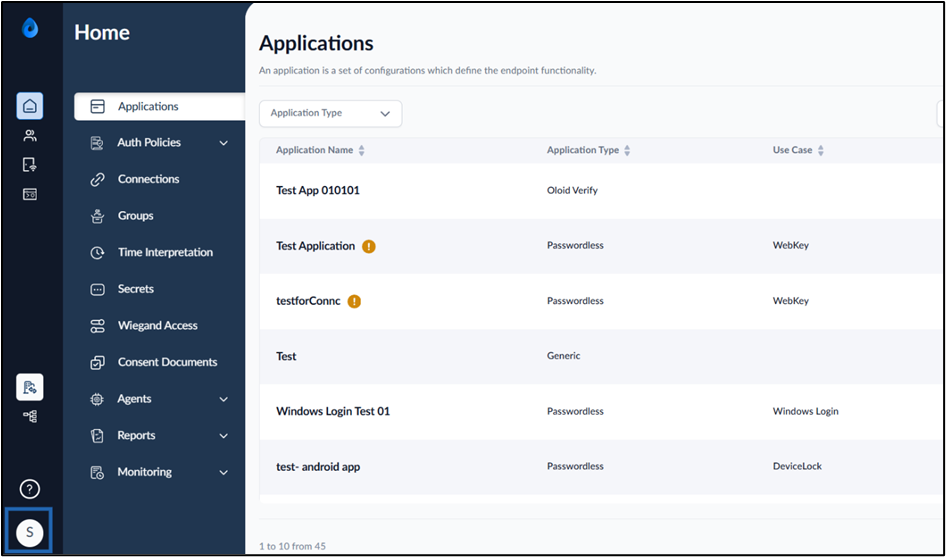
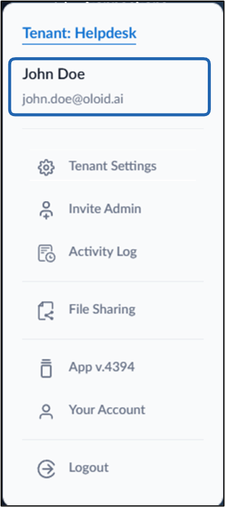
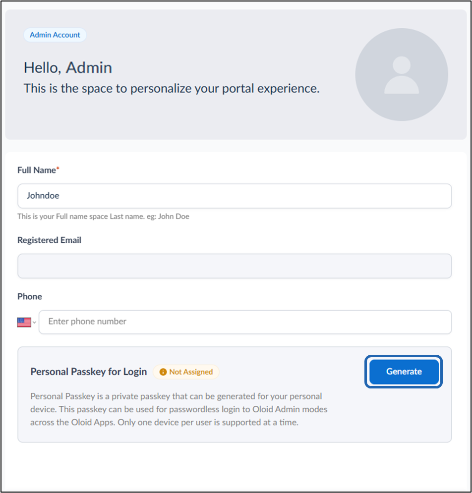
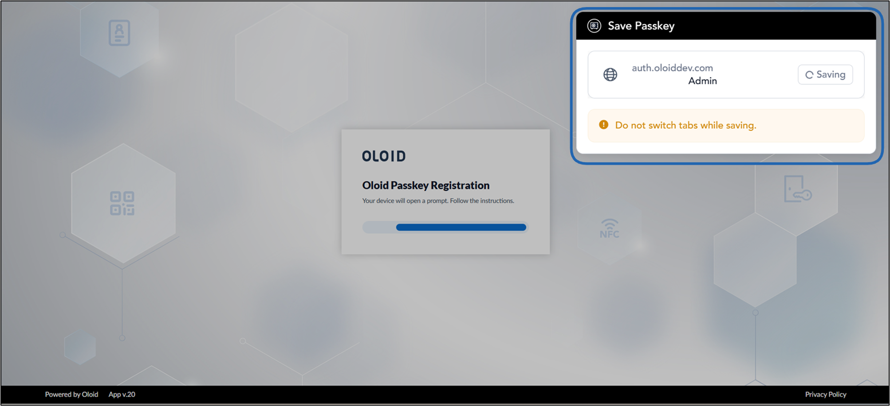
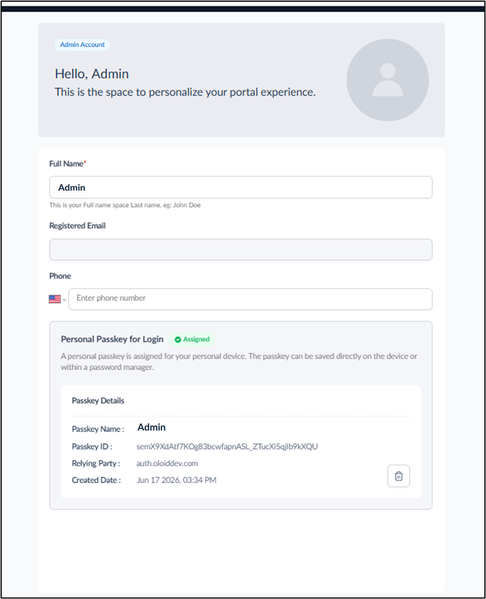
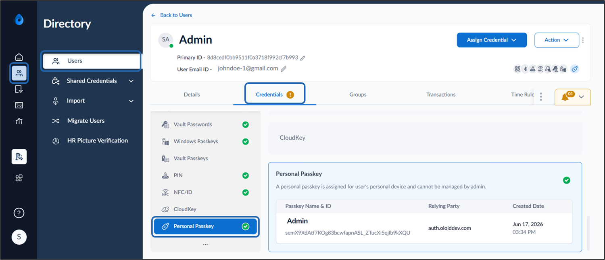

{/* Source: Intercom article 13856872 - https://oloid.help/en/articles/13856872-tenant-admin-portal-how-to-generate-personal-passkey */}
{/* Generated by intercom_to_mintlify.py - re-running overwrites this file. */}

## Introduction

A Personal Passkey allows Tenant Admin to set up secure, passwordless authentication through passkeys. Tenant Admins can generate a passkey from the user profile in the Tenant Admin Portal.

## Prerequisite

- You must have access to Tenant Admin account.
- Personal Passkey must be enabled in the Tenant Admin portal. Refer: [How to Enable Passkey SSO in Tenant Admin Portal](/more/passwordless-authenticator/tenant-admin-portal-how-to-enable-sso-using-personal-passkey-in-the)

## Steps to Generate Personal Passkey

1. Log in to the **Tenant Admin Portal**.
2. On the homepage of the portal, click **Profile icon** on the bottom left corner of the menu panel.

   

   The user profile menu is displayed.
3. Click **Username**.

   

   The **User Profile** page is displayed.
4. Do the following:
   1. Edit **Full Name**. (Optional)
      1. Click **Save.**

         <Note>
           **Note:** Click **Save** if Full Name field is changed.
         </Note>

   2. Click **Generate**.
   3. Enter **Phone** number. (Optional)

      

      The Passkey registration screen is displayed.

      

      The Passkey is successfully generated.

      

      <Note>
        **Note:** The Passkey will be saved to Oloid Vault, Windows Login, Google Password manager or Windows Hello.
      </Note>

The Personal Passkey will be displayed on the User's profile under the Credentials tab.

