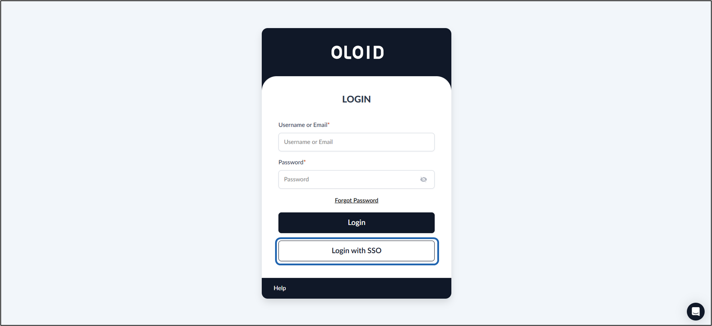
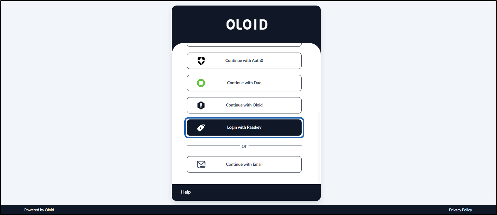
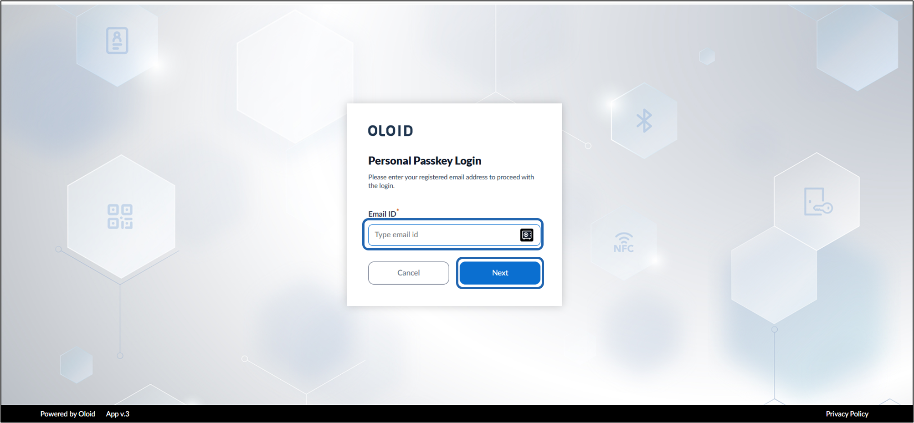
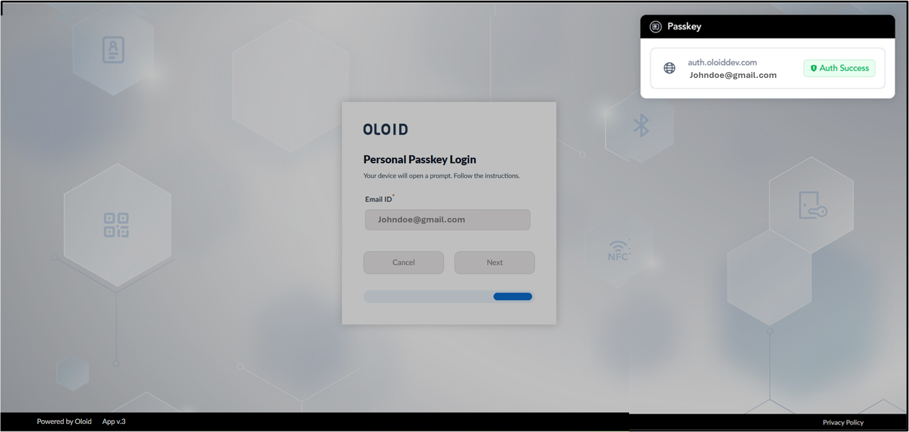
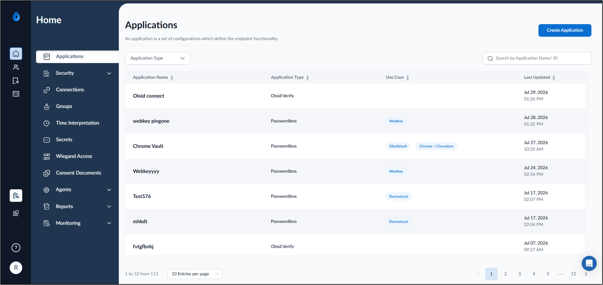

{/* Source: Intercom article 15531507 - https://oloid.help/en/articles/15531507-tenant-admin-portal-how-to-log-into-tenant-admin-portal-using-personal-passkey */}
{/* Generated by intercom_to_mintlify.py - re-running overwrites this file. */}

## Introduction

Personal Passkey enables secure, passwordless access to the Tenant Admin Portal using a passkey associated with an individual user account.

## Prerequisites

- You must have access to the Tenant Admin Portal.
- Ensure Passkey is enabled for the user. Refer: [How to Enable Passkey SSO in Tenant Admin Portal](/more/passwordless-authenticator/tenant-admin-portal-how-to-enable-sso-using-personal-passkey-in-the)
- Personal Passkey is **enabled for your account**. Refer: [How to Generate Personal Passkey in the Tenant Admin Portal](/more/passwordless-authenticator/tenant-admin-portal-how-to-generate-personal-passkey)

## Steps to log into Tenant Admin Portal using Personal Passkey

1. Launch your browser.
2. Enter the provided **URL** in the browser’s address bar and press **Enter**.
   The **Oloid Login** page is displayed.
3. Click **Login with SSO**.

   

   The configured login options are displayed.
4. Click **Login with Passkey**.

   

   The Oloid login page is displayed.

Enter **Email ID** > click **Next**.

The user is authenticated using passkey.

The User is logged into the Tenant Admin Portal.

