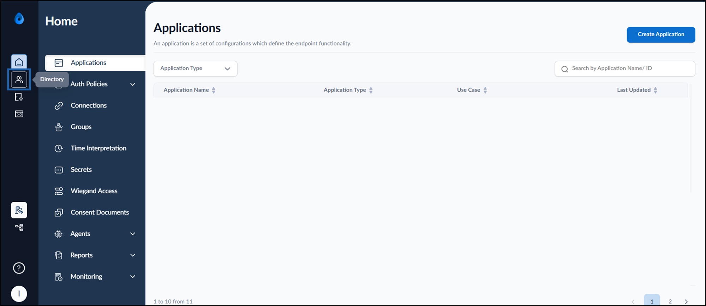
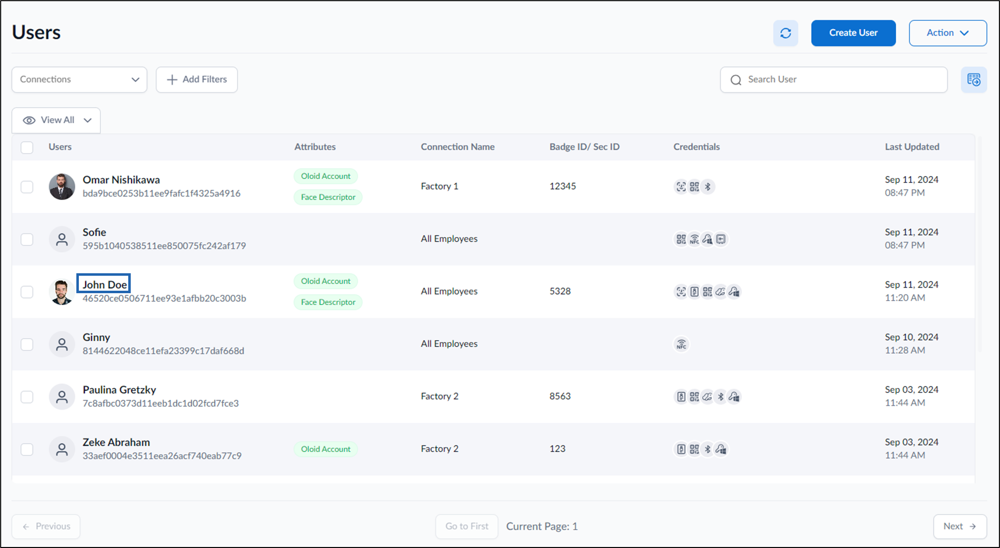
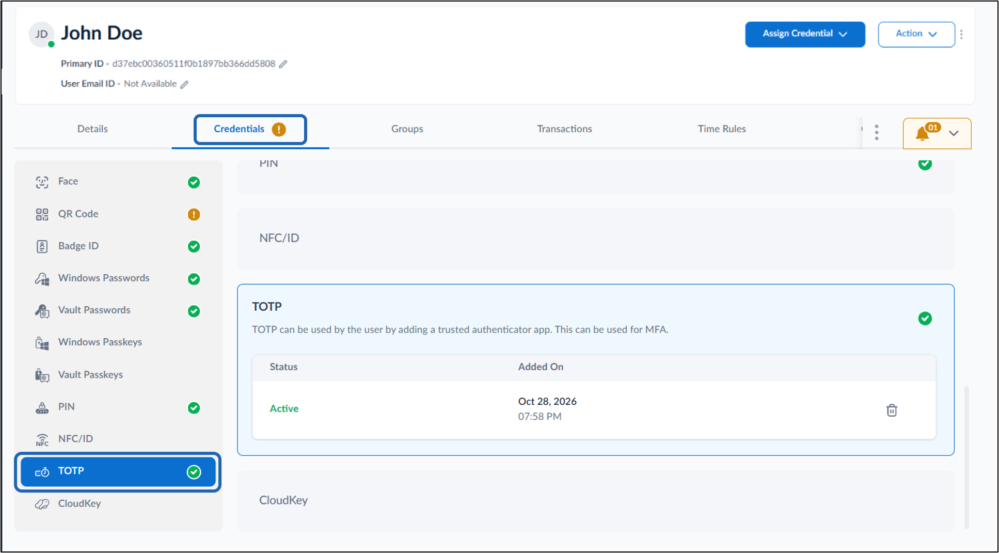
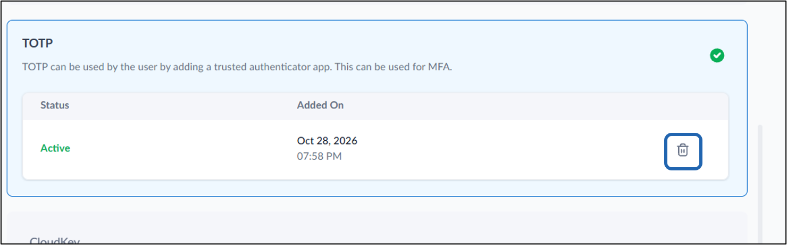
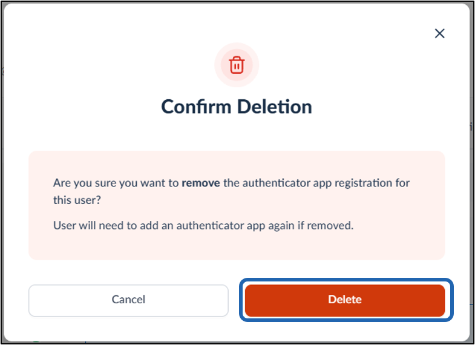

{/* Source: Intercom article 17766161 - https://oloid.help/en/articles/17766161-tenant-admin-portal-how-to-view-and-delete-totp-time-based-one-time-password */}
{/* Generated by intercom_to_mintlify.py - re-running overwrites this file. */}

## Introduction

The Credentials tab on the User details page in the Tenant Admin Portal allows administrators to view and manage the credentials assigned to a user. One of these credentials is TOTP (Time-based One-Time Password), which links the user’s account to an authenticator app, such as Google Authenticator or Microsoft Authenticator, that generates a time-based one-time code for multi-factor authentication.

<Note>
  **Note:** TOTP can be used only as a second factor under MFA.
</Note>

## Prerequisites

- You must have admin access to Tenant Admin Portal.
- User must already exist in the Tenant Admin Portal. Refer: [How to create a User in the Tenant Admin Portal](/platform/tenant-admin-portal/videos/how-to-create-a-user-in-the-tenant-admin-portal-video-tutorial)
- An Authenticato app must be registered under TOTP credential for the user. Refer: [Windows Login (Healthcare)- How to register an Authenticator app for TOTP](/platforms/windows/industry-workflows/healthcare/windows-login-healthcare-how-to-register-an-authenticator-app-for-totp)

## **Steps to** View and Delete TOTP

1. Log in to the **Tenant Admin Portal**.
2. On the home page of the portal, click **Directory** icon on the left panel menu.

   

   The **Users** page is displayed.
3. Click user name to edit.

   

   The User details page is displayed.
4. Click **Credentials** tab > Select **TOTP.**

   

   The TOTP screen is displayed.
5. Click the **Delete Icon**.

   

   The Confirm Deletion pop-up box is displayed.
6. Click **Delete.**

   <Note>
     **Note:** Deleting the TOTP credential removes the authenticator app registration from the user’s account. The user can no longer authenticate with TOTP until they register an authenticator app again.
   </Note>

   

The Authenticator app is removed.
