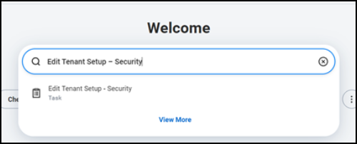
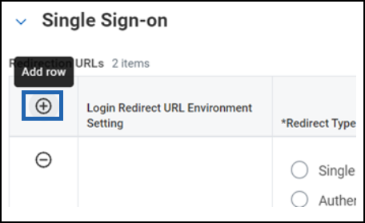
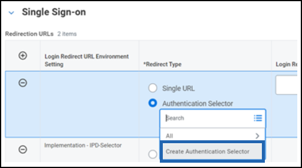
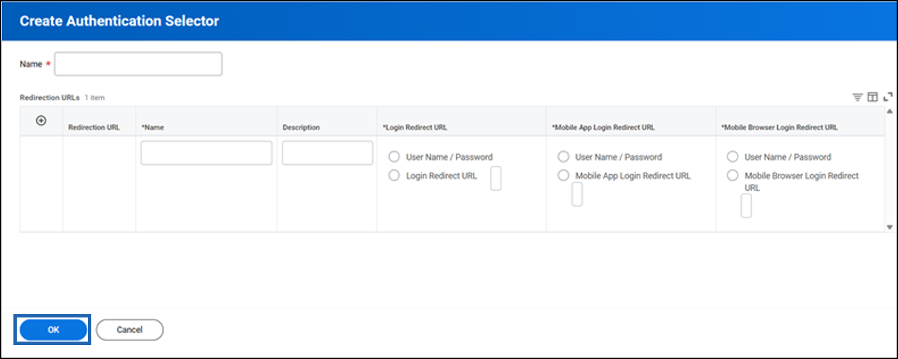
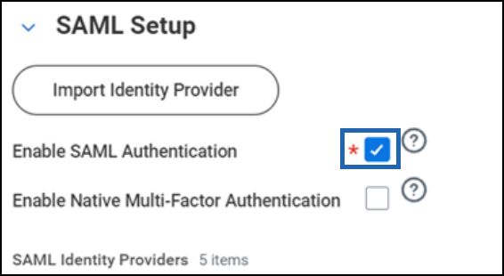
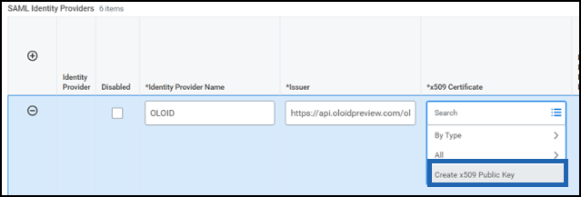
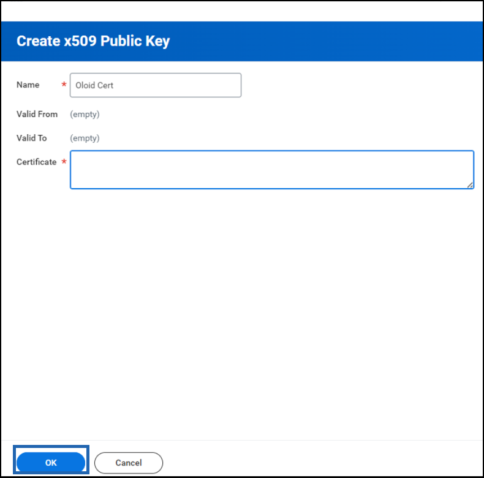
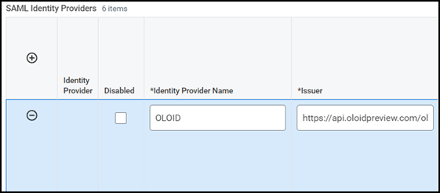
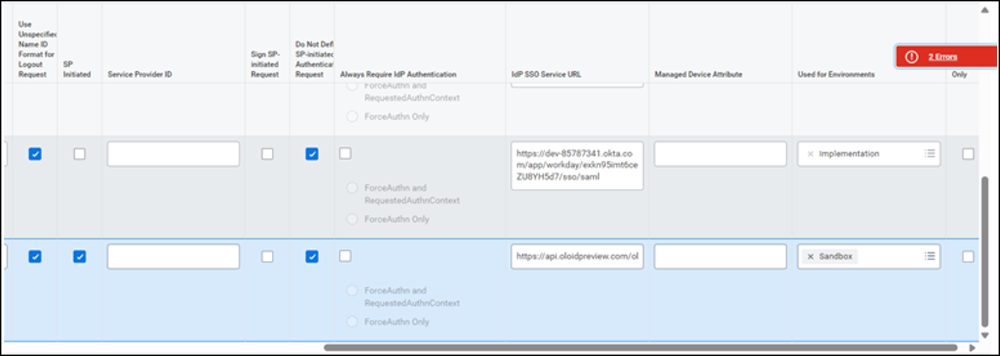

{/* Source: Intercom article 14884360 - https://oloid.help/en/articles/14884360-configuring-security-assertion-markup-language-saml-sso-with-workday-and-oloid */}
{/* Generated by intercom_to_mintlify.py - re-running overwrites this file. */}

## Introduction

This document provides step-by-step instructions to configure Workday for Single Sign-On (SSO) integration with Oloid. It covers security configuration, creation of an Authentication Selector, setup of an Identity Provider, and SAML configuration required to enable secure user authentication through Oloid.

## Prerequisites

- You must have access to the Workday Admin Access.
- Ensure that the Webkey application is created and configured in the Tenant Admin Portal. For more information, refer. [How to create and configure WebKey Application in Tenant Admin Portal](/platforms/web/webkey/webkey-how-to-create-and-configure-a-webkey-application-in-tenant).
- Ensure that the IDP profile is created and configured in the Tenant Admin Portal. For more information, refer [How to Create IDP Profile for Security Assertion Markup Language (SAML) in the Tenant Admin Portal](/platform/tenant-admin-portal/tenant-admin-portal-how-to-create-idp-profile-for-security-assertion).

## Steps to Configure Workday

- [Configure Workday Security](#configure-workday-security)
- [Create and Configure Authentication Selector](#create-and-configure-authentication-selector)
- [Create Identity Provider in Workday](#create-identity-provider-in-workday)
- [Configure Certificate](#configure-certificate-in-workday)
- [Configure SAML Settings](#configure-saml-settings-in-workday)
- Generate Workday Certificate & Signature (Optional but Recommended)

The Workday is configured successfully.

### Configure Workday Security

1. Log in to the Workday.
   The Welcome screen is displayed.
2. Navigate/Search **Edit Tenant Setup – Security** in the search bar.

   

   The Edit Tenant Setup - Security page is displayed.

### Create and Configure Authentication Selector

<Note>
  **Note:** Workday requires an **Authentication Selector** to route users to the appropriate Identity Provider (e.g., Oloid). If one does not already exist, it must be created.
</Note>

1. Go to **Single Sign-on** section.
2. Click the **➕ (Add Row)** button.

   

   A new row is added.
3. In the new row, under **Redirect Type**, select **Authentication Selector > Create Authentication Selector.**

   

   The **Create Authentication Selector** screen is displayed.
4. Do the following.
   1. Enter **Name**.
   2. Enter **Description** (Optional).
   3. Select and Enter **Login Redirect URL.**
   4. Select and Enter **Mobile App Login Redirect URL**.
   5. Select and Enter **Mobile Browser Login Redirect URL**.

      <Note>
        **Note:** Refer below table for the URLs.
      </Note>

| Field | Value |
| --- | --- |
| Login Redirect URL | https://&lt;**your-environment>**.workday.com/&lt;**your-tenant-name>**/login-saml2.flex |
| Mobile App Login Redirect URL | https://&lt;**your-environment>**.workday.com/&lt;**your-tenant-name>**/login-saml2.flex |
| Mobile Browser Login Redirect URL | https://&lt;**your-environment>**.workday.com/&lt;**your-tenant-name>**/login-saml2.flex |

<Note>
  **Note:** Enter your workday environment and your tenant name in the URL.
</Note>

5. Click **OK**.

The **Authentication Selector** is created and configured successfully.

6. Go back to **Single Sign-on** section and do the following.

a. Select the newly created selector.

b. Enable **SAML Authentication**.

### Create Identity Provider in Workday

1. Enter **Identity Provider Name.**
2. Enter **Issuer**.

   

   <Note>
     **Note:** To navigate the issuer URL, on your **Tenant Admin Portal**, go to **Auth Policy > Identity Provider > Select the preferred IDP > Oloid Metadata**, copy **Entity ID**.
   </Note>

### Configure Certificate in Workday

1. Select **Create x509 Public Key**.

   

   The **Create x509 Public Key** pop-up is displayed.
2. Do the following.
   1. Upload the **signing certificate**.

      <Note>
        **Note:** To download the Certificate, on your **Tenant Admin Portal**, go to **Auth Policy > Identity Provider > Select the preferred IDP > Oloid Metadata**, click **Download Certificate**.
      </Note>

   2. Click **Ok**.

      

      The certificate is configured successfully, and the SAML Identity Provider page is displayed.

      

### Configure SAML Settings in Workday

1. Go the **SAML Identity Provider** page, scroll right to configure the SAML settings in Workday.
2. Enable **Use Unspecified Name ID Format for Logout Request**.
3. Enable **SP Initiated**.
4. Enable **Do Not Deflate SP-initiated Authentication Request**.
5. Enter **IdP SSO Service URL.**

   <Note>
     **Note:** To navigate the IdP SSO Service URL, on your **Tenant Admin Portal**, go to **Auth Policy > Identity Provider > Select the preferred IDP > Oloid Metadata**, copy **Sign-on URL**.
   </Note>

6. Enter **Used for Environments**.

   <Note>
     **Note:** You can select Implementation, Sandbox and Production (as required).
   </Note>

7. Click **Ok**.

   

   The SAML Settings is configured successfully.
   After configuration, to log in to Workday refer [How to Log in to Workday with Assigned Credentials](/more/sso-and-mfa/how-to-log-in-to-workday-with-assigned-credentials)
