{/* Source: Intercom article 13157388 - https://oloid.help/en/articles/13157388-how-to-configure-okta-multi-factor-authentication-mfa-for-the-windows-login-application-in-the-okta-admin-console */}
{/* Generated by intercom_to_mintlify.py - re-running overwrites this file. */}

## Introduction

OKTA provides authentication and MFA capabilities that can be integrated with Oloid applications. Configuring OKTA allows admin to establish a secure environment, create applications, and enable MFA for users.

## Prerequisite

You must have **admin access** to the **OKTA Administrator Console**.

## Steps to Add User in OKTA

1. Login to the Okta Admin Account.
   Okta Dashboard screen is displayed.

   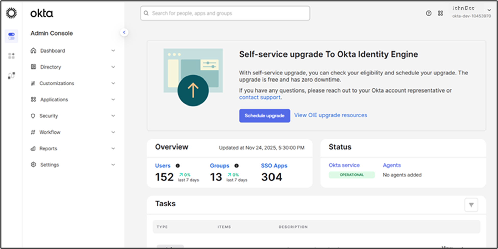

2. Click **Directory > People > Add Person.**

   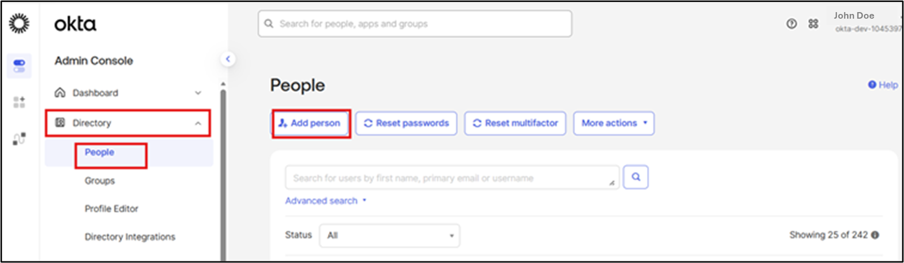

   Add Person pop-up box is displayed.
3. Do the following:
   1. Select **User Type**.
   2. Enter **First name**.
   3. Enter **Last name**.
   4. Enter **Username**.
   5. Enter **Email ID**.
   6. Groups (Optional)
   7. Select **Password**.
   8. **Select** the send user activation email now.
4. Click **Save.**

   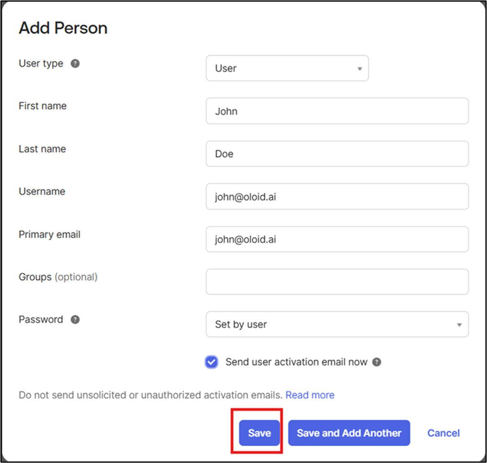

   The user added successfully, and user screen is displayed.
5. Click on the user.

   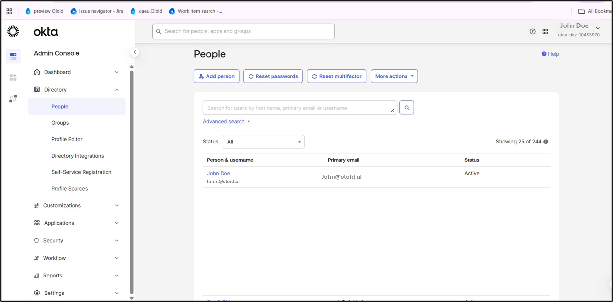

   The user detail page is displayed.

On the address bar, after the **/Users/profile/** in the URL, copy the user ID.

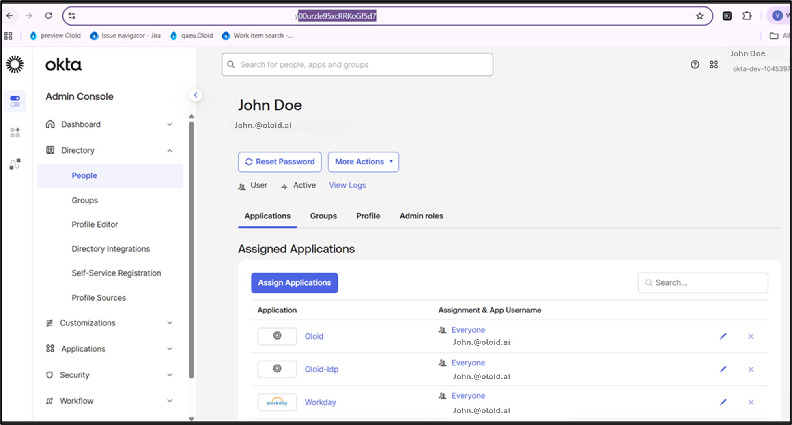

```
For Example: https://your-domain-admin.okta.com/admin/user/profile/00u1abcdEFGHijkLM5d7
```

7. Enter this ID in the **OKTA ID** field in the **Tenant Admin Portal**.
   To navigate the OKTA ID field, go to **Directory > Users > Select User > Other Identifier** section, enter the ID in the **OKTA ID** field.

   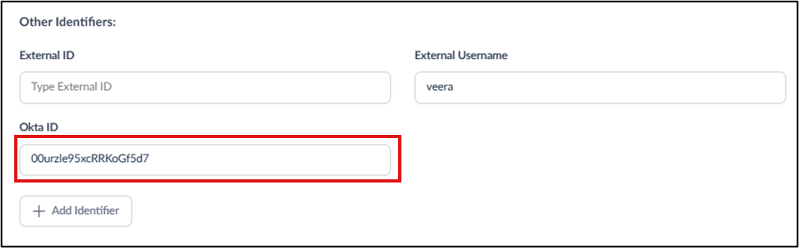

   The **OKTA ID** added successfully.
8. User receives an Okta Activation Email on registered email ID, click **Activate Okta Account.**

   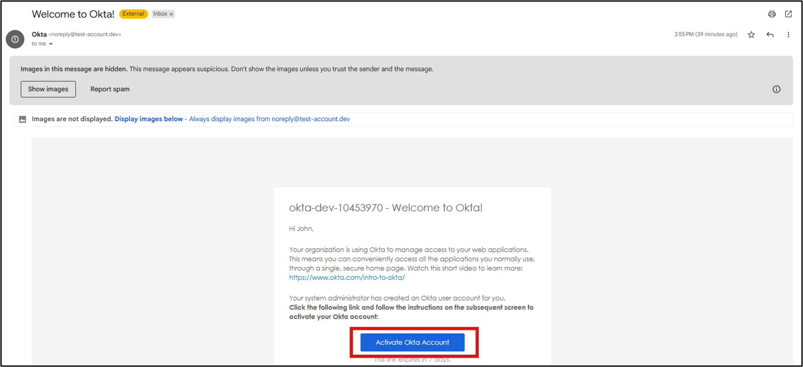

   The OKTA Change password screen is displayed.
9. Do the following:
   1. Enter **Old Password** in the Old Password field.
   2. Enter **New Password** in the New Password field.
   3. Enter **New Password** in the Repeat password field.

      <Note>
        **Note:** Keep New Password same in **New Password** and **Repeat Password** fields.
      </Note>

   4. Click **Change Password**.

      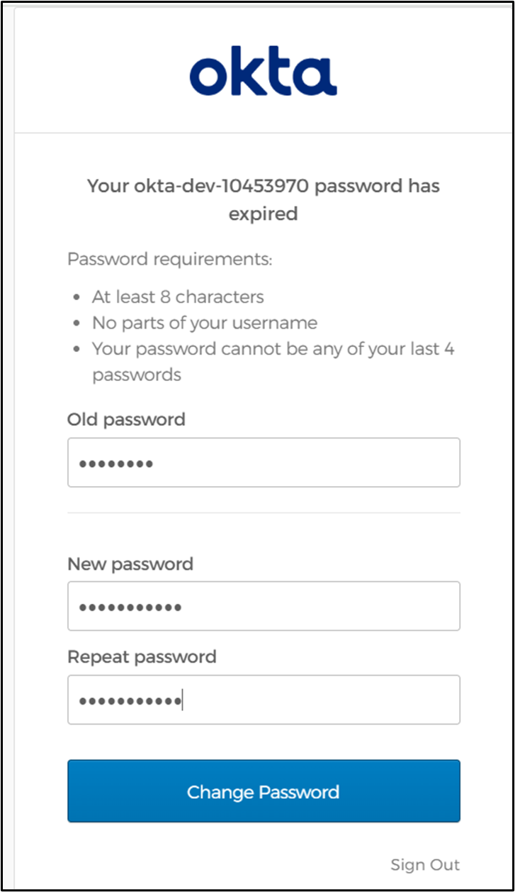

      The Password is changed successfully, and you will be redirected to the OKTA user dashboard screen.
10. Go to **User Profile > Settings**.

    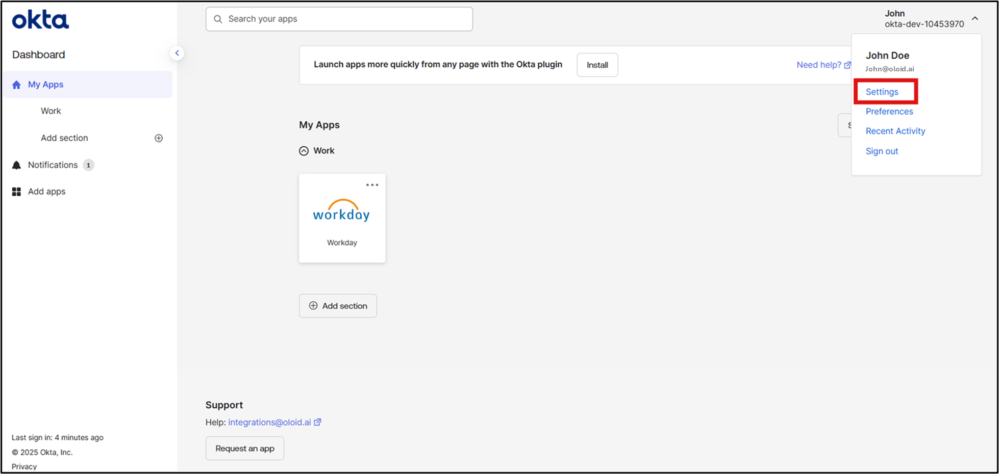

    The Settings page is displayed.
11. Click **Set up**.

    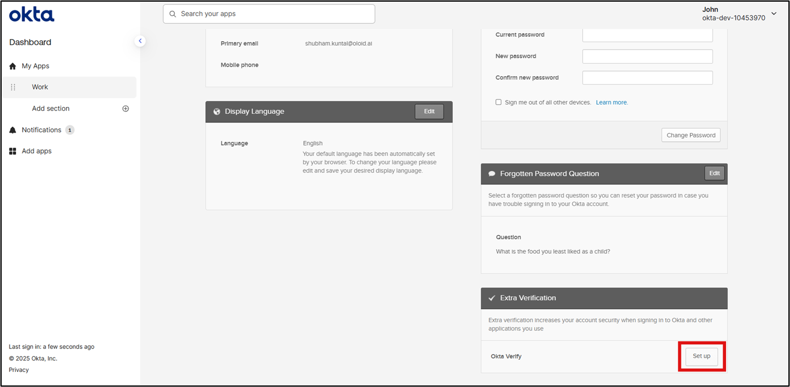

    The Set up multifactor authentication screen is displayed.
12. Click **Setup**.

    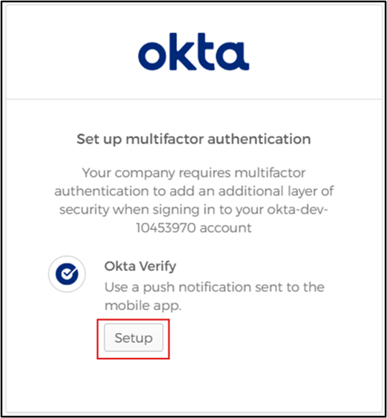

    The Setup OKTA Verify screen is displayed.
13. Select the device i.e., **iPhone** or **Android**.

    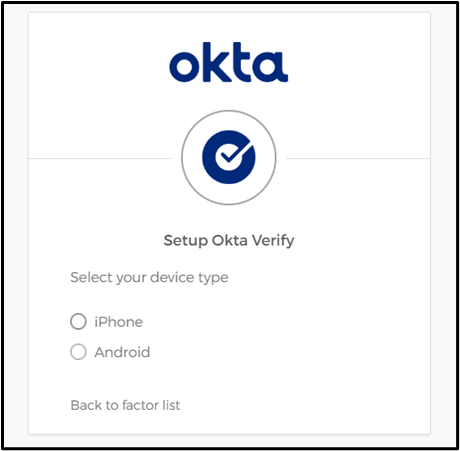

    The QR code screen is displayed.
14. Open the OKTA verify application from your device and scan the QR code.

    <Note>
      **Note:** Make sure that OKTA Verify application is installed in your device.
    </Note>

    OKTA Verify is configured successfully.

### Related Articles

[How to Enable OKTA MFA Credential for Windows Login Application in the Tenant Admin Portal](/more/sso-and-mfa/windows-login-how-to-enable-okta-multi-factor-authentication-mfa).

[How to Configure OKTA Multi Factor Authentication (MFA) for Windows Login Application in the Tenant Admin Portal](/more/sso-and-mfa/how-to-configure-okta-multi-factor-authentication-mfa-for-windows)
