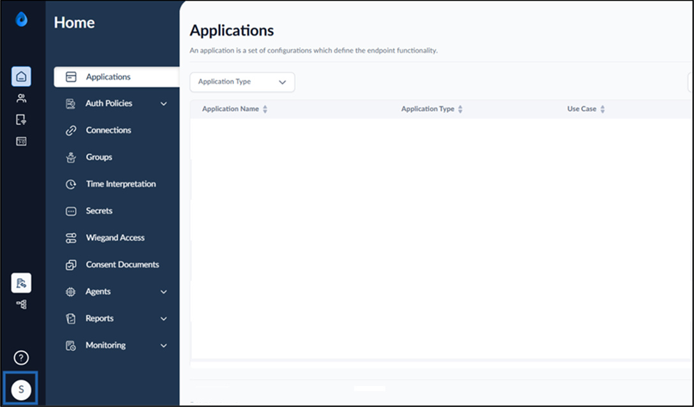
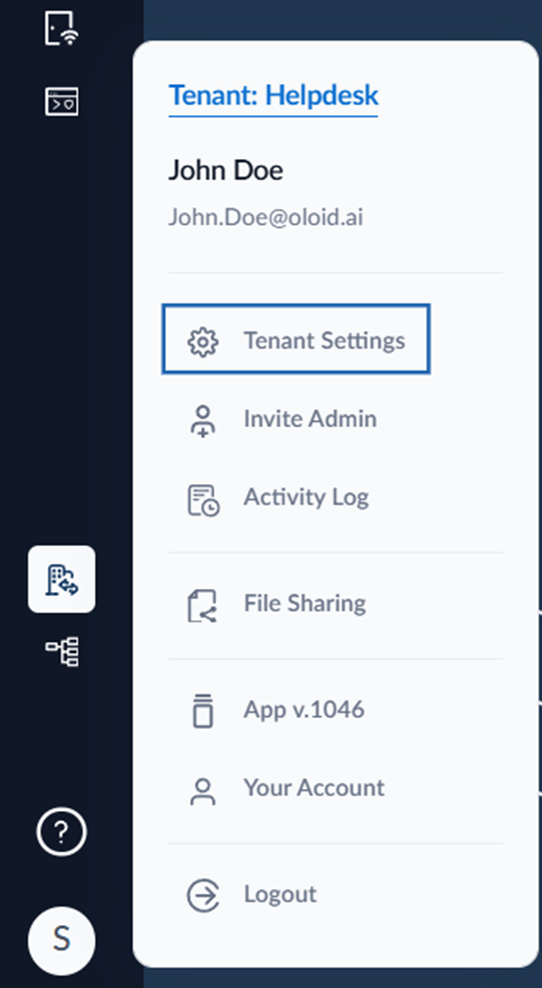
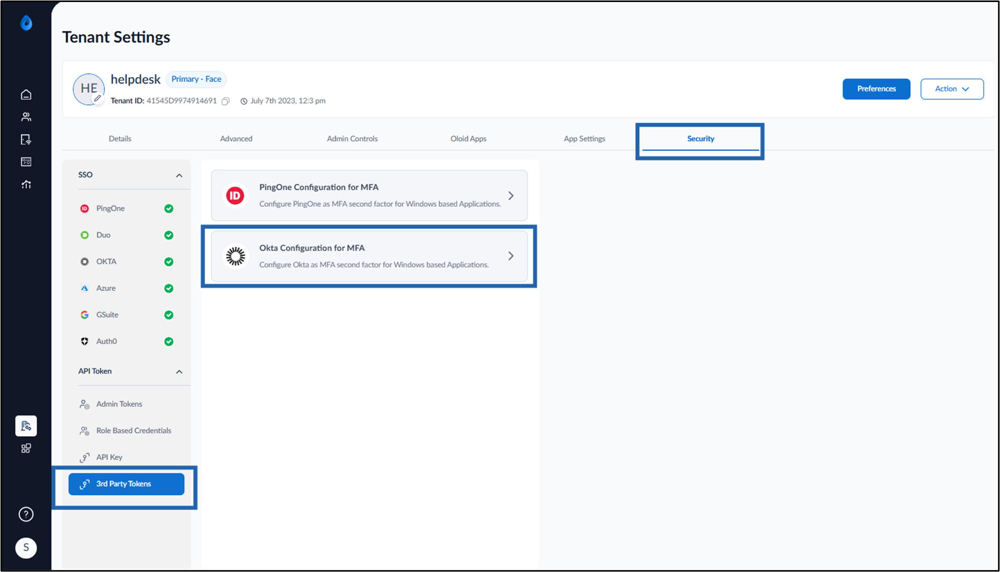
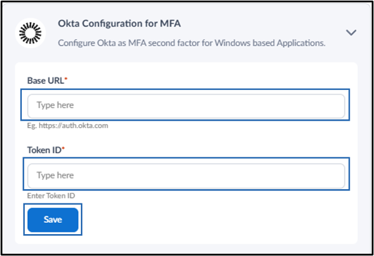
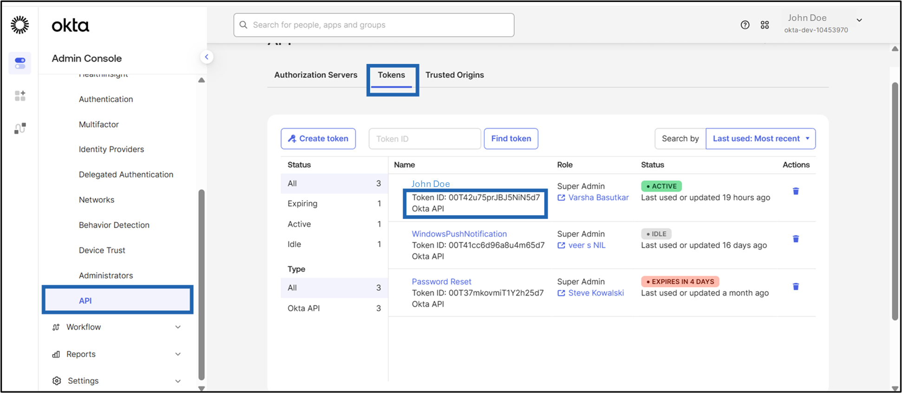
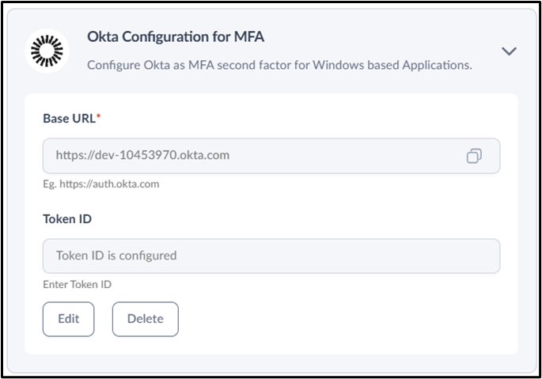

{/* Source: Intercom article 13165352 - https://oloid.help/en/articles/13165352-how-to-configure-okta-multi-factor-authentication-mfa-for-windows-login-application-in-the-tenant-admin-portal */}
{/* Generated by intercom_to_mintlify.py - re-running overwrites this file. */}

## Introduction

This document describes how to configure **OKTA Multi-Factor Authentication (MFA)** in the **Oloid Tenant Admin Portal**. Enabling OKTA MFA adds an additional verification step during login and requires configuring the necessary parameters from the **OKTA Administrator Console**.

## Prerequisites

- You must have **Tenant Admin access** in the Tenant Admin Portal.
- Ensure OKTA Multi Factor Authentication toggle is enabled in the Windows Login Application. To enable, refer [How to Enable OKTA MFA Credential for Windows Login Application in the Tenant Admin Portal](/more/sso-and-mfa/windows-login-how-to-enable-okta-multi-factor-authentication-mfa)
- Ensure Token ID is created. To create, refer [How to Create Token ID in OKTA for Windows Login Application](/more/sso-and-mfa/how-to-create-token-id-for-windows-login-application-in-okta-admin)

## Steps to Configure OKTA MFA

1. Log in to the Tenant Admin Portal.
2. On the homepage of the portal, click **user profile icon** on the bottom left corner of the menu panel.

   

   The user profile menu is displayed.
3. Click **Tenant Settings**.

   

   The **Tenant Settings** page is displayed.
4. Click **Security > 3rd Party Tokens** > **OKTA Configuration for MFA**.

   

   OKTA Configuration for MFA screen is displayed.
5. Do the following:
   1. **Base URL:** Add the **Base URL** in the Base URL field.
   2. **Token ID:** Enter the Token ID in the Token ID field.
   3. Click **Save**.

      

      To see the Token ID in **OKTA Administrator Console**, go to **Security** > **API** > **Tokens** tab.

      

      The OKTA Configuration for MFA is configured.

      

### Related Articles

[How to Create Token ID in OKTA for Windows Login Application](/more/sso-and-mfa/how-to-create-token-id-for-windows-login-application-in-okta-admin)

[How to Enable OKTA MFA Credential for Windows Login Application in the Tenant Admin Portal](/more/sso-and-mfa/windows-login-how-to-enable-okta-multi-factor-authentication-mfa)
