{/* Source: Intercom article 10299914 - https://oloid.help/en/articles/10299914-how-to-configure-okta-sso-in-tenant-admin-portal */}
{/* Generated by intercom_to_mintlify.py - re-running overwrites this file. */}

## Introduction

Okta Single Sign-On (SSO) allows users to sign in to Oloid using their existing Okta credentials. To enable this integration, admin must generate specific parameters in the Okta Admin Console and enter them in the Oloid Portal.

## Prerequisites

- You must have access to the Tenant Admin Portal.
- To configure the integration between Okta and Oloid, generate the required parameters in the **Okta Admin Console**. For detailed steps, see [Okta Settings for Oloid SSO](/more/sso-and-mfa/okta-settings-for-oloid-sso).

## Steps to Configure Okta SSO

1. Log in to the **Tenant Admin Portal**.
2. On the homepage of the portal, click **user profile icon** on the bottom left corner of the menu panel.

   

   The user profile menu is displayed.
3. Click **Tenant Settings**.

   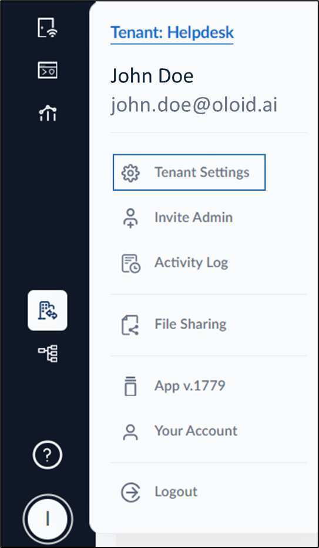

   The **Tenant Settings** page is displayed.
4. Go to **Security** > **Okta**.

   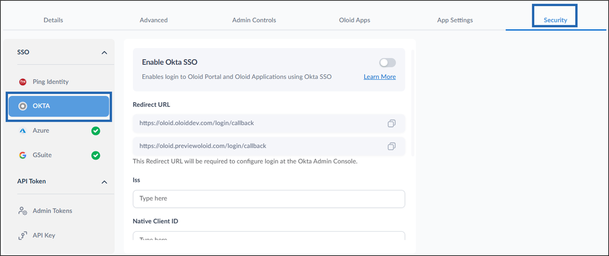

5. Turn on **Enable Okta SSO** toggle.

   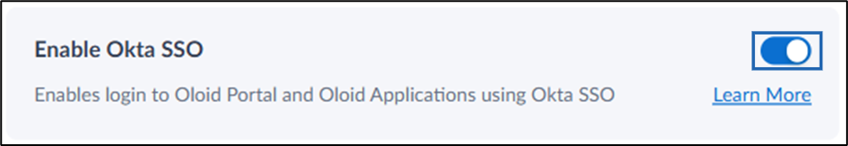

6. Do the following:
   1. **Redirect URL**: Copy the redirect URL.

      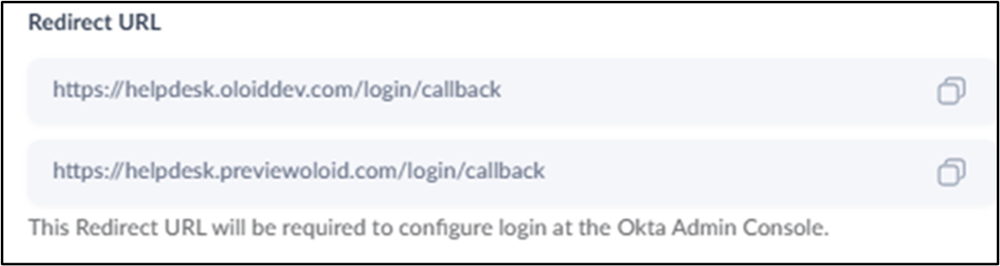

      Use the Redirect URLs when configuring client application in the Okta Admin Console.

      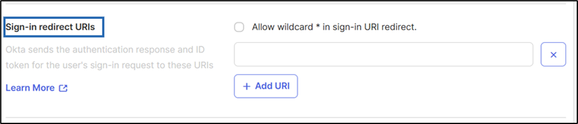

   2. **Iss**:Enter the default Issuer URL in the Iss field.

      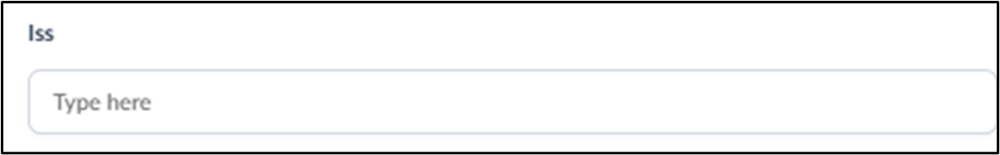

      You can find the **default Issuer URL** from your Okta Admin Console under **Security** > **API** > **Authorization server** tab.

      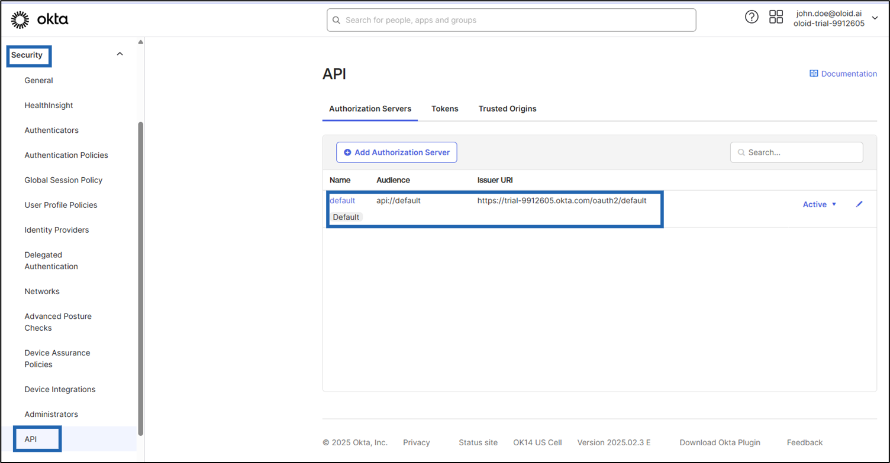

   3. **Native Client ID** (Not Applicable).
   4. **Domain**: Enter the **Domain ID** in the domain field.

      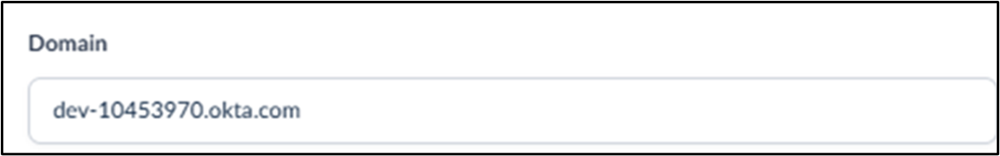

      You can find the Domain ID from your Okta Admin Console under **User Profile** icon.

      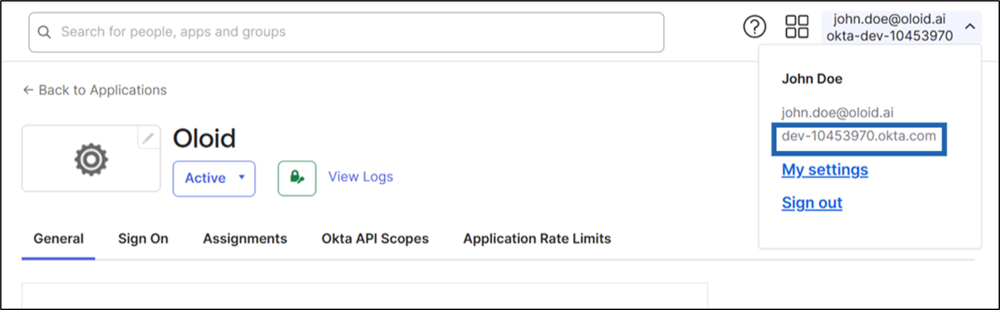

   5. **Web Client ID:** Enter the client ID in the Web Client ID field.

      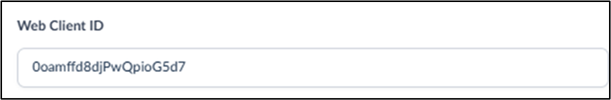

      You can find the Client ID from your Okta Admin Console under **General** tab.

      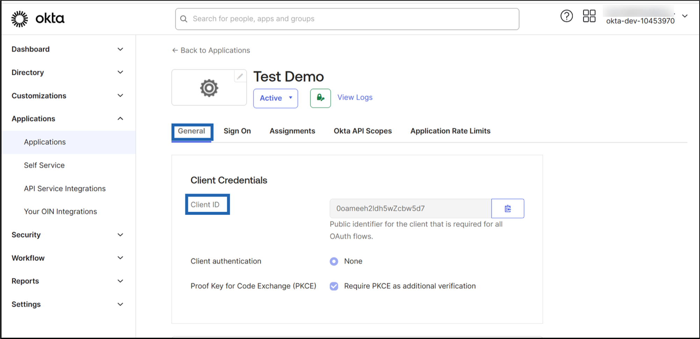

   6. **User Info URL** (Not Applicable).
   7. Click **Save**.
      The Okta SSO is configured successfully.

      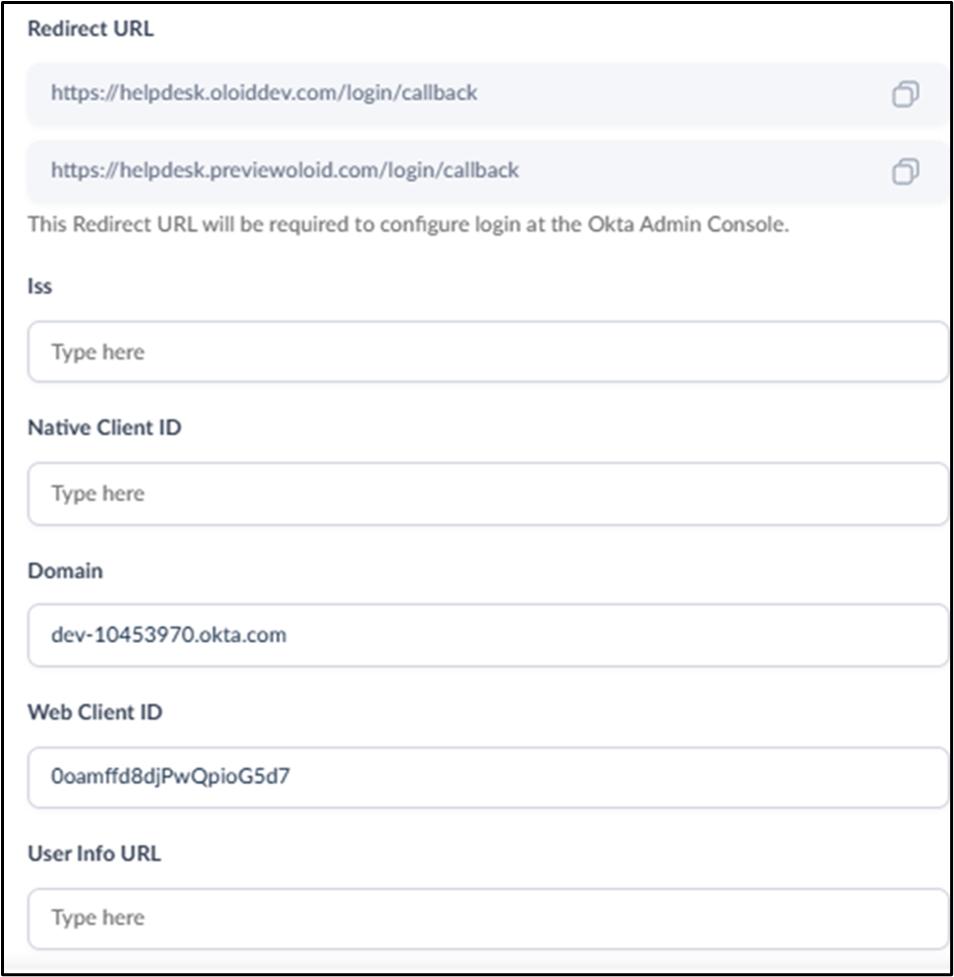
