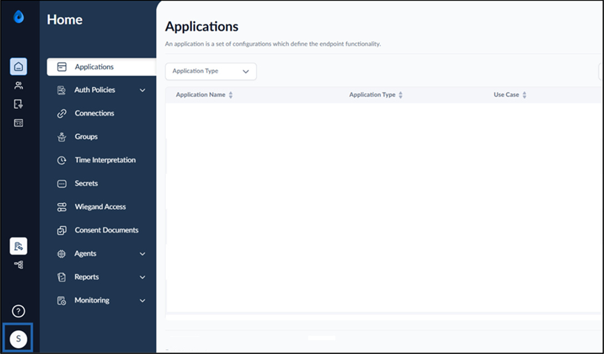
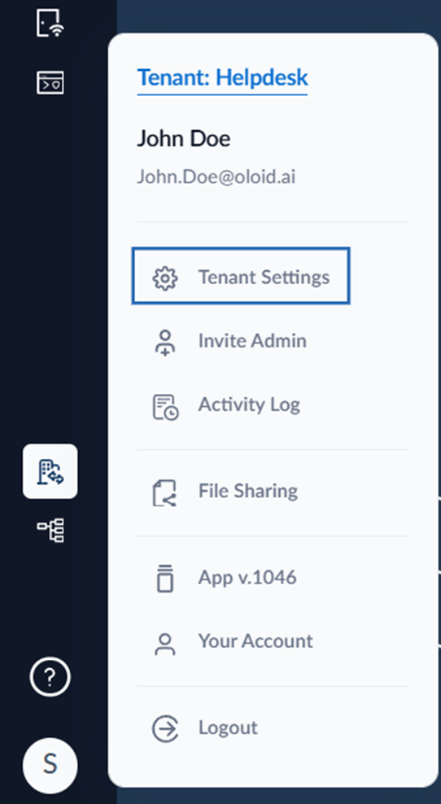
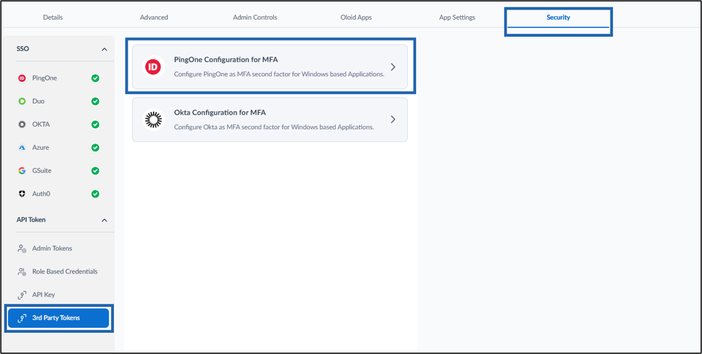
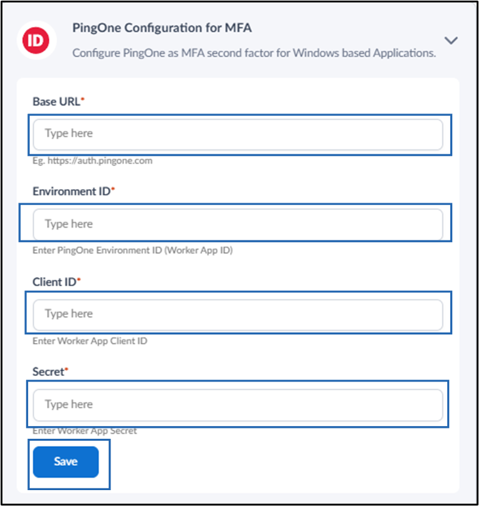
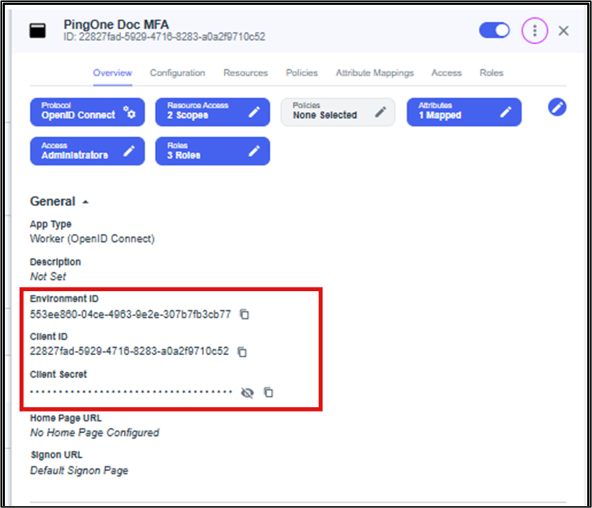
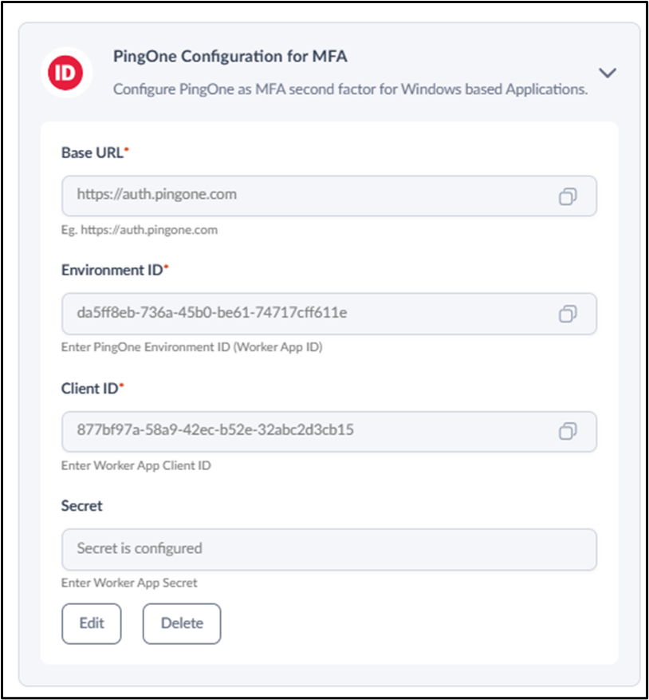

{/* Source: Intercom article 12972617 - https://oloid.help/en/articles/12972617-how-to-configure-pingone-multi-factor-authentication-mfa-for-windows-login-application-in-the-tenant-admin-portal */}
{/* Generated by intercom_to_mintlify.py - re-running overwrites this file. */}

## Introduction

This document describes how to configure **PingOne Multi-Factor Authentication (MFA)** in the **Oloid Tenant Admin Portal**. Enabling PingOne MFA adds an additional verification step during login and requires configuring the necessary parameters in the PingOne Administrator Console.

## Prerequisites

- You must have **Tenant Admin access** in the Tenant Admin Portal.
- Ensure PingOne Multi Factor Authentication toggle is enabled for the Windows Login Application. To enable, refer [How to Enable PingOne MFA for Windows Login Application in the Tenant Admin Portal](/more/sso-and-mfa/windows-login-how-to-enable-pingone-multi-factor-authentication-mfa).

## Steps to Configure PingOne MFA

1. Log in to the Tenant Admin Portal.
2. On the homepage of the portal, click **user profile icon** on the bottom left corner of the menu panel.

   

   The user profile menu is displayed.
3. Click **Tenant Settings**.

   

   The **Tenant Settings** page is displayed.
4. Click **Security > API Tokens > 3rd Party Tokens** > **PingOne Configuration for MFA**.

   

   Pingone Configuration for MFA screen is displayed.
5. In the **PingOne Administrator Console**, go to **Application > Overview > General** section, copy the following parameters and add the following details.
   1. **Base URL:** Add the **Base URL** in the Base URL field.
   2. **Environment ID:** Add the **Environment ID** in the Environment ID field.
   3. **Client ID:** Add the **Client ID** in the Client ID field.
   4. **Secret:** Add the **Client Secret** in the Secret field.
   5. Click **Save**.

      

      

      The PingOne Configuration for MFA is configured successfully.

      

### Related Articles

[How to Configure PingOne Multi Factor Authentication (MFA) in Windows Login Application](/more/sso-and-mfa/how-to-configure-pingone-multi-factor-authentication-mfa-for-windows-12958196)
