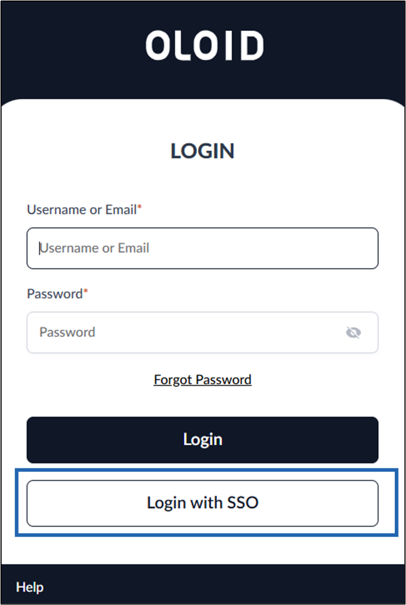
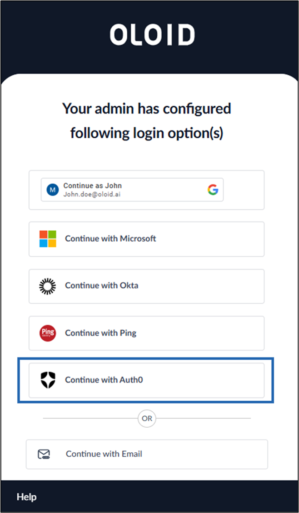
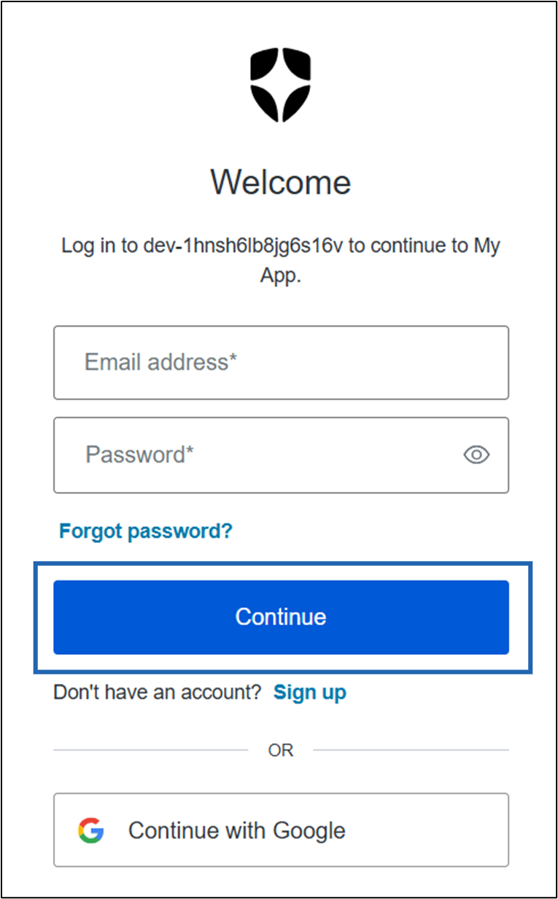
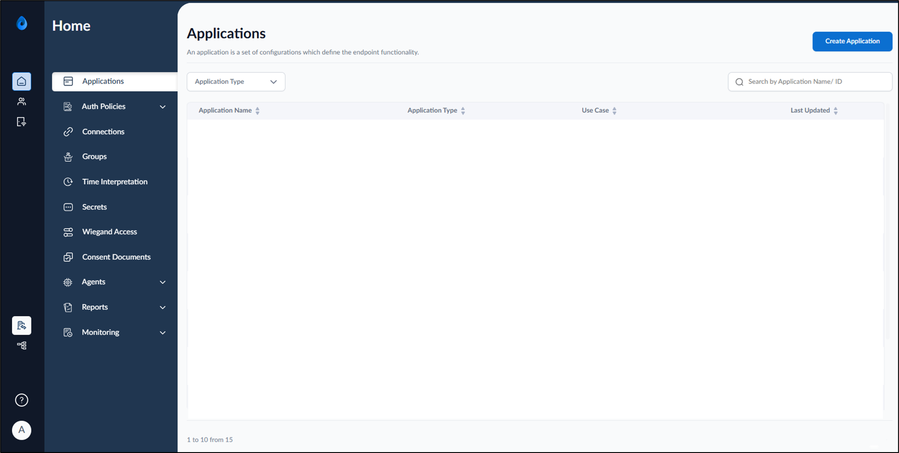

{/* Source: Intercom article 11130515 - https://oloid.help/en/articles/11130515-how-to-log-in-to-tenant-admin-portal-using-auth0-sso */}
{/* Generated by intercom_to_mintlify.py - re-running overwrites this file. */}

**Pre-requisite**

- You should be a user with Tenant Admin role in Oloid Portal.
- A user account must be created in the Auth0 dashboard.

**Steps to log in to Tenant Admin Portal using Auth0 SSO Login option**:

1. Launch your browser.
2. Enter the URL provided for you in the browser’s address bar. Then, press **Enter** on your keyboard.
   The **Oloid Portal** page is displayed.
3. Click **Log in with SSO**.

   

   The configured Login options are displayed.
4. Click **Continue with Auth0**.

   

   The **Welcome** pop-up is displayed.
5. Do the following:
   1. Enter your **Email address**.
   2. Enter your **Password**.
6. Click **Continue**.

   

   You are logged in to the Tenant Admin Portal using Auth0 SSO successfully.

   
