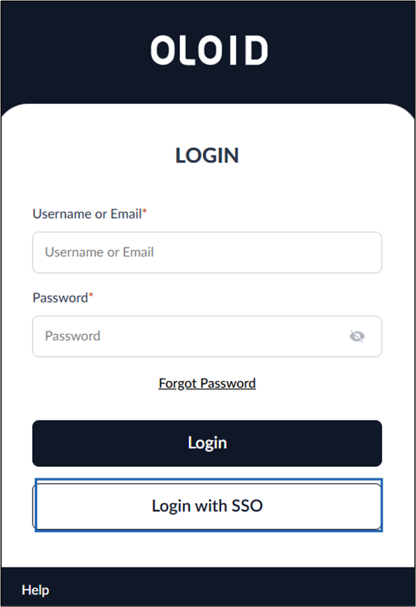
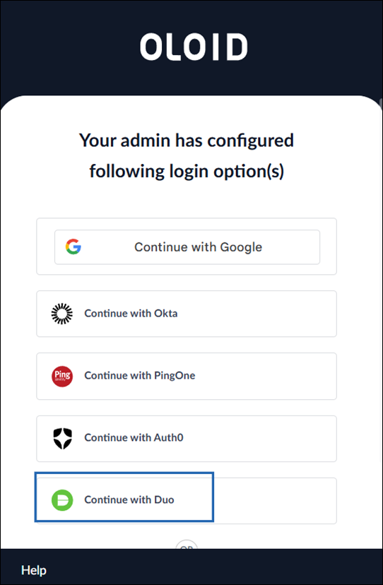
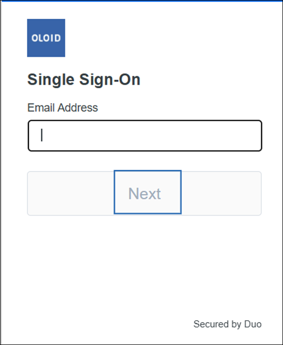
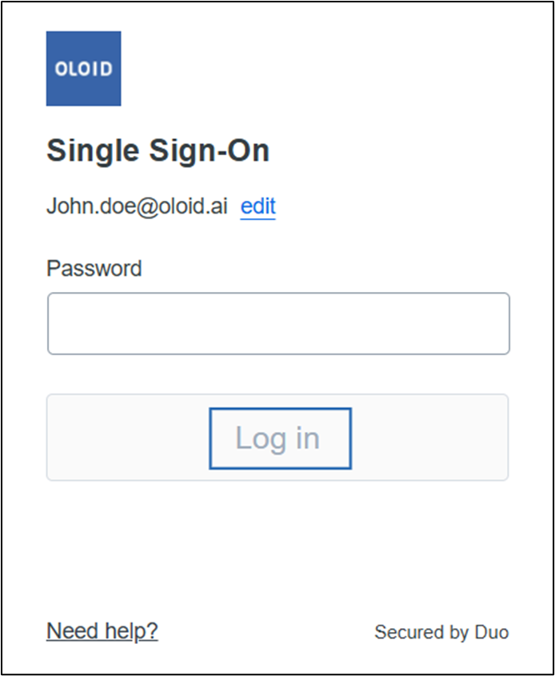
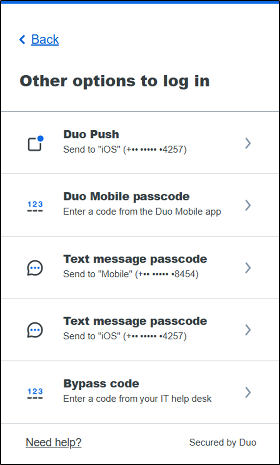

{/* Source: Intercom article 12147243 - https://oloid.help/en/articles/12147243-how-to-log-in-to-tenant-admin-portal-with-duo-sso */}
{/* Generated by intercom_to_mintlify.py - re-running overwrites this file. */}

## Introduction

This document explains how to log in to the Tenant Admin Portal using Duo SSO. It includes step-by-step instructions for completing the login process with Duo authentication.

Before you begin, make sure Duo SSO is enabled for your account. To enable it, submit a request to [Oloid Support.](mailto:Support@oloid.ai) Activation may take up to 48 hours.

## **Prerequisites**

Before logging into the Tenant Admin Portal using Duo SSO, ensure the following:

- You are a registered user in the **Tenant Admin Portal** with the Admin role.
- Duo SSO is **enabled for your account**. If not, submit a request to **Oloid Support** for activation, which may take up to 48 hours.
- You have the **login URL** provided to access the Tenant Admin Portal.

## Steps to log into Tenant Admin Portal using **Duo SSO**

1. Launch your browser.
2. Enter the provided **URL** in the browser’s address bar and press **Enter**. The **Oloid Login** page is displayed.
3. Click **Login with SSO**.

   

   The configured Log in options are displayed.
4. Click **Continue with Duo** to log in to Oloid Platform with Duo SSO.

   

   The Single Sign-On screen is displayed.
5. Follow below steps to complete the sign-in process.
   a. Enter your **Email address,** then click **Next**.

   

   b. Enter your **Password**, then click **Log in**.

   

   The **Duo authenticator** screen is displayed.

   <Note>
     **Note:** To update your email address, click **edit**. This will take you to the login screen where you can update the email address.
   </Note>

   c. On authenticator screen, select your preferred authentication method.

   <Note>
     **Note:** The available authentication method may vary depending on how you configured Duo when setting up your device in the **Duo Consent app**.
   </Note>

   **For Example:** If you choose **Duo Mobile passcode,** a code will appear in the app. For **Text Message** or **Duo Push**, you will receive a message or push notification.

   

On successful authentication, you are logged in to the Oloid User Portal using Duo SSO.
