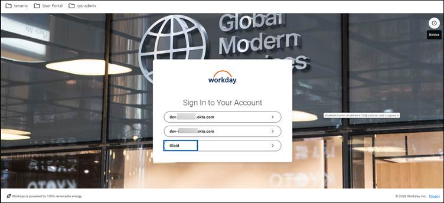
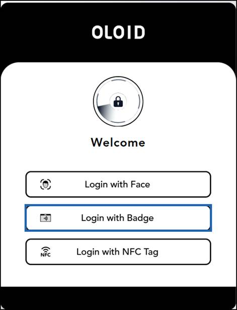
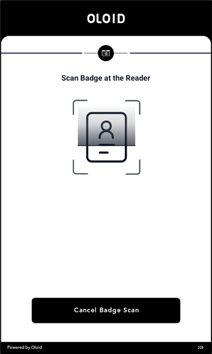
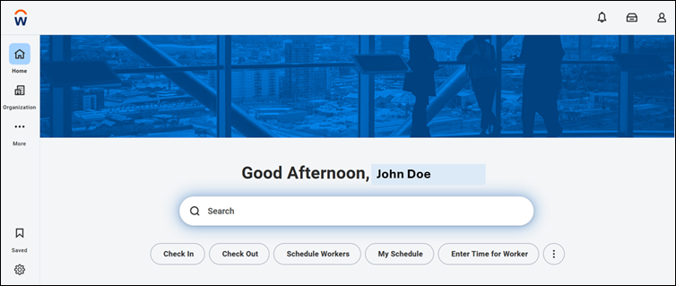

{/* Source: Intercom article 15030169 - https://oloid.help/en/articles/15030169-how-to-log-in-to-workday-with-assigned-credentials */}
{/* Generated by intercom_to_mintlify.py - re-running overwrites this file. */}

## Introduction

This document provides step-by-step instructions to log in to Workday using a Badge credential through Oloid authentication.

## Prerequisite

A credential must be assigned to the user in the Tenant Admin Portal.

**Assumption:** Badge is assigned to the user.

## Steps to Log in to Workday with Badge

1. Launch the Workday.
   The **Workday Sign In** screen is displayed.
2. Click **Oloid**.

   

   The **Welcome** screen is displayed.
3. Click **Login with Badge**.

   <Note>
     **Note:** Based on the configured authentication methods, users may also authenticate using Face or NFC credentials.
   </Note>

   

   The **Scan Badge at the Reader** pop-up box is displayed.
4. Tap the Badge on the Badge Reader to scan it.

   

   After successful authentication, workday home screen is displayed.

   
