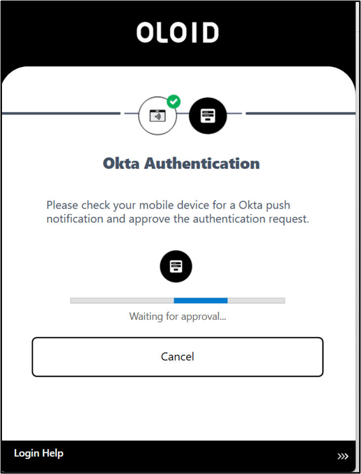
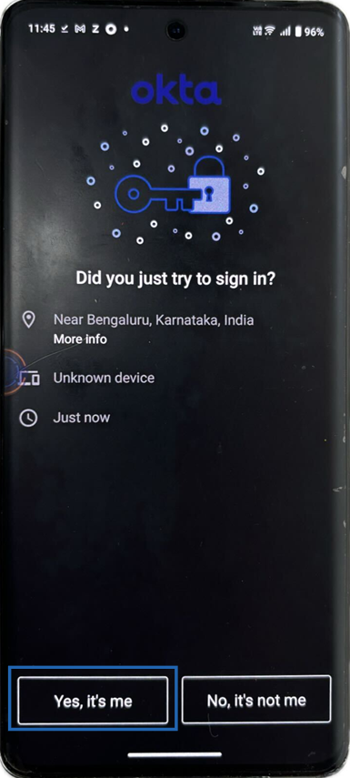
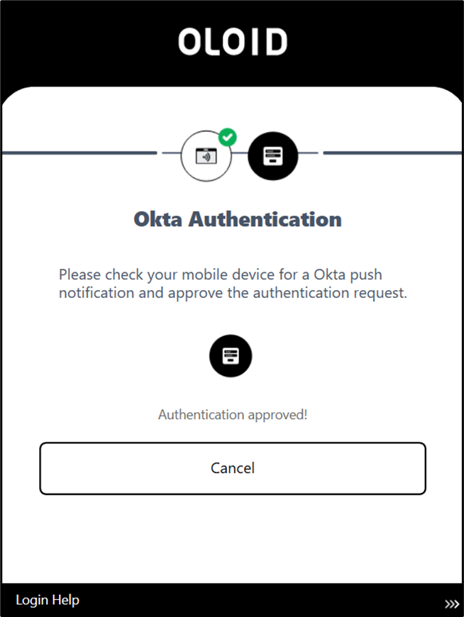

{/* Source: Intercom article 13374319 - https://oloid.help/en/articles/13374319-how-to-login-to-windows-device-using-badge-id-and-okta-credentials */}
{/* Generated by intercom_to_mintlify.py - re-running overwrites this file. */}

## Introduction

The Windows Login app allows users to securely sign in to their Windows devices using Badge ID and OKTA credentials. This passwordless, multi-factor login method provides a faster and more secure way to access devices.

## Prerequisites

- A Badge ID must be assigned to you.
- You must have access to a registered mobile device where the OKTA app is installed and enrolled for your user account.

  <Note>
    **Note:** If you don't see the login option reach out to [Oloid Support](mailto:support@oloid.ai).
  </Note>

## Steps to log in to Windows Device

1. On the Windows lock screen, do the following:
   1. Click **Sign-in options**.

      

      The Windows login app is displayed.
   2. Select **Windows login app**.

      

   3. Select **Login with OLOID**.

      

      The **Scan Badge** pop-up box is displayed.
2. Tap the **Badge** on the **Badge Reader** to scan it.

   

3. The **OKTA Authentication** pop-up box is displayed.

   

   The Push notification is displayed in your registered device.
4. Tap **Yes, It's me**.

   

   The Authentication Approved screen is displayed.

   

   The **Choose Your Account** pop-up box is displayed.

   <Note>
     **Note:** If the user has multiple passwords configured in the Oloid Portal, they can select a specific account to sign in. If the user has only one account configured, **Choose Your Account** pop-up box will not be displayed.
   </Note>

5. Select the account to sign in.

   

   You are signed in to the Windows device successfully.
