{/* Source: Intercom article 15652452 - https://oloid.help/en/articles/15652452-microsoft-entra-id-how-to-configure-cross-domain-identity-management-scim-provisioning-for-oloid */}
{/* Generated by intercom_to_mintlify.py - re-running overwrites this file. */}

## Introduction

This document provides instructions to configure **SCIM (System for Cross-domain Identity Management) provisioning** between **Microsoft Entra ID** and **Oloid**. The configuration enables automatic user and group provisioning, updates, and deprovisioning using the **SCIM 2.0** protocol with **Bearer Token** or **OAuth 2.0 Client Credentials** authentication.

## Prerequisites

- You must have **Admin** access to the Microsoft Entra ID Admin Center.
- The **SCIM integration** must be enabled for your Oloid tenant.
- You must have a pilot user or group available in Microsoft Entra ID for validating the provisioning configuration.

## Steps to Setup the SCIM

1. [Create the Enterprise Application](#create-the-enterprise-application)
2. Configure Provisioning
3. [Monitor and Verify](#monitor-and-verify)

### Create the Enterprise Application

1. Log in to **Microsoft Entra ID Admin Center**.
   The Microsoft Entra ID homepage is displayed.
2. Click **Enterprise applications**.

   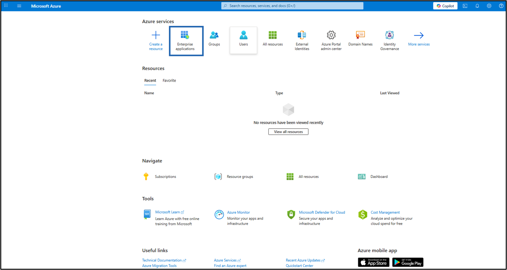

   The **Enterprise applications** screen is displayed.
3. Click **New application**.

   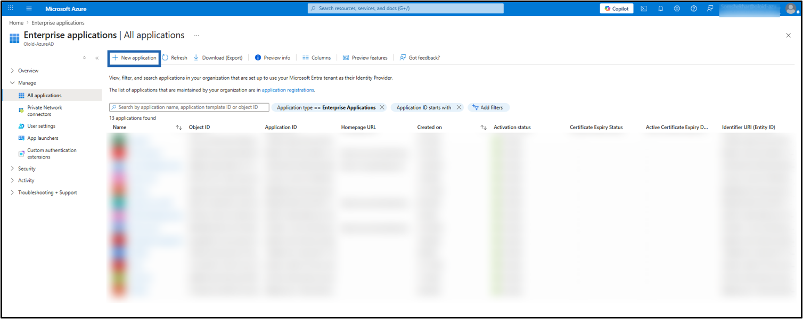

   The **Browse Microsoft Entra App Gallery** screen is displayed.
4. Click **Create your own application**.

   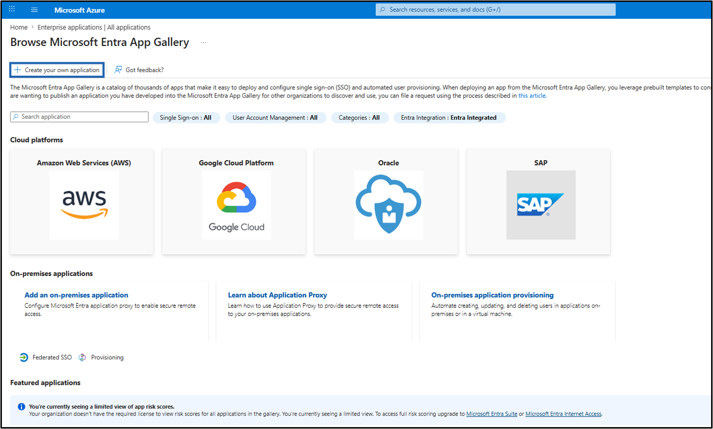

   The **Create your own application** pop-up box displayed.
5. Do the following:
   1. Enter the app name.
   2. Select **Integrate any other application you don't find in the gallery (Non-gallery)**.
   3. Click **Create**.

      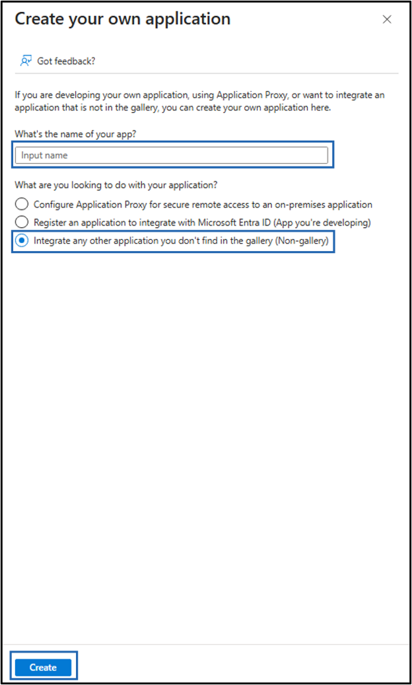

      The **Enterprise application** is created successfully, and application details screen is displayed.

      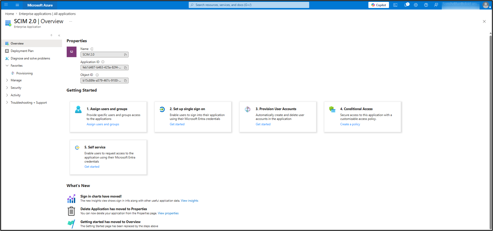

### Configure the Provisioning

1. Go back to the Enterprise screen and click **Provisioning**.

   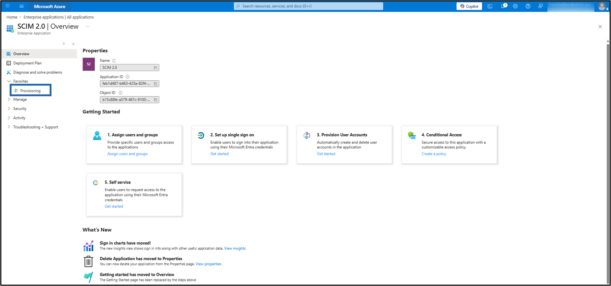

   The **Overview** screen is displayed.
2. Go to **Manage** > click **Provisioning**.

   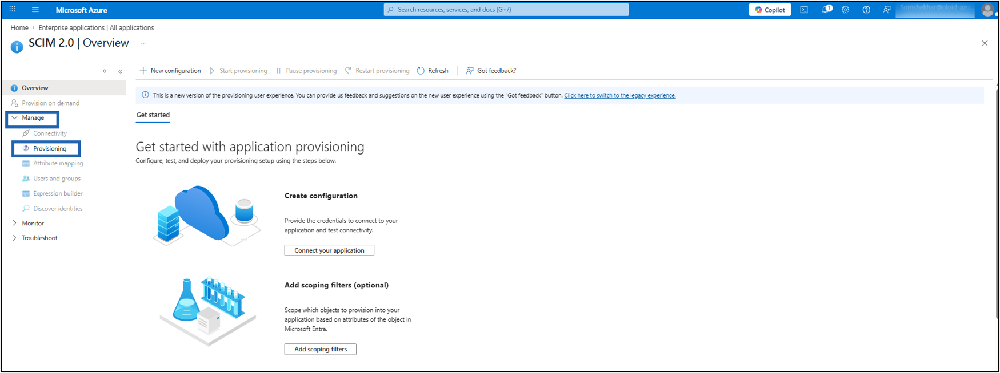

   The **Provisioning** screen is displayed.
3. On **Provisioning** screen, do the following:
   1. Select Provisional mode as **Automatic** from the drop-down.

      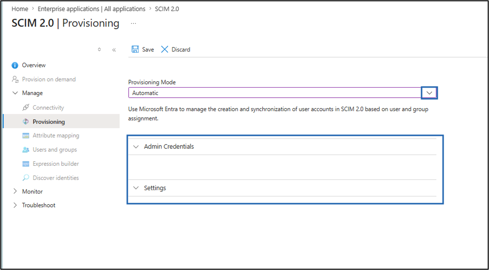

   2. On **Admin Credentials** section, **click here to switch to the new admin credentials experience**.
      The Connectivity screen is displayed.
   3. Do one of the following:
      1. Select **Bearer authentication** as an Authentication Method.

         <Note>
           **Note:** The values required for the following fields are available in the **Tenant Admin Portal**. To view them, go to **Agents > SCIM > API Token**.
         </Note>

      2. Enter **Tenant URL**.

         <Note>
           **Note:** Copy the **Base URL** and paste it into the **Tenant URL** field.
         </Note>

      3. Enter **Secret Token**.

         <Note>
           **Note:** Copy the **Token** and paste it into the **Secret Token** field.
         </Note>

         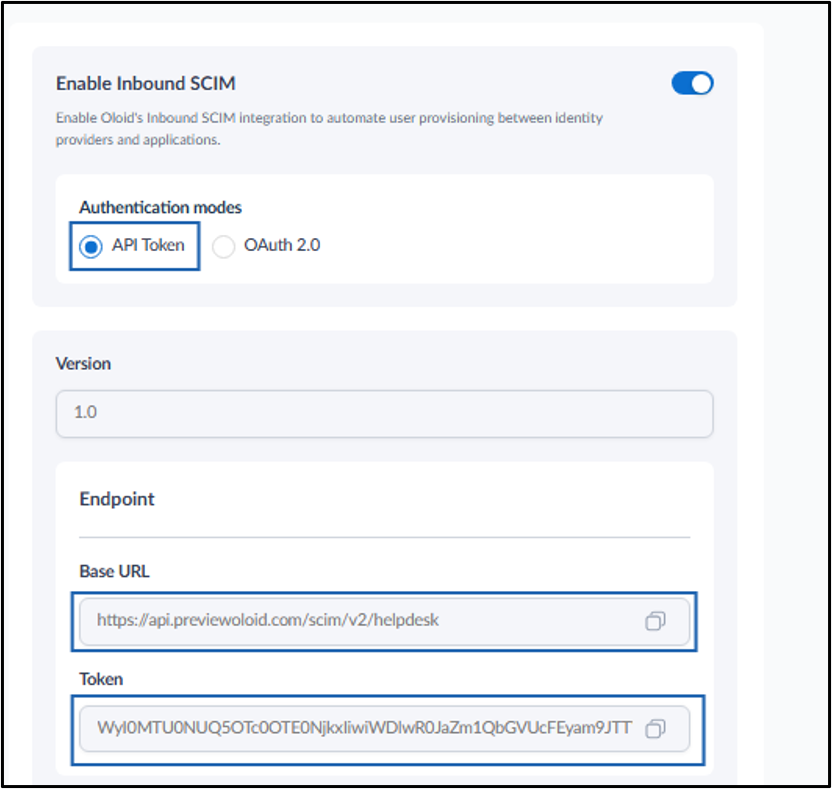

      4. Click **Test Connection.**
         The Success message is displayed.

         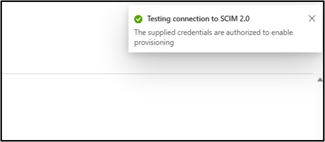

      5. Click **Save**.

         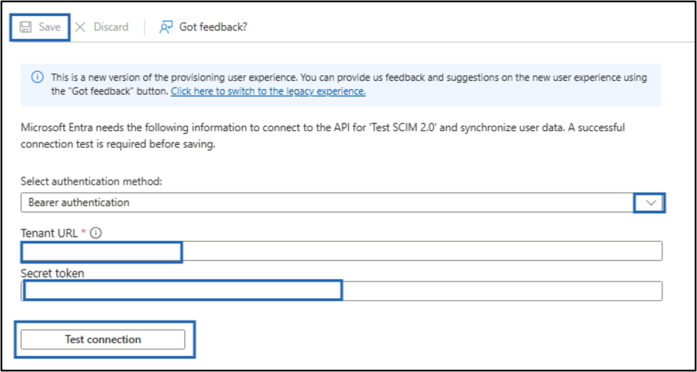

         The **Admin Credentials** tab is configured successfully.
         OR
      1. Select **OAuth2 Client Credentials Grant** as an Authentication Method.

         <Note>
           **Note:** The values required for the following fields are available in the **Tenant Admin Portal**. To view them, go to **Agents > SCIM > OAuth 2.0**.
         </Note>

      2. Enter **Tenant URL**.

         <Note>
           **Note:** Copy the **Base URL** and paste it into the **Tenant URL** field.
         </Note>

      3. Enter **Token Endpoint**.

         <Note>
           **Note:** Copy the **Endpoint Token** and paste it into the **Token Endpoint** field.
         </Note>

      4. Enter **Client Identifier**.

         <Note>
           **Note:** Copy the **Client ID** and paste it into the **Client Identifier** field.
         </Note>

      5. Enter **Client Secret**.

         <Note>
           **Note:** If the **Client Secret** is not displayed, click **Get Secret**. Copy the generated **Client Secret** and paste it into the **Client Secret** field.
         </Note>

         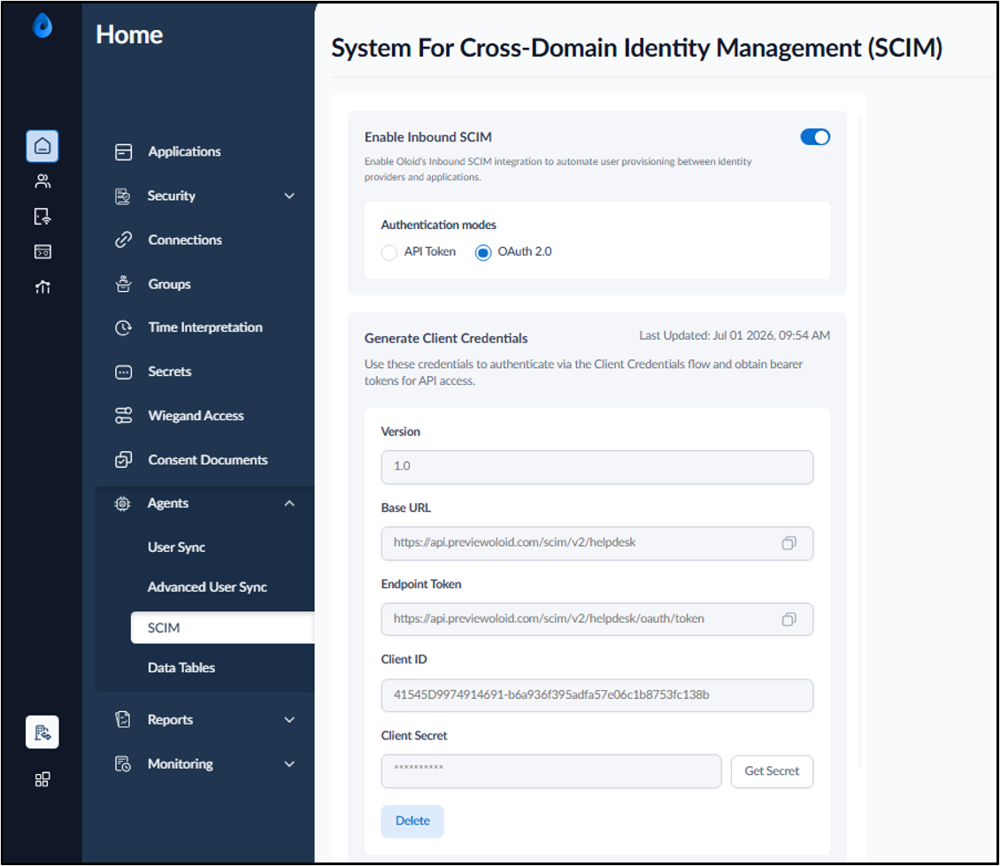

      6. Click **Test Connection**.
         The Success message is displayed.

         

      7. Click **Save**.

         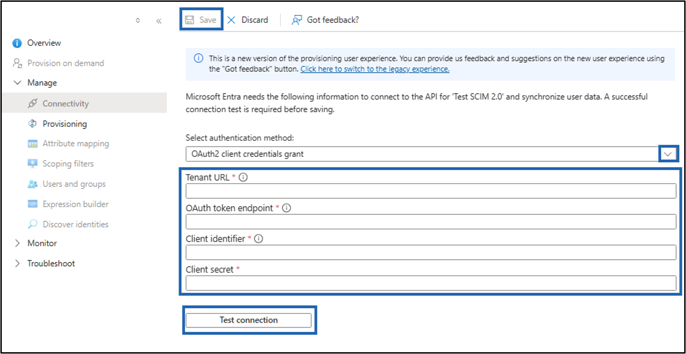

         The **Admin Credentials** tab is configured successfully.
   4. Go to **Settings** section and do the following:
      1. Select **Send Email notification when failure occurs**.
      2. Enter **Email ID**.

         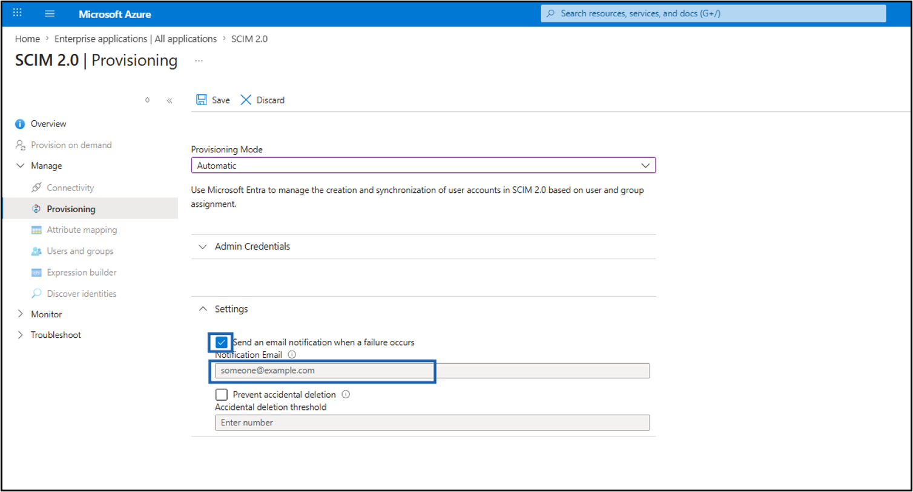

   5. Click **Save**.

      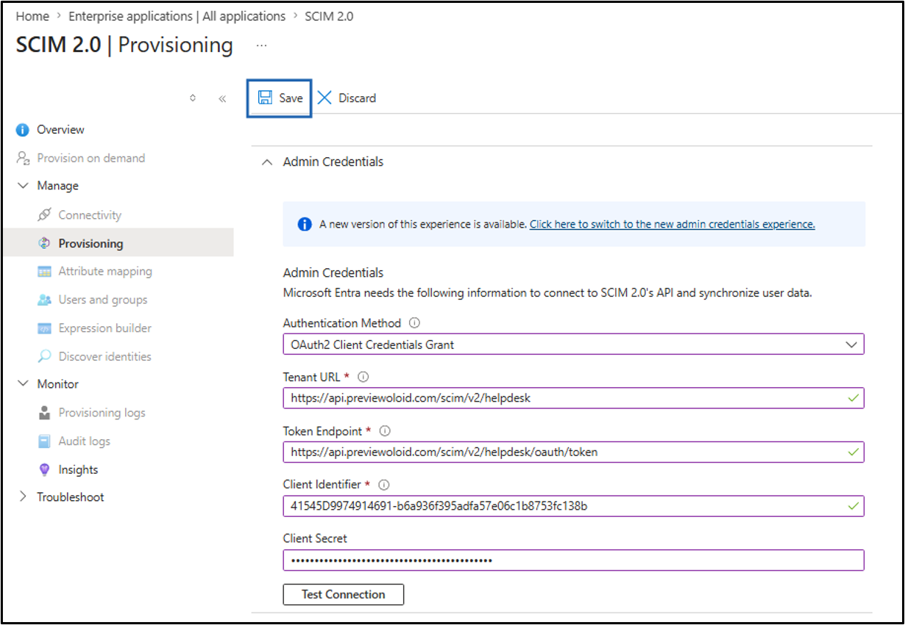

      The Mappings section is displayed.

      <Note>
        **Note:** Remove any default attribute mappings that are not supported by the Oloid schema (for example, `preferredLanguage` and `addresses[*]`). This helps reduce unnecessary HTTP 400 (Bad Request) errors in the synchronization logs.
      </Note>

   6. Do the following:
      1. Select **Provision Microsoft Entra ID Groups**.
         The Attribute Mapping screen for Provision Microsoft Entra ID Groups is displayed.

         <Note>
           **Note:** Refer [Group Attribute Table](#group-attribute-table) to map the attribute for Entra ID Groups.
         </Note>

      2. On **Attribute Mappings** tab, do the following:
         1. Ensure **Yes** is select as Enabled.
         2. Click **Save**.

            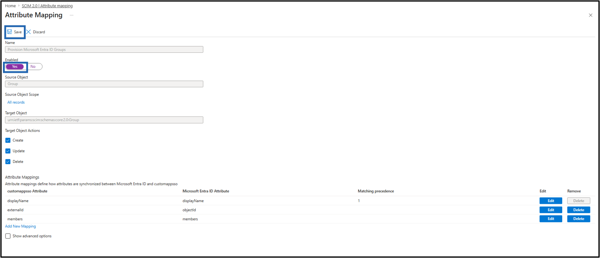

            A confirmation pop-up box is displayed.
         3. Click **Yes**.

            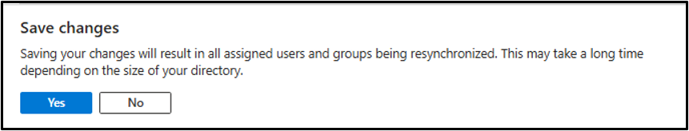

      3. Select **Provision Microsoft Entra ID Users**.
         The Attribute Mapping screen for Provision Microsoft Entra ID Users is displayed.

         <Note>
           **Note:** Refer [User Attribute Table](#user-attribute-table) to map the attribute for Entra ID users.
         </Note>

      4. On **Attribute Mappings** tab, do the following:
         1. Ensure **Yes** is select as Enabled.
         2. Click **Save**.

            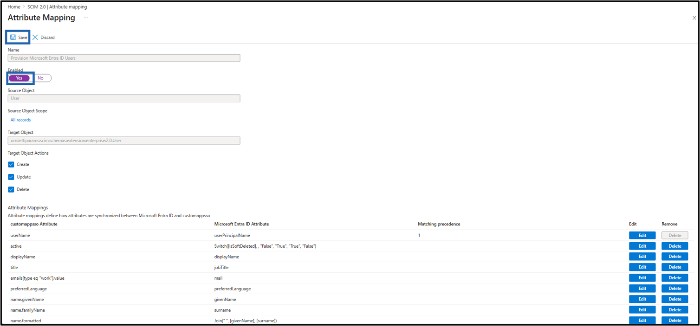

            A confirmation pop-up box is displayed.
         3. Click **Yes**.

            

            The Provisioning tab is configured successfully.
4. Click on the **Users and groups** tab.
   The Users and Groups screen is displayed.
5. Click **Add user/group**.

   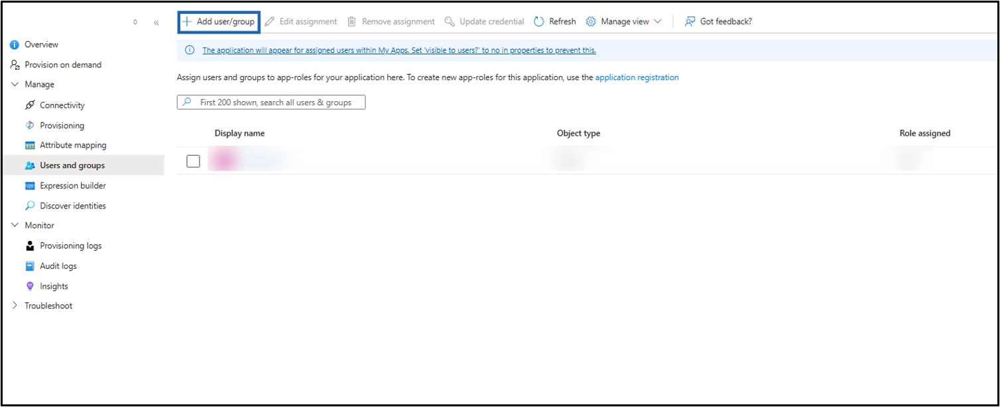

   The **Add Assignment** screen is displayed.
6. Click **None Selected**.

   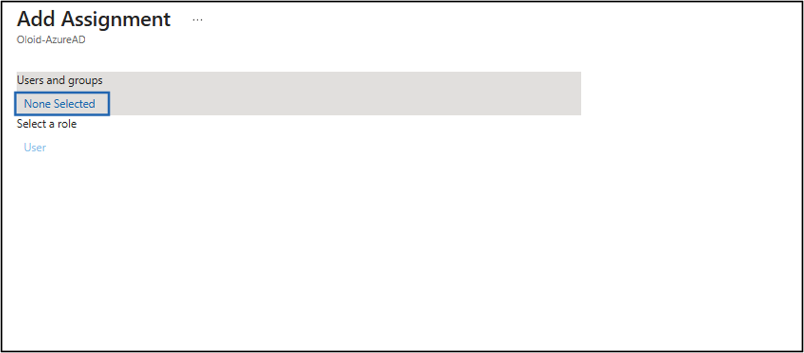

   The **Users and groups** pop-up box is displayed.
7. Select the applicable user/group > click **Select**.

   <Note>
     **Note:** Assign a pilot user group (recommended) or individual users.
   </Note>

   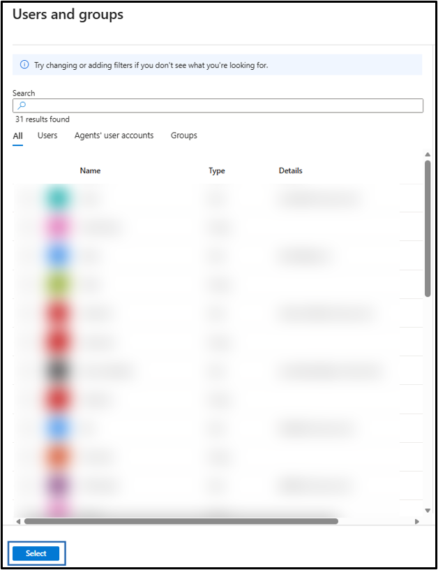

   The user(s) or group(s) is(are) selected.
8. Go back to **Provisioning** tab > under settings tab, configure the following:
   1. Select the scope with the help of drop-down.
      **Note:**
      1. **Sync only assigned users and groups (recommended):** Synchronizes only the users and groups assigned to the enterprise application. Use this option for initial setup and validation.
      2. **Sync all users and groups:** Synchronizes all users and groups in Microsoft Entra ID. Use this option only after the initial setup has been validated.
   2. Ensure Provisioning Status set to **ON**.
   3. Click **Save**.

      <Note>
        **Note:** Entra schedules the initial cycle within a few minutes; full enumeration can take up to 40 minutes on a fresh tenant. After the initial cycle, Entra runs incremental cycles every ~40 minutes
      </Note>

      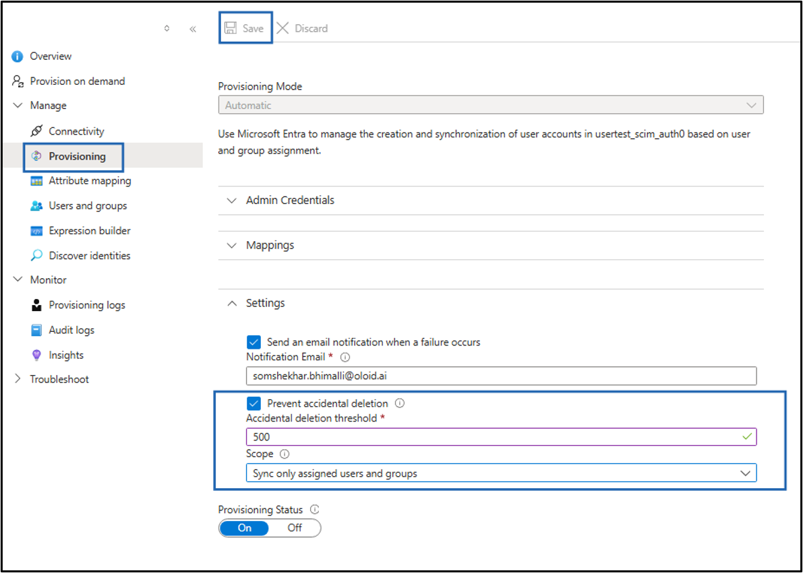

      The Provisioning tab is configured successfully.

### Monitor and Verify

1. Go to **Monitor > Provisioning Logs**.
   The **Provisioning Logs** page is displayed.
   Filter by Status to inspect failures. Each entry shows the SCIM operation, the Entra source object, and the upstream HTTP response from Oloid.

   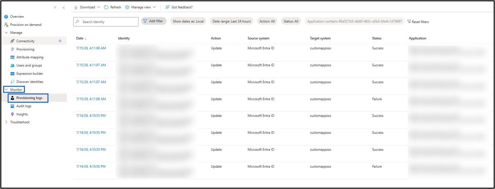

2. Click **Provision on Demand** and do the following:

   <Note>
     **Note:** Provision on Demand dry run a single user or group without waiting for the cycle. This is the fastest feedback loop while validating mappings.
   </Note>

   1. Select Group in **Selected group**.
   2. Select one of the following in **Selected users**.
      1. View members only.
      2. View all users.
   3. Click **Provision**

      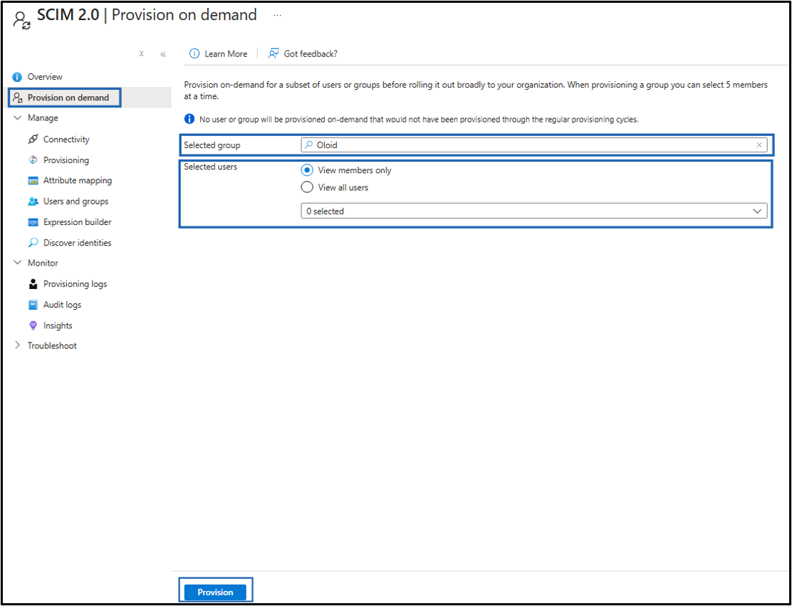

3. Click **Monitor > Audit Logs**.
   The Audit Log page is displayed.

   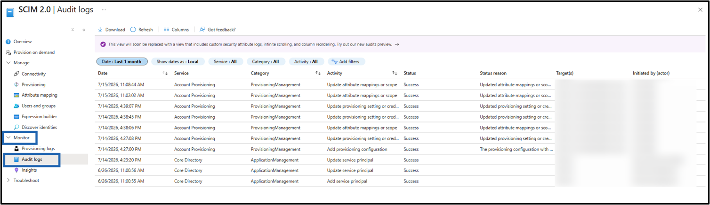

4. Filter **Service** Account Provisioning to see who started, paused, or modified the provisioning configuration.

---

### Attribute Table

#### User Attribute Table

| Entra attribute | SCIM Attribute (Target) | Notes |
| --- | --- | --- |
| userPrincipalName | userName | Required. Used as the SCIM unique identifier on the Oloid side (PrimaryID). |
| Switch([IsSoftDeleted], , "False", "True", "True", "False") | active | Required. Drives Oloid Active/Inactive state on deprovisioning. |
| displayName | displayName | Required for nice display in Oloid UI. |
| mail | emails[type eq "work"].value | Required. Oloid stores this as the user's email. |
| givenName | name.givenName | Optional but recommended. |
| surname | name.familyName | Optional but recommended. |
| objectId | externalId | Recommended. Stable identifier used for re-linking after rename. |

#### Group Attribute Table

| Entra attribute | SCIM attribute (target) | Notes |
| --- | --- | --- |
| displayName | displayName | Required. Used as the human-readable group name. |
| members | members | Required. Each member emits a &#123;value, $ref&#125; pair pointing at the SCIM user id Oloid returned at user creation time. |

---

#### Additional Information

- Rotate the Secret Token periodically (recommended at least every 12 months, sooner on personnel change).
- Create a new API key for SCIM from the Oloid admin portal.

---

#### Related Article

[Tenant Admin Portal - How to Configure System for Cross-Domain Identity Management (SCIM)](/more/sso-and-mfa/tenant-admin-portal-how-to-configure-system-for-cross-domain-identity)
