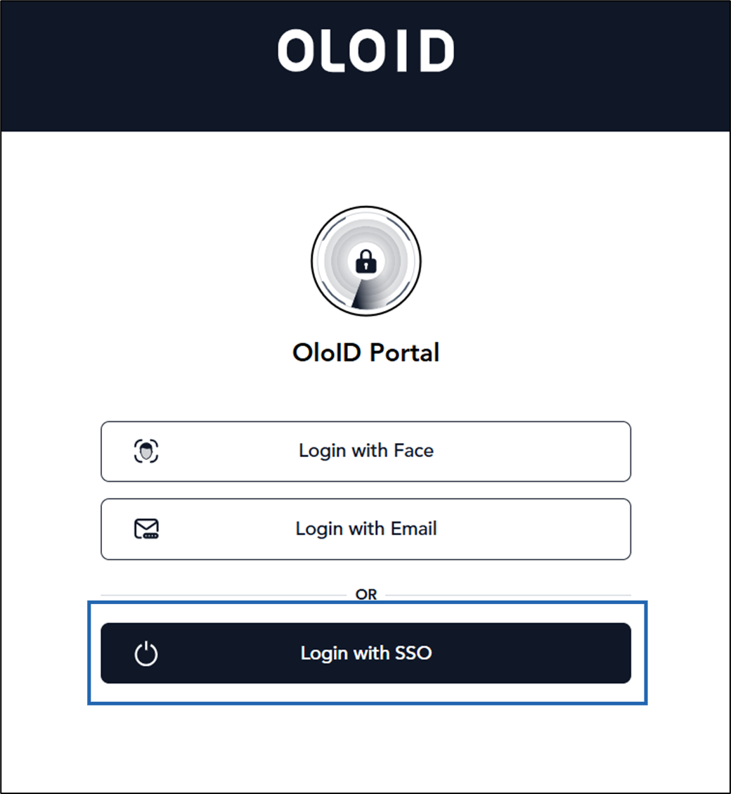
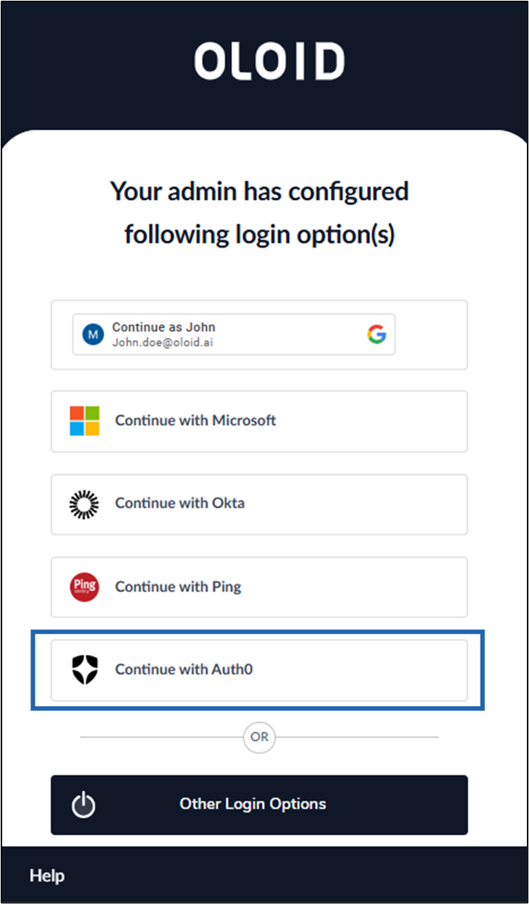
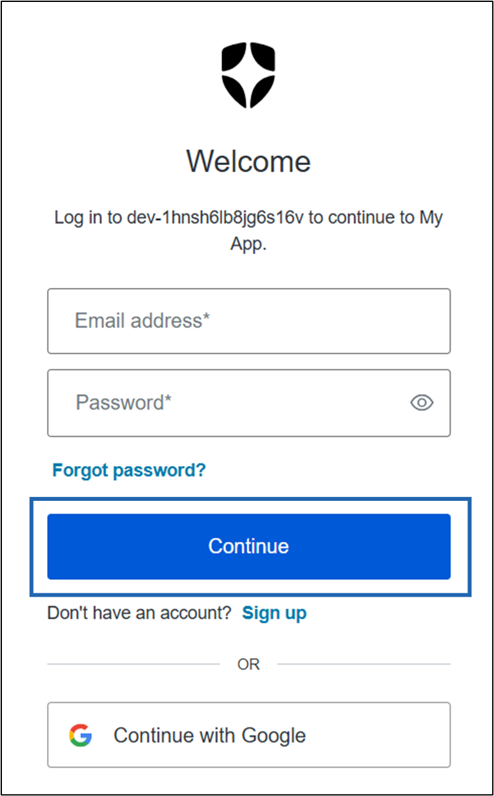
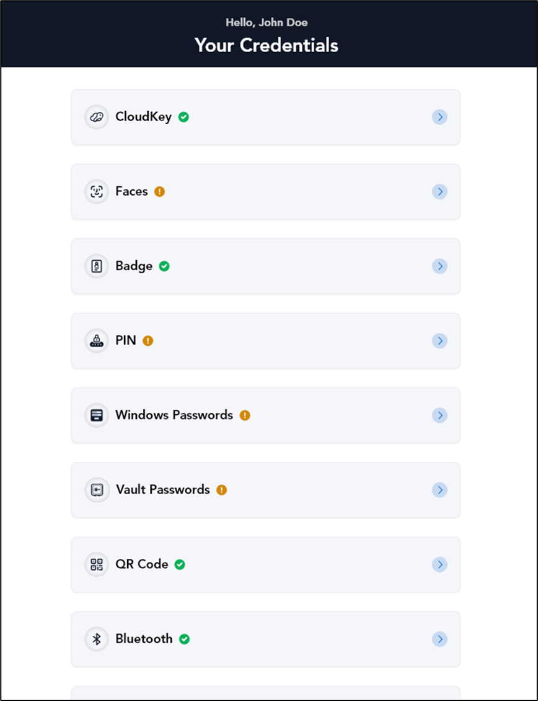

{/* Source: Intercom article 11122318 - https://oloid.help/en/articles/11122318-oloid-user-portal-how-to-log-in-to-oloid-user-portal-using-auth0-sso */}
{/* Generated by intercom_to_mintlify.py - re-running overwrites this file. */}

## Introduction

This document provides instructions to log in to the Oloid User Portal using Auth0 SSO.

## Prerequisites

- You must be a user in the Tenant Admin Portal.
- You must have valid Auth0 credentials.

## Steps to log in to Oloid User Portal using Auth0 SSO Login

1. Launch your browser.
2. Enter the provided **URL** in the browser’s address bar and press **Enter**. The **Oloid User Portal** page is displayed.
3. Click **Login with SSO**.

   

   The configured Login options are displayed.
4. Click **Continue with Auth0**.

   

   The **Welcome** pop-up box is displayed.
5. Do the following.
   1. Enter your **Email address**.
   2. Enter your **Password**.
   3. Click **Continue**.

      

      On successful authentication, you are logged in to the Oloid User Portal using Auth0.

      
