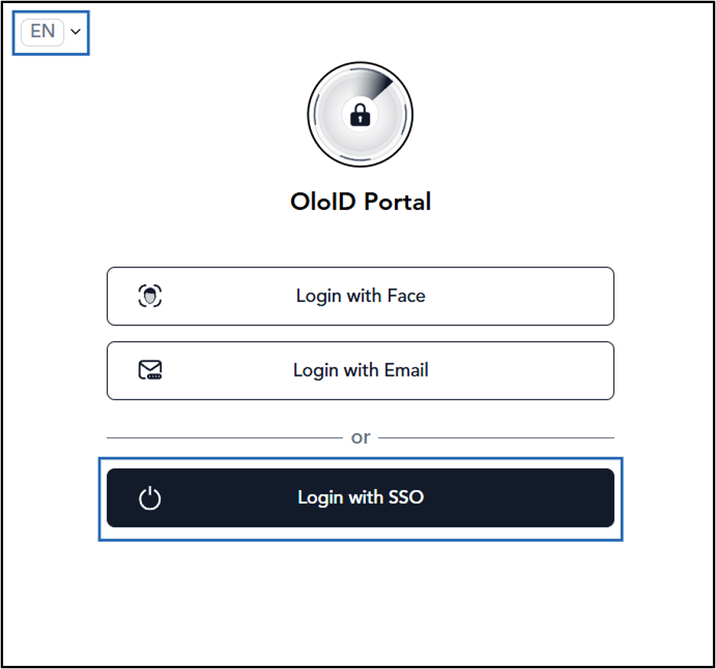
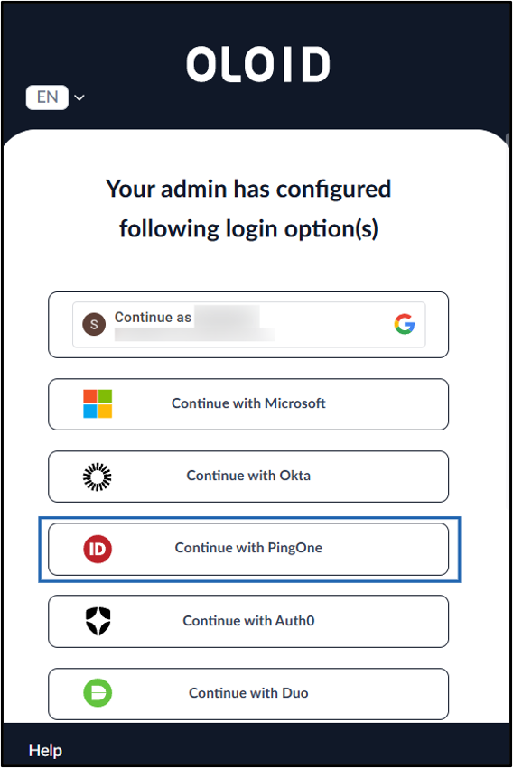
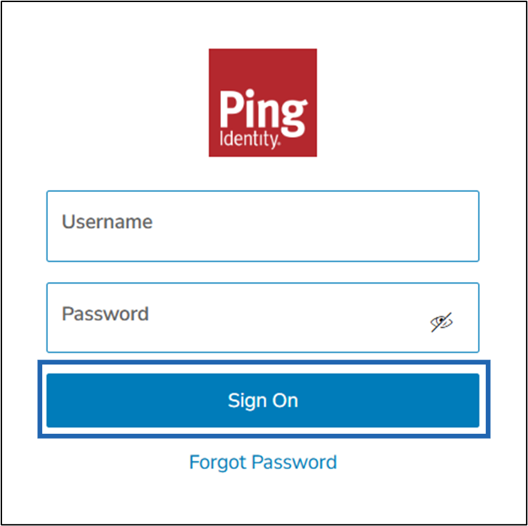
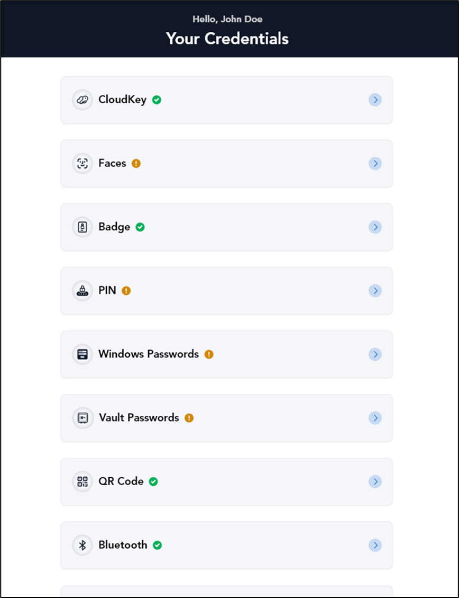
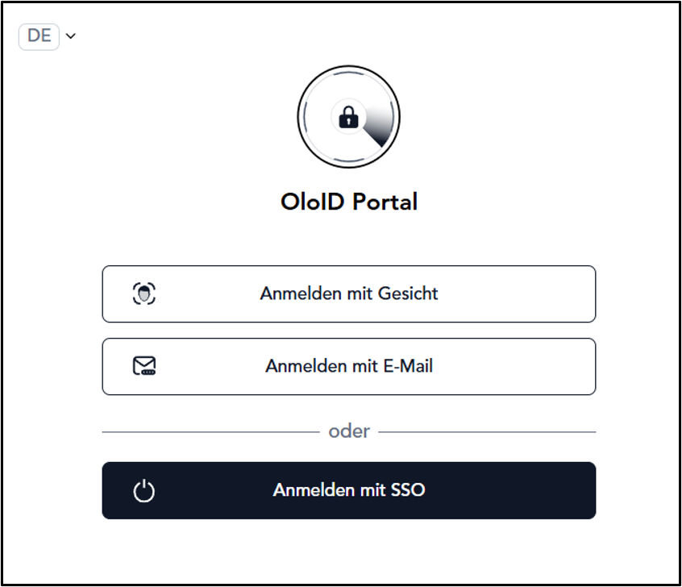

{/* Source: Intercom article 9556317 - https://oloid.help/en/articles/9556317-oloid-user-portal-how-to-login-to-oloid-user-portal-with-pingone-single-sign-on-sso */}
{/* Generated by intercom_to_mintlify.py - re-running overwrites this file. */}

## Introduction

This document provides instructions to login to the **Oloid User Portal** using **PingOne Single Sign-On (SSO)**.

## Prerequisites

- You must be a user in the Tenant Admin Portal.
- You must have valid PingOne login credentials.

## Steps to Login to Oloid User Portal using PingOne SSO

1. Launch your browser.
2. Enter the URL provided for you in the browser’s address bar and press **Enter**.
   The **OloID Portal** page is displayed.
3. Click **Login with SSO**.

   <Note>
     **Note:** You can select preferred display language from the **Language Dropdown Selector**. For more information, refer [Additional information section](#additional-information).
   </Note>

   

   The configured login options are displayed.
4. Click **Continue with PingOne**.

   

   The Sign in pop-up box is displayed.
5. Do the following.
   1. Enter your Ping ID in the **Username** field.
   2. Enter your **Password**.
   3. Click **Sign On**.

      

      You are logged in to the Oloid User Portal using Ping SSO successfully.

      

---

##### Additional Information

**Oloid User Portal** supports multiple language versions, allowing users to select their preferred display language from the **Language Dropdown Selector** on the Login screen.

<Note>
  **Note:** Languages supported: English, Spanish, French, German, and Portuguese language.
</Note>

**Sample Screen**

The display language updates based on the selected language. The following sample shows the Oloid portal application in German.

