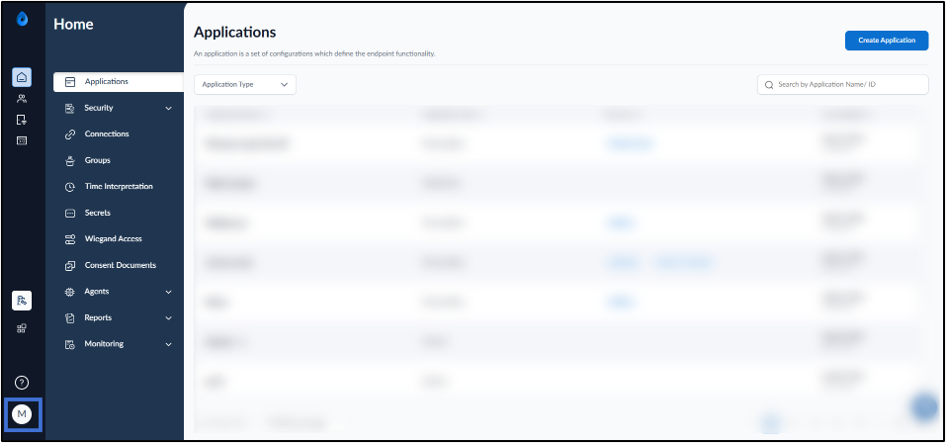
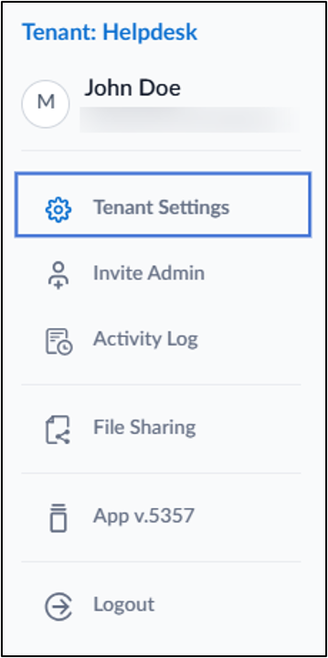
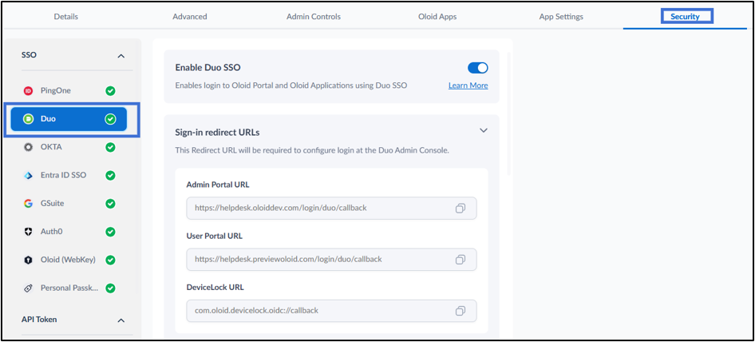
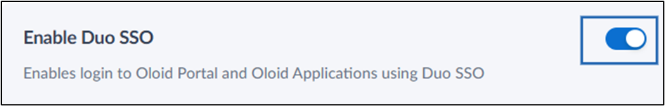
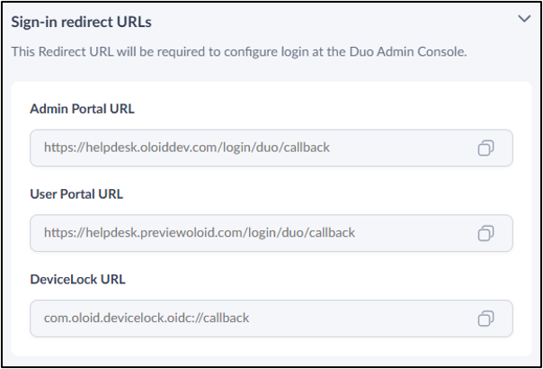
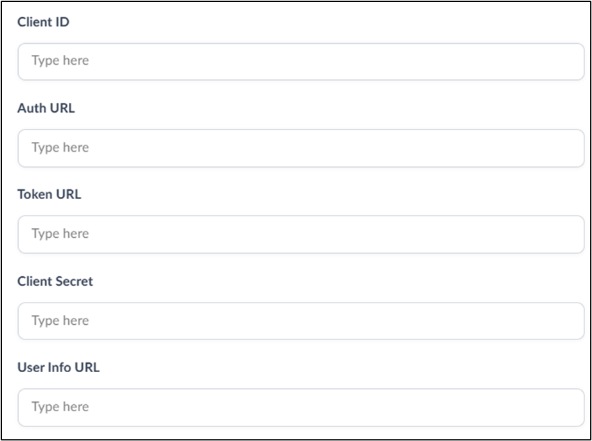
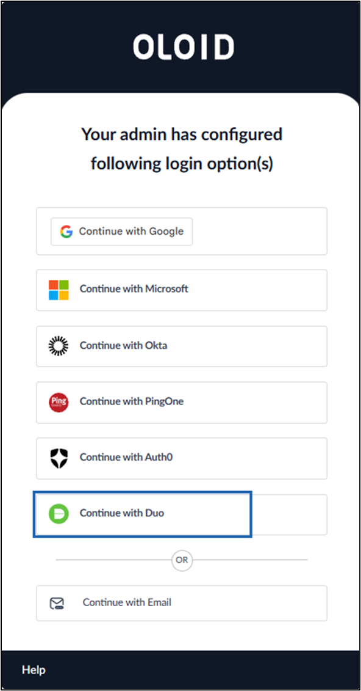

{/* Source: Intercom article 12086393 - https://oloid.help/en/articles/12086393-tenant-admin-portal-how-to-configure-duo-sso */}
{/* Generated by intercom_to_mintlify.py - re-running overwrites this file. */}

## Introduction

This document provides steps on how to set up Duo Single Sign-On (SSO) in the Tenant Admin Portal by enabling Duo SSO and adding the required parameters from the Duo Administrator Console.

## Prerequisite

To set up the configuration between Duo and Oloid, you must generate the parameters in Duo Administrator Console. For detailed instructions, see [Duo Settings for Oloid SSO](/more/sso-and-mfa/duo-settings-for-oloid-sso).

## Steps to Configure Duo SSO

1. Log in to the **Tenant Admin Portal**.
2. On the homepage of the portal, click **user profile icon** on the bottom left corner of the menu panel.

   

   The user profile menu is displayed.
3. Click **Tenant Settings**.

   

   The **Tenant Settings** page is displayed.
4. On Tenant Settings page, go to **Security** tab, and click **Duo.**
   The Duo configuration page is displayed.

   

5. Turn on **Enable Duo SSO** toggle.

   

6. Copy both **Redirect URLs** from the Duo configuration page and add them to the **Duo Identity Administrator Console**.
   1. Use the first URL for the Tenant Admin Portal.
   2. Use the second URL for the User Portal.

      

      <Note>
        **Note:** You must enter both URLs in the Duo Identity Administrator Console. They are required to complete the login configuration. For more, refer to [Duo Settings for Oloid SSO](/more/sso-and-mfa/duo-settings-for-oloid-sso)
      </Note>

7. In the **Duo Identity Administrator Console**, go to **Application > Single Sign-On** tab, and locate the **[Metadata](/more/sso-and-mfa/duo-settings-for-oloid-sso)**section and then Copy the parameters and add the following details.
   1. **Client ID:** Add the Client ID in the Client ID field.
   2. **Auth URL:** Add the Authorization URL in the Auth URL field.
   3. **Token URL:** Add the Token URL in the Token URL field.
   4. **Client Secret:** Add the Client Secret in the Client Secret field.
   5. **User Info URL:** Add the User Info URL in the User Info URL field.

      

8. Click **Save**.

   

   The Duo Identity SSO is configured.

## Sample Screen for Duo SSO

After configuration in the Tenant Admin Portal, the Duo SSO login option is displayed in both the Tenant Admin Portal and the User Portal.

