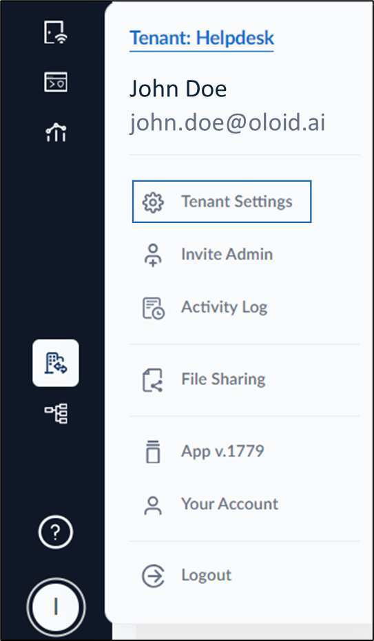
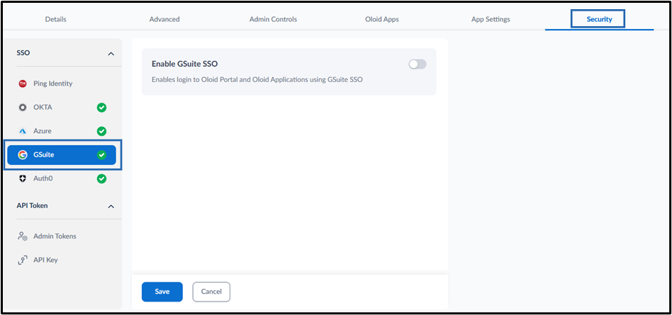
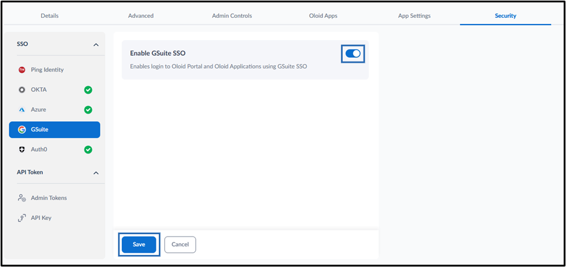
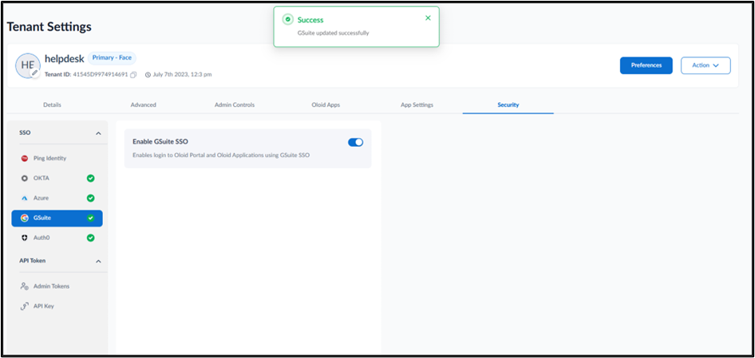

{/* Source: Intercom article 11129566 - https://oloid.help/en/articles/11129566-tenant-admin-portal-how-to-enable-gsuite-sso-in-tenant-admin-portal */}
{/* Generated by intercom_to_mintlify.py - re-running overwrites this file. */}

**Steps to configure GSuite SSO:**

1. Log in to the **Tenant Admin Portal**.
2. On the homepage of the portal, click **user profile icon** on the bottom left corner of the menu panel.

   

   The user profile menu is displayed.
3. Click **Tenant Settings**.

   

   The **Tenant Settings** page is displayed.
4. Go to **Security** > click **GSuite**.

   

5. Turn on **Enable GSuite SSO** toggle > click **Save**.

   

   The **GSuite** SSO configuration is saved successfully.

   
