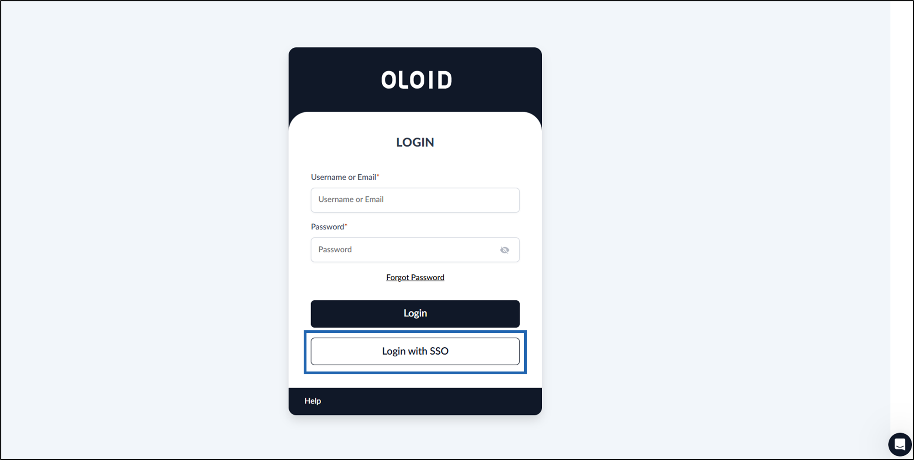
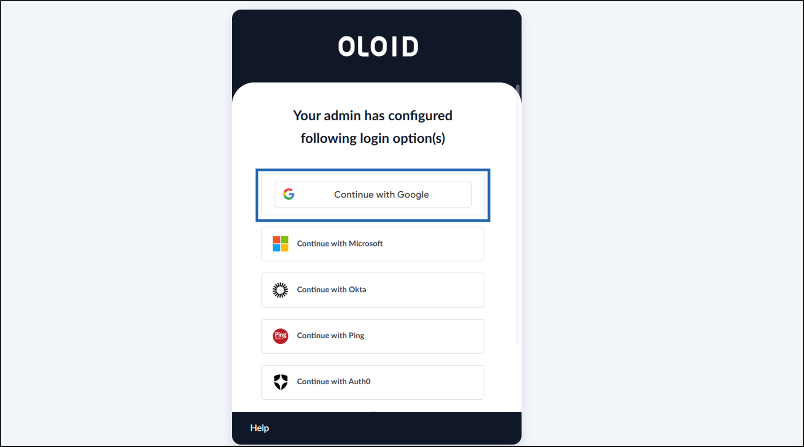
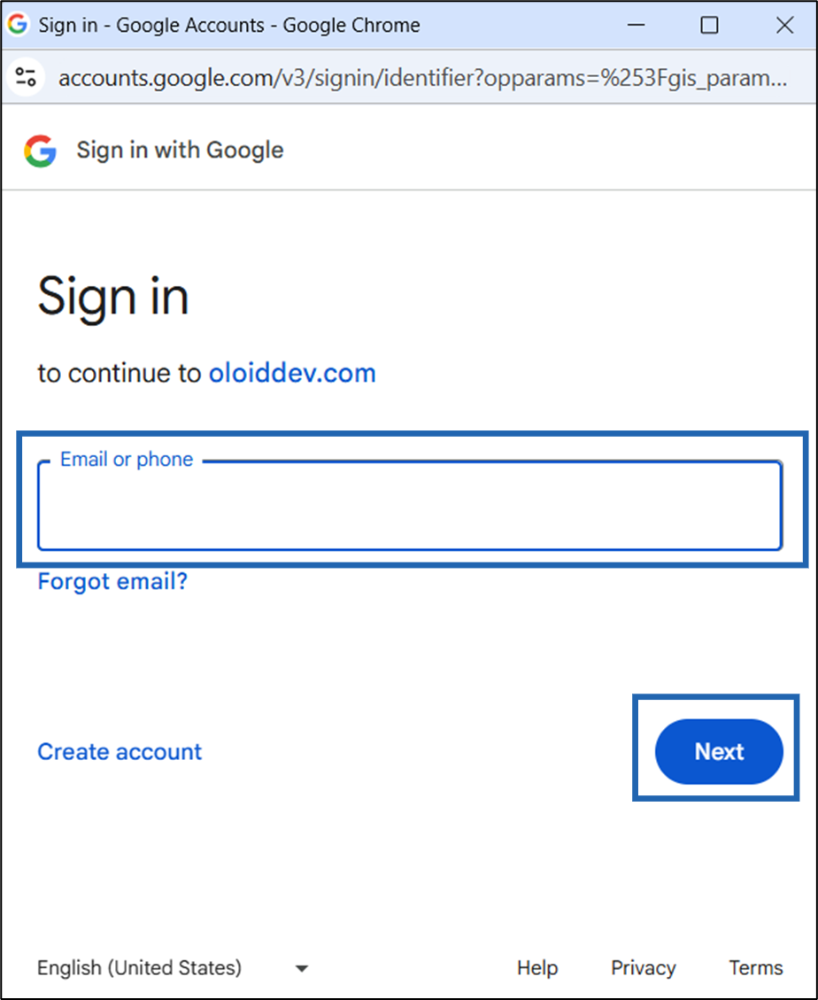
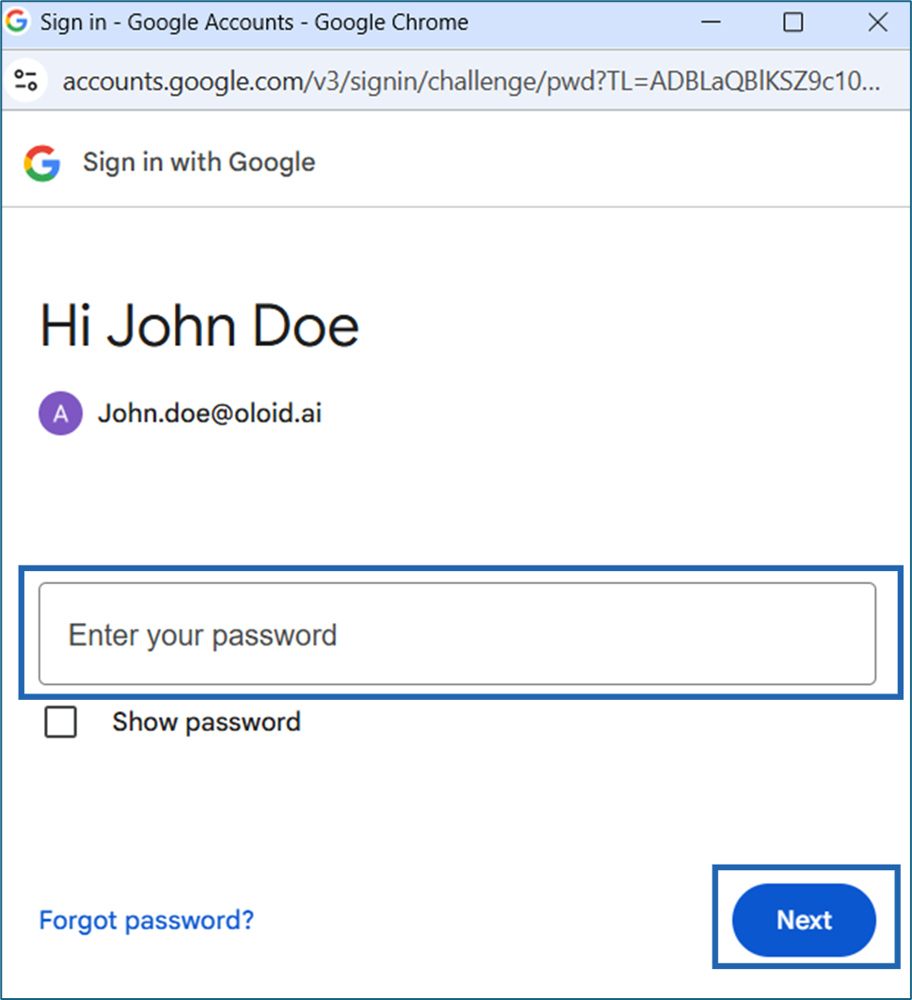
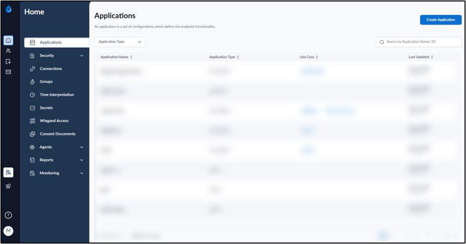

{/* Source: Intercom article 8727486 - https://oloid.help/en/articles/8727486-tenant-admin-portal-how-to-log-in-to-tenant-admin-portal-with-google-sso */}
{/* Generated by intercom_to_mintlify.py - re-running overwrites this file. */}

## Introduction

This document explains how to log in to the Oloid Tenant Admin Portal using Google Single Sign-On (SSO).

## Prerequisites

- You should be a user in the Tenant Admin Portal with **Admin/Supervisor** role.
- The Google credential (user email ID) must be added to the user detail page.

## Steps to log into Tenant Admin Portal using **Google SSO**

1. Launch your browser.
2. Enter the URL provided for you in the browser’s address bar > press **Enter** on your keyboard.
   The Oloid LOGIN page is displayed.
3. Click **Login with SSO.**

   

4. Click **Continue with Google** to log in to Oloid Platform with Google SSO.
   The configured Log in options are displayed.

   

   The Sign in pop-up box is displayed.
5. Enter your **Email ID** > click **Next**.

   

6. Enter your **Password** > click **Next**.

You are logged in to the Tenant Admin Portal using Google SSO successfully.

