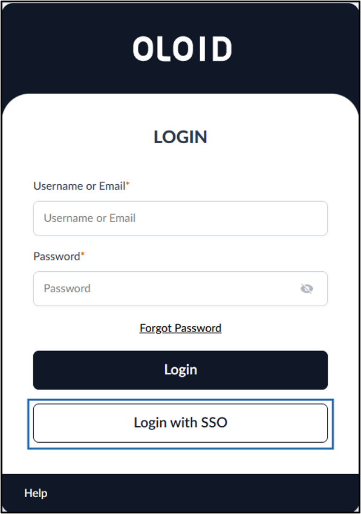
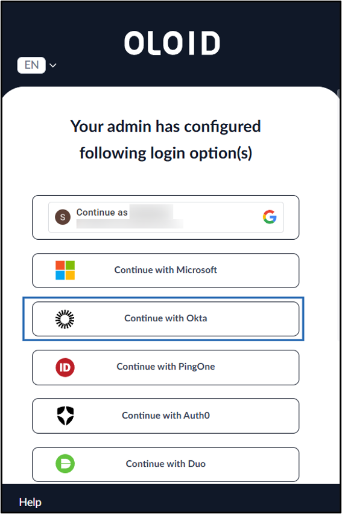
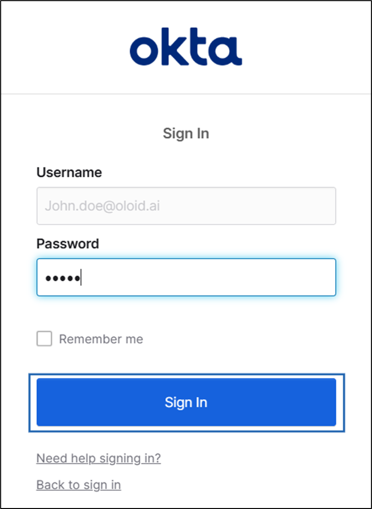
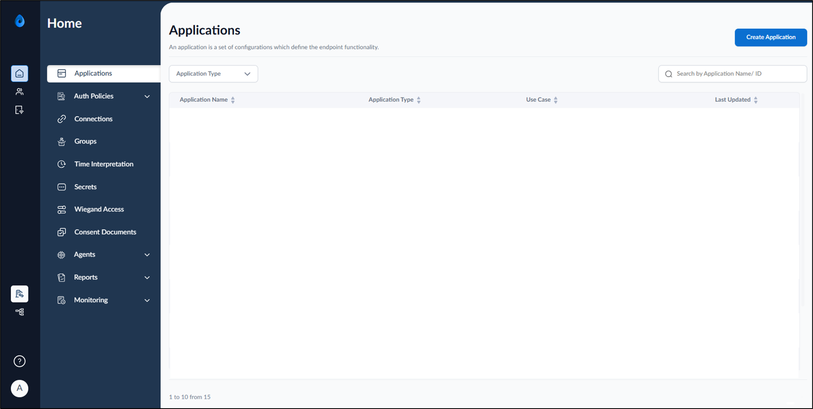

{/* Source: Intercom article 11744118 - https://oloid.help/en/articles/11744118-tenant-admin-portal-how-to-login-to-the-tenant-admin-portal-with-okta-single-sign-on-sso */}
{/* Generated by intercom_to_mintlify.py - re-running overwrites this file. */}

## Introduction

This document provides instructions to login to the Tenant Admin Portal using OKTA Single Sign-On (SSO).

## Prerequisites

- You should be a user in the Oloid Portal with **Admin/Supervisor** role.
- You must have valid OKTA login credentials.

## Steps to Login to Tenant Admin Portal using OKTA SSO

1. Launch your browser.
2. Enter the URL provided for you in the browser’s address bar > press **Enter** on your keyboard.
   The Tenant Admin Portal **Login** page is displayed.
3. Click **Login with SSO.**

   

   The **Configured login options(s)** page is displayed.
4. Click **Continue with Okta**.

   

   The Sign in pop-up box is displayed.
5. Do the following:
   1. Enter your OKTA ID in the **Username** field.
   2. Enter **Password**.
   3. Select **Remember me** to stay signed in on this device without having to re-enter your credentials each time you log in. (optional)
   4. Click **Sign In**.

      

      You are logged in to the Tenant Admin Portal using Okta SSO successfully.

      
