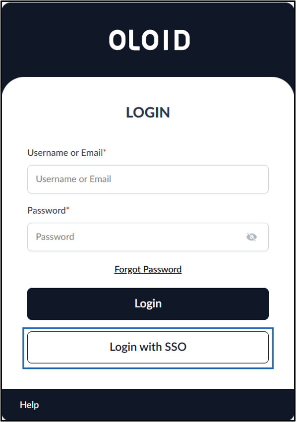
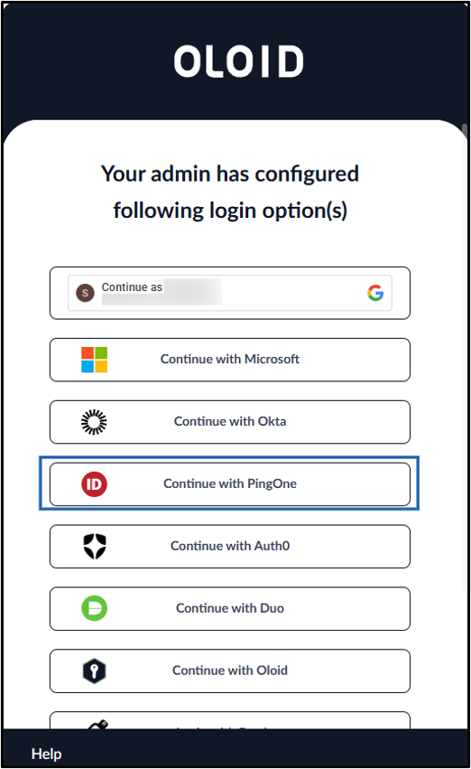
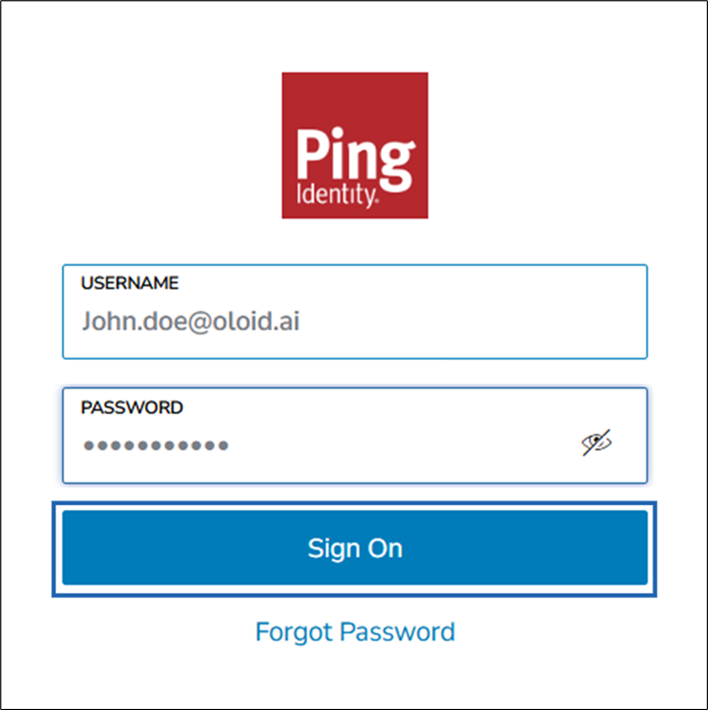
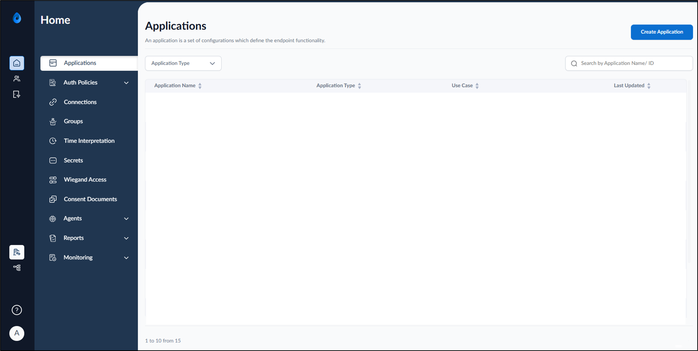

{/* Source: Intercom article 11136469 - https://oloid.help/en/articles/11136469-tenant-admin-portal-how-to-login-to-the-tenant-admin-portal-with-pingone-single-sign-on-sso */}
{/* Generated by intercom_to_mintlify.py - re-running overwrites this file. */}

## Introduction

This document provides instructions to login to the **Tenant Admin Portal** using **PingOne Single Sign-On (SSO).**

## Prerequisites

- You should be a user in the Oloid Portal with **Admin/Supervisor** role.
- You must have valid PingOne login credentials.

## Steps to Login to Tenant Admin Portal using PingOne SSO Login

1. Launch your browser.
2. Enter the URL provided for you in the browser’s address bar and press **Enter**.
   The Oloid LOGIN page is displayed.
3. Click **Login with SSO**.

   

   The configured Log in options are displayed.
4. Click **Continue with PingOne**.

   

   The Sign in pop-up box is displayed.
5. Do the following:
   1. Enter your Ping ID in the **Ping UserName** field.
   2. Enter **Password**.
   3. Click **Sign On**.

You are logged in to the Oloid Portal using PingOne SSO successfully.

