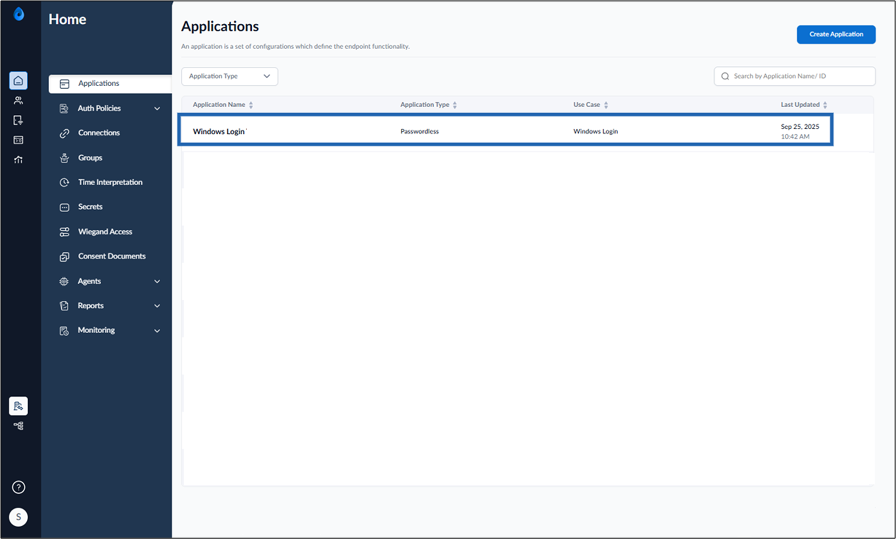
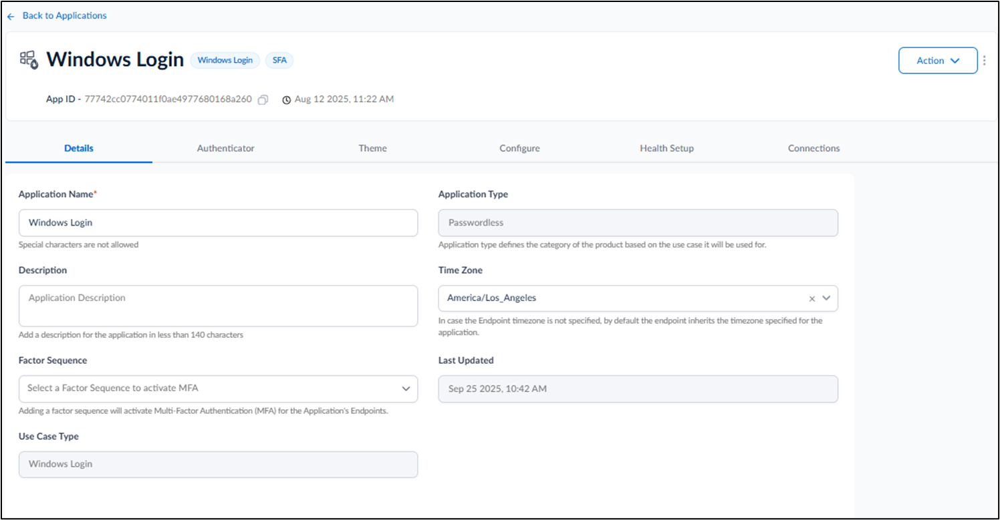
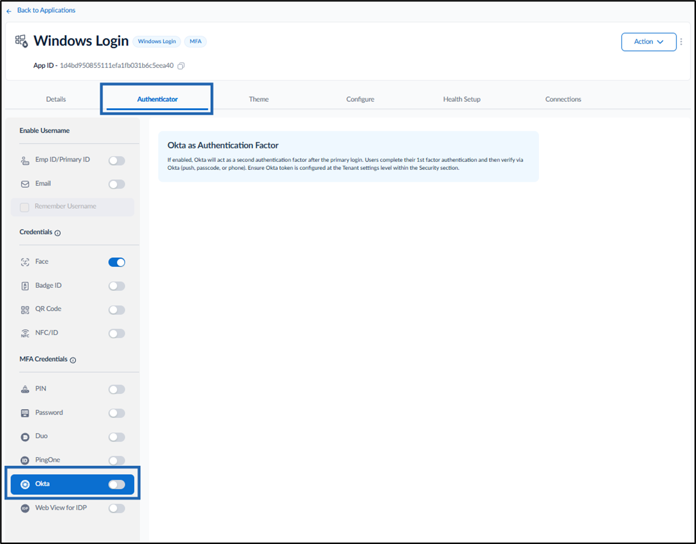
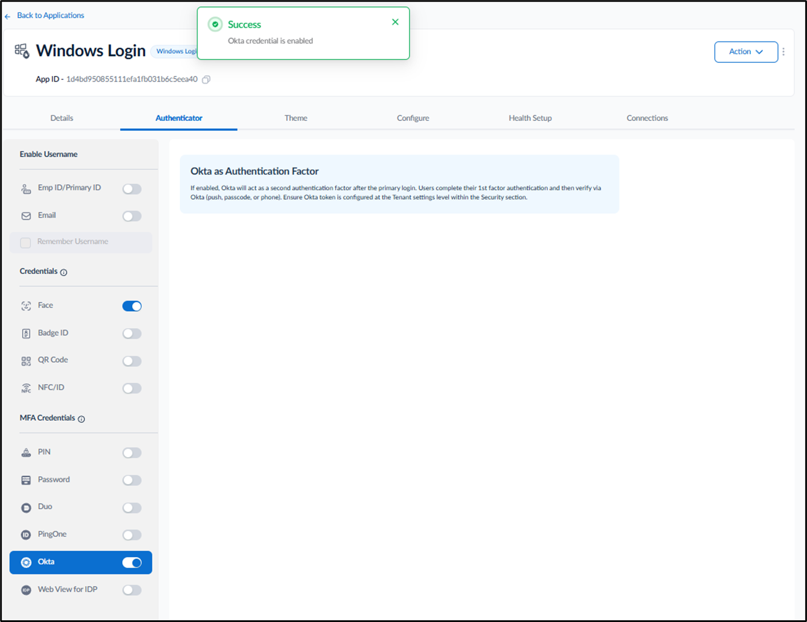

{/* Source: Intercom article 12888385 - https://oloid.help/en/articles/12888385-windows-login-how-to-enable-okta-multi-factor-authentication-mfa-credential-for-windows-login-in-the-tenant-admin-portal */}
{/* Generated by intercom_to_mintlify.py - re-running overwrites this file. */}

## Introduction

The OKTA feature in the Tenant Admin Portal allows admins to enable OKTA as a second factor authentication for the Windows Login application. When enabled with other primary factors, users can log in to endpoints using OKTA credentials as a second factor.

<Note>
  **Note:** Windows Login supports Face, Badge, QR Code and NFC/ID as primary factor.
</Note>

## Prerequisite

You must have a Tenant Admin access in the Tenant Admin Portal.

## Steps to Enable OKTA MFA

1. Log in to the **Tenant Admin Portal**.
2. On the **Applications** page, select the Windows Login application.

   

   The application page is displayed.

   

Go to the **Authenticato**r tab > **MFA Credential** > turn on **OKTA** toggle.

The OKTA MFA credential is enabled successfully.

<Note>
  **Note:** You must do the [Sync Configuration](#sync-configuration-to-apply-changes) to apply changes.
</Note>

### Sync Configuration to Apply Changes

After enabling the **OKTA MFA credential**, you must sync the configuration in the **Supervisor App** to apply the changes. For detailed steps, see [How to sync configuration in Supervisor App](/platforms/windows/supervisor-app/how-to-sync-configuration-in-supervisor-app).
