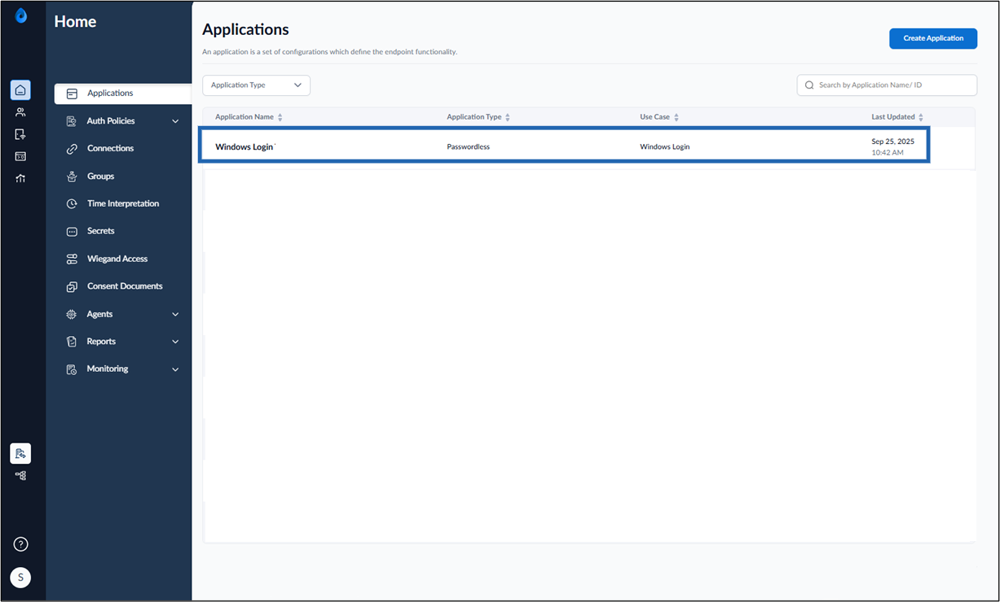
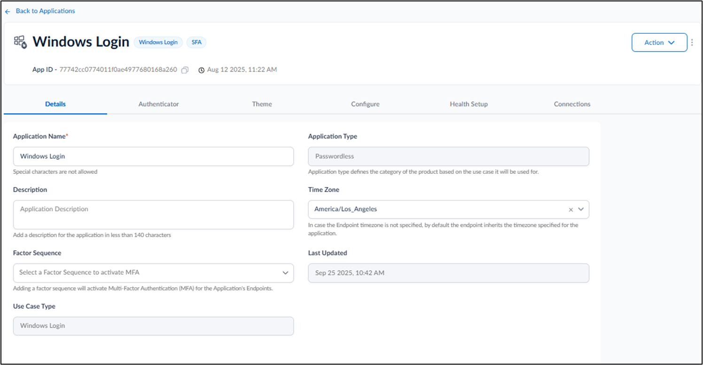
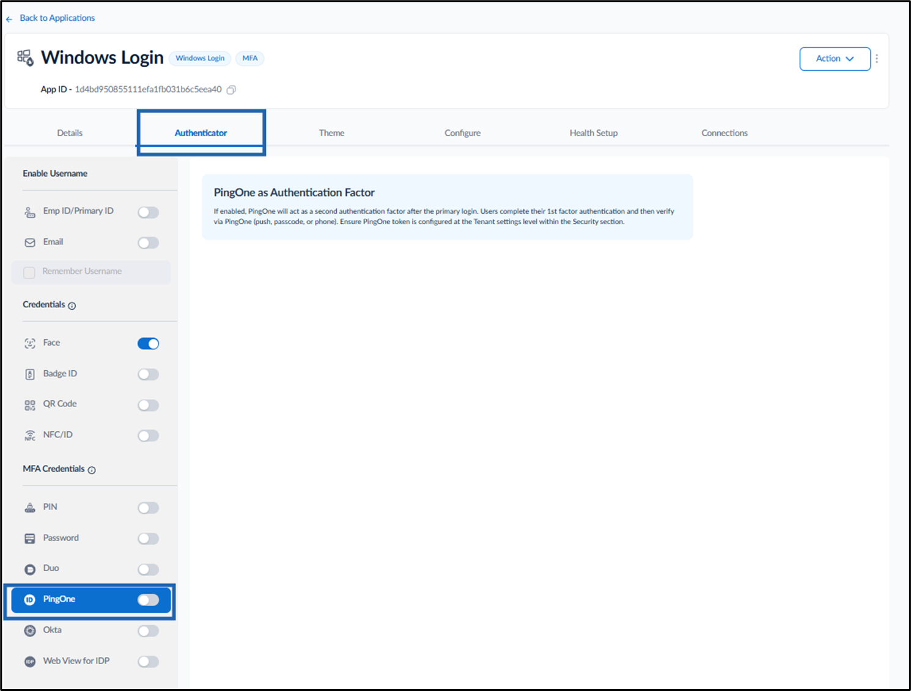
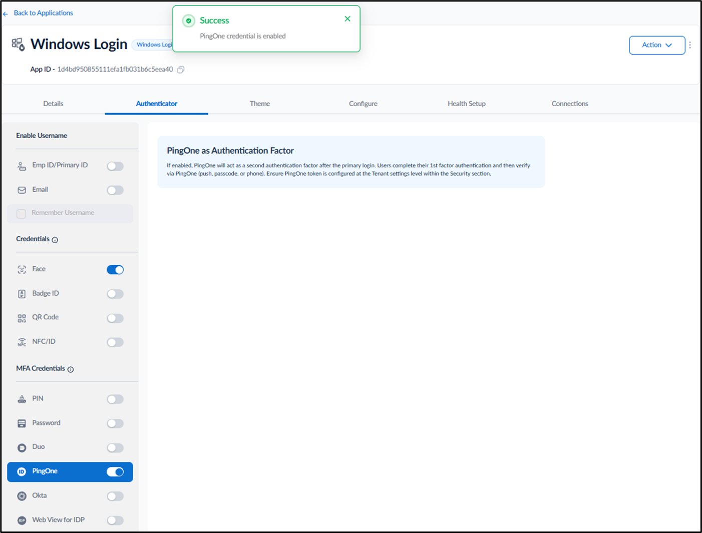

{/* Source: Intercom article 12888354 - https://oloid.help/en/articles/12888354-windows-login-how-to-enable-pingone-multi-factor-authentication-mfa-for-windows-login-in-the-tenant-admin-portal */}
{/* Generated by intercom_to_mintlify.py - re-running overwrites this file. */}

## Introduction

The PingOne feature in the Tenant Admin Portal allows admins to enable PingOne as a second factor authentication for the Windows Login application. When enabled with other primary factors, users can log in to endpoints using PingOne credentials as a second factor.

## Prerequisite

You must have a **Tenant Admin access** in the Tenant Admin Portal.

## Steps to Enable PingOne MFA

1. Log in to the **Tenant Admin Portal**.
2. On the **Applications** page, select the Windows Login application.

   

   The application page is displayed.

   

3. Go to the **Authenticato**r tab > **MFA Credential** > turn on **PingOne** toggle.

   

   The PingOne MFA credential is enabled successfully.

   <Note>
     **Note:** You must do the [Sync Configuration](#sync-configuration-to-apply-changes) to apply changes.
   </Note>

   

### Sync Configuration to Apply Changes

After enabling the **PingOne MFA credential**, you must sync the configuration in the **Supervisor App** to apply the changes. For detailed steps, see [How to sync configuration in Supervisor App](/platforms/windows/supervisor-app/how-to-sync-configuration-in-supervisor-app).

### Related Articles

[How to Configure PingOne Multi Factor Authentication (MFA) for Windows Login Application in the Tenant Admin Portal](/more/sso-and-mfa/how-to-configure-pingone-multi-factor-authentication-mfa-for-windows)
