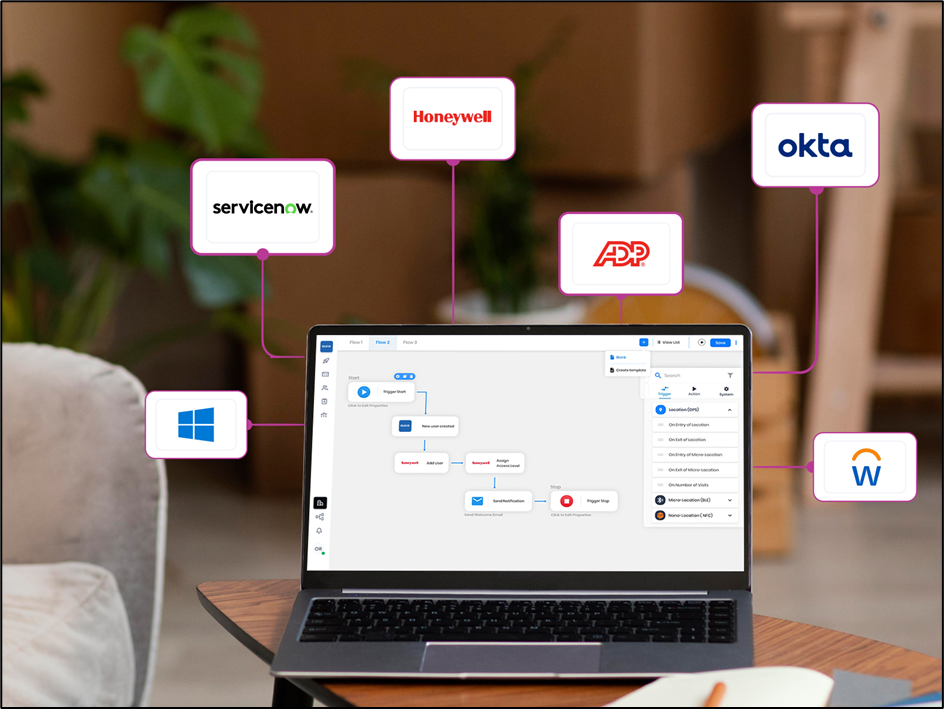

{/* Source: Intercom article 7983269 - https://oloid.help/en/articles/7983269-getting-started-with-oloid-workflow */}
{/* Generated by intercom_to_mintlify.py - re-running overwrites this file. */}

Oloid Workflow is a visual flow automation application with a no-code/low-code rule engine which supports automation of complex business processes across cloud and on-premises applications.

It provides a platform where users can create, manage, and track workflows and tasks. With Workflow, users can improve productivity by enabling teams to collaborate effectively and integrate with other business applications.

It runs as a cloud application or as an on-prem application. A tenant can have at most one cloud application and any number of on-prem applications.

Following is the architectural model of workflow on-prem instance and how it interacts with various entities.

## Features

## To get started with Oloid Workflow

Client should have following things to deploy and use Oloid Workflow.

- Access to Oloid Platform Tenant
- For on-prem application,
  - A windows machine with recommended spec.
  - Outbound network access for recommended URLs.

For more info, see [Oloid Workflow Guides List](/more/workflow/oloid-workflow-guides-list).
