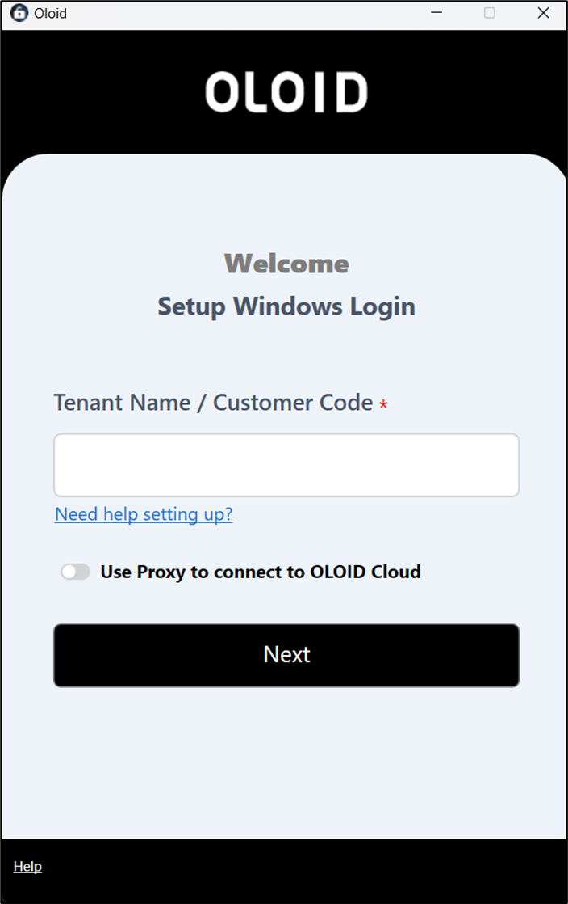
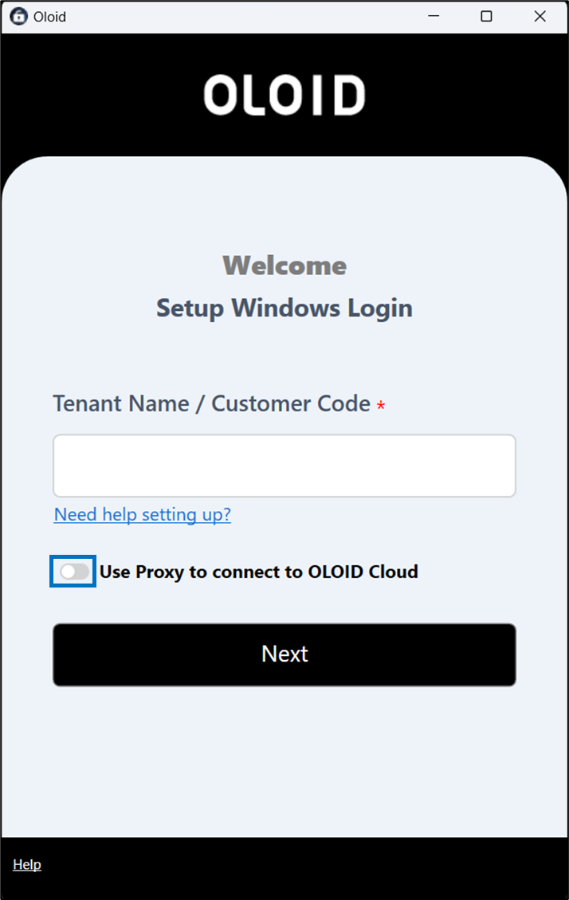
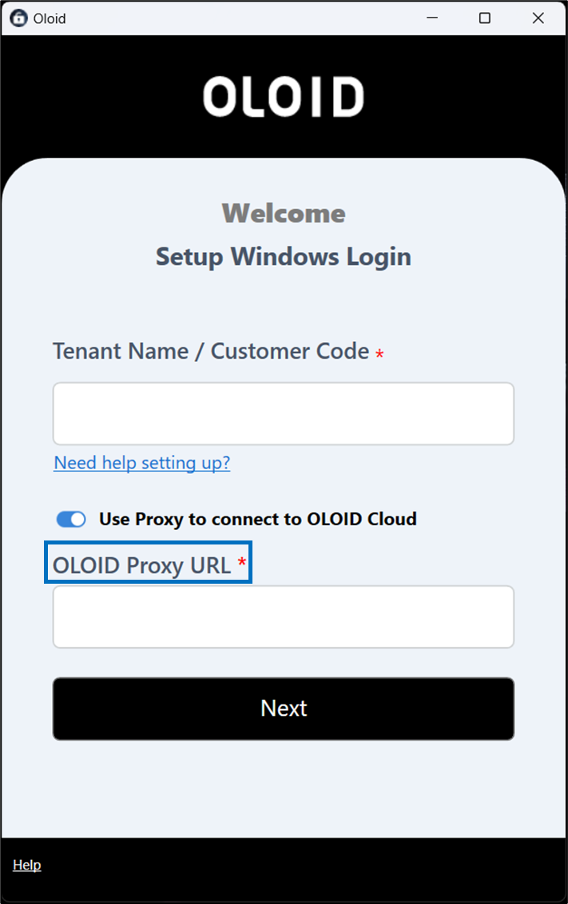
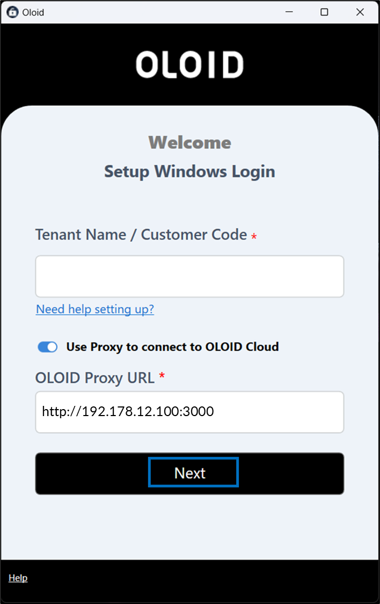
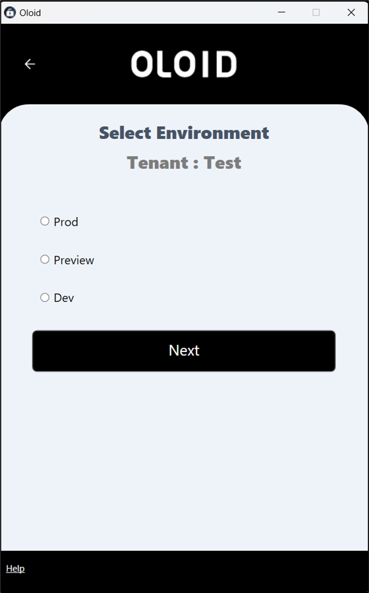
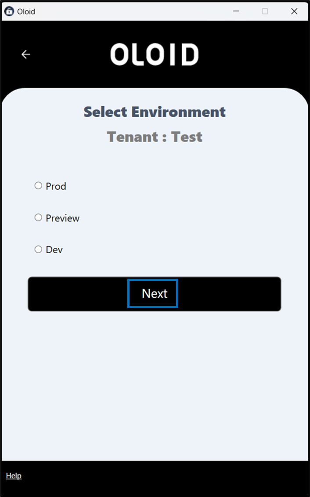
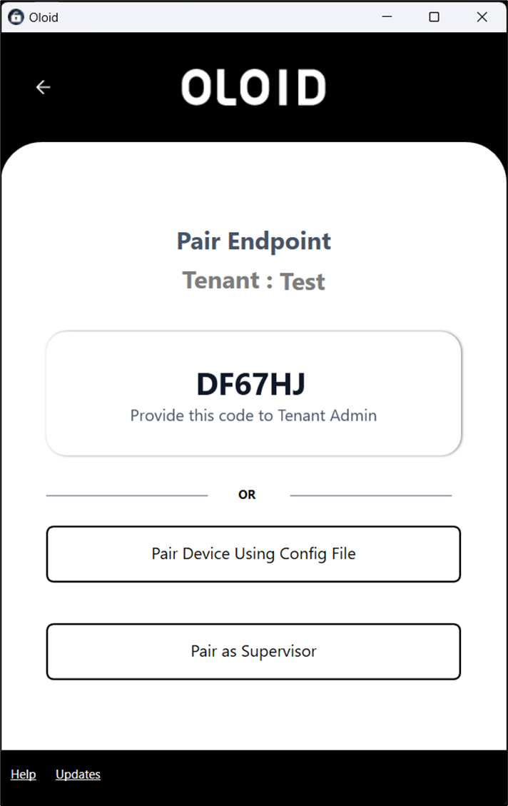

{/* Source: Intercom article 8878376 - https://oloid.help/en/articles/8878376-how-to-configure-windows-device-admin-app-with-workflow-as-a-proxy */}
{/* Generated by intercom_to_mintlify.py - re-running overwrites this file. */}

Configuring the Windows Device app with Workflow as proxy enables the device app to work offline.

Steps to configure Windows Device App:

1. Double-click on the **Windows Device** app to open.
   The **Welcome** page is displayed.

   

2. Enable **Use Proxy to connect to OLOID Cloud**.

   

3. Enter Oloid Proxy URL in the **OLOID Proxy URL** field.

   

4. Click **Next**.

   

   If the tenant name is available in different environments then **Select Environment** page is displayed.

   

5. Select an environment and click **Next**.

   

   The Windows device is configured with the tenant. You can now activate the endpoint to use the app.

   
