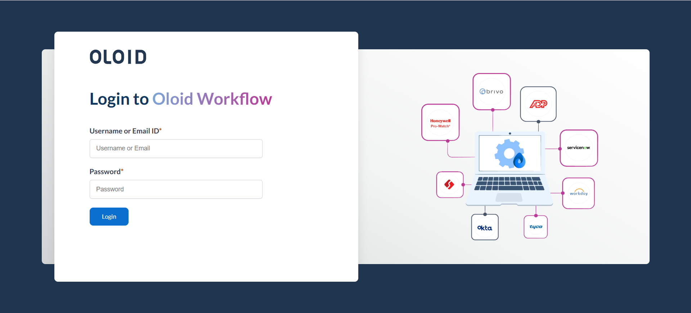
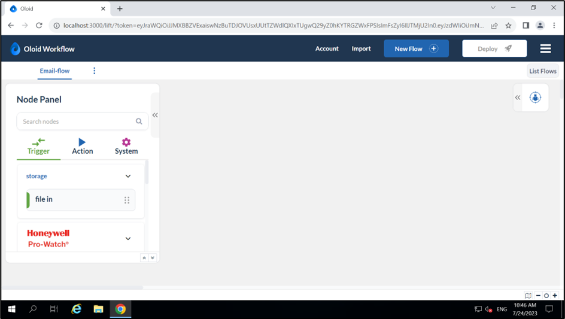
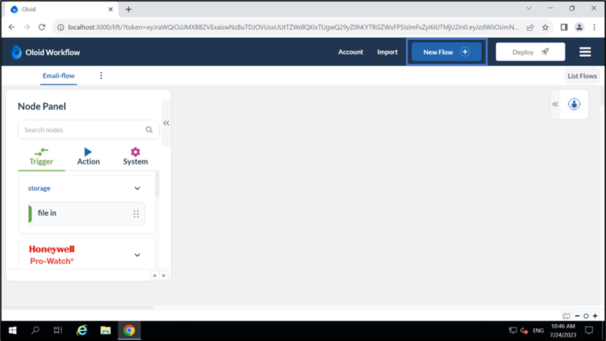
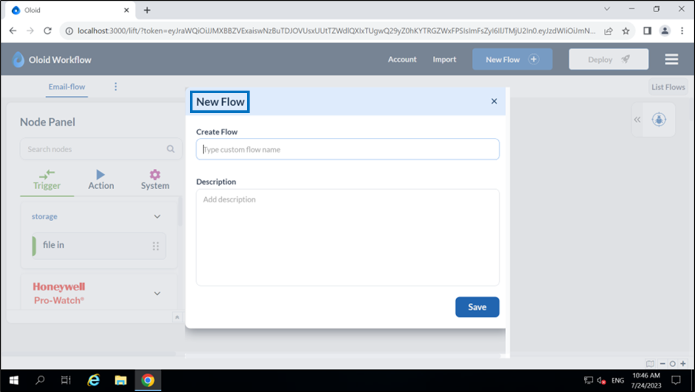
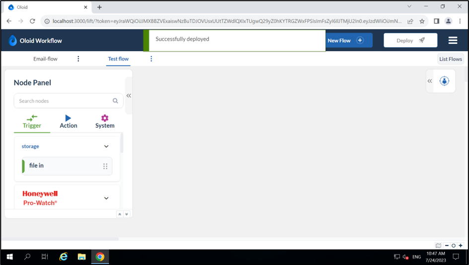
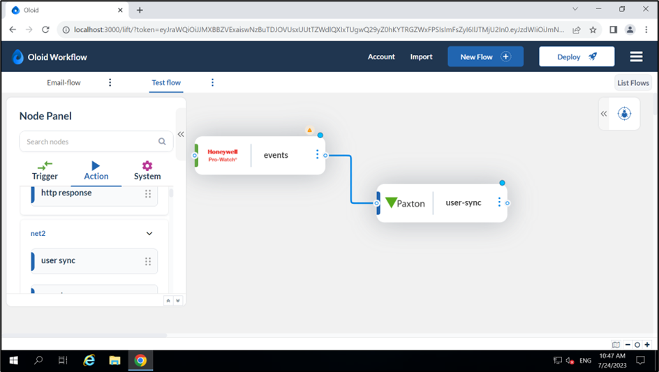

{/* Source: Intercom article 8574780 - https://oloid.help/en/articles/8574780-how-to-create-a-flow */}
{/* Generated by intercom_to_mintlify.py - re-running overwrites this file. */}

Steps to create a Flow:

1. Launch your chrome browser.
2. Enter **localhost: 3000** in your browser address bar. Then, press Enter on your keyboard.
   The Workflow Login page is displayed.

   

3. Enter username and password in the appropriate fields.
4. Click **Login**.
   The Oloid Workflow application page is displayed.

   

5. Click **New Flow** on the top menu.

   

   The **New Flow** pop-up box is displayed.

   

6. Do the following in the pop-up box:
   1. Enter name of the flow in the **Create Flow** textbox.
   2. Enter **Description**.
7. Click **Save**.
   The new blank flow is created and added as a tab in the application

   

8. Drag and drop the elements from the Node Panel to create your desired flow.

   

9. Click **Deploy.**
   The flow is successfully deployed.
