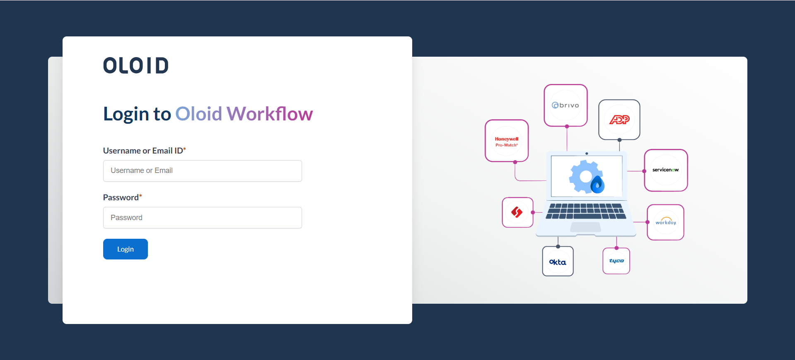
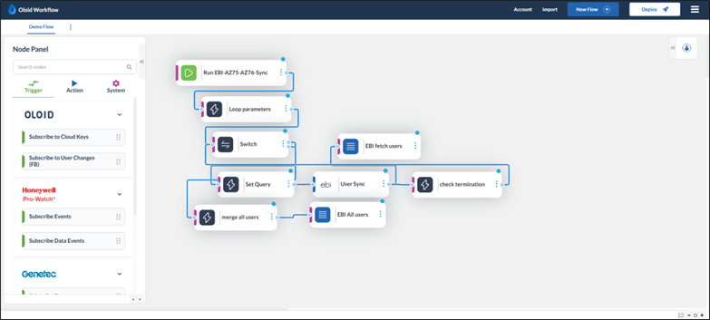
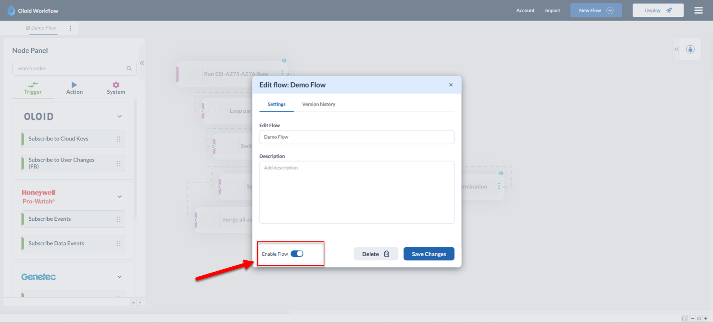
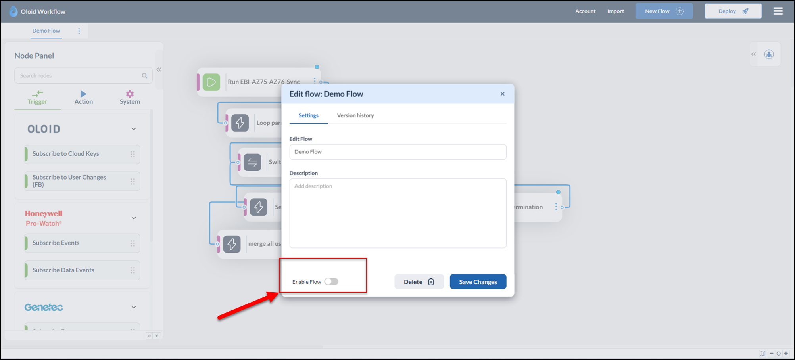

{/* Source: Intercom article 10264390 - https://oloid.help/en/articles/10264390-how-to-enable-disable-flow */}
{/* Generated by intercom_to_mintlify.py - re-running overwrites this file. */}

Pre-requisite: Flow should be imported to the application. For instructions on importing flow, see **[How to import a flow?](/more/workflow/how-to-import-a-flow)**

Steps to enable/disable flow:

1. Launch your chrome browser.
2. Enter **localhost: port number** in your browser address bar. Then, press Enter on your keyboard.

   <Note>
     **Note:** Port number should be same as used during installation.
   </Note>

   Default port number: 80
   The **Workflow Login** page is displayed.

   

3. Enter username and password in the appropriate fields.
4. Click **Login**.
   The Oloid Workflow application page is displayed.

   

5. **Double click** on the flow to edit .
   The edit flow pop-up box is displayed.

   

   

6. Turn on /off  **Enable Flow** toggle button to enable or disable the flow.

   <Note>
     **Note:** By default the toggle button is enabled.
   </Note>

7. Click **Save Changes**.
8. Next, click **Deploy**.
   The changes are saved successfully.
