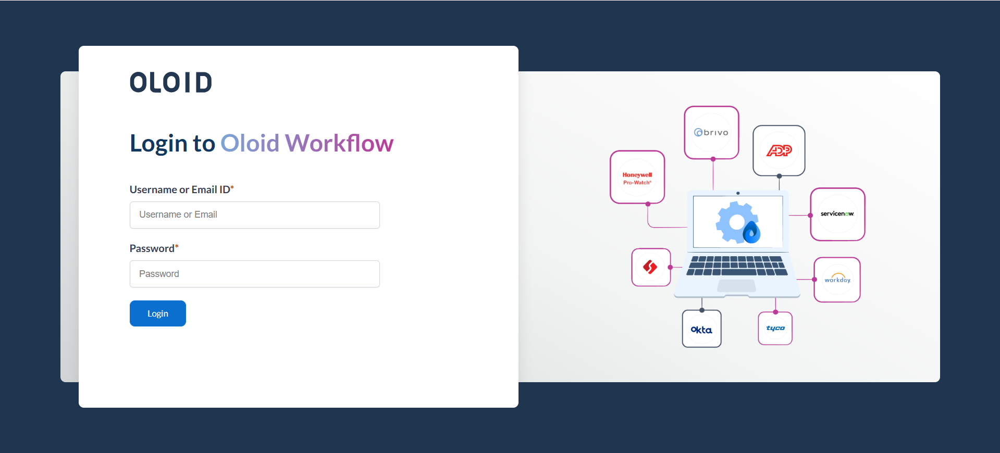
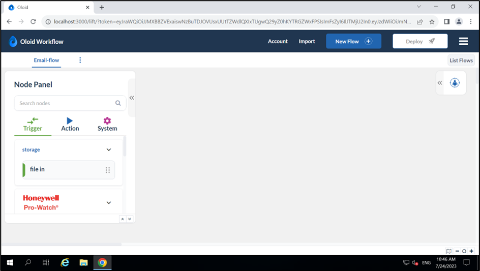
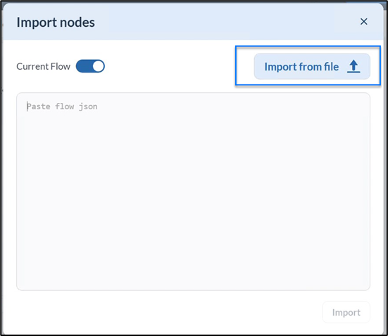
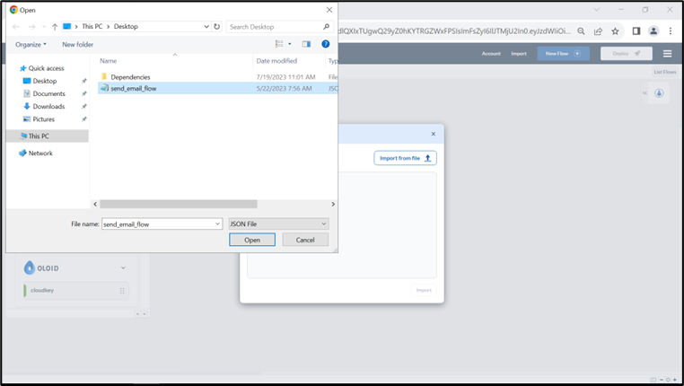
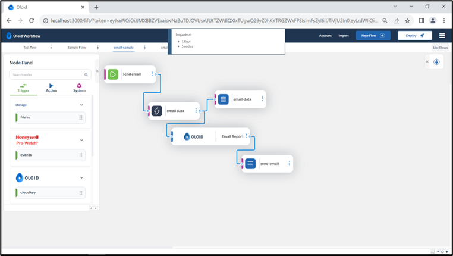
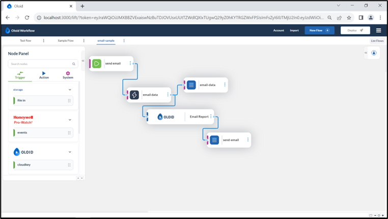

{/* Source: Intercom article 8574815 - https://oloid.help/en/articles/8574815-how-to-import-a-flow */}
{/* Generated by intercom_to_mintlify.py - re-running overwrites this file. */}

Steps to import a Flow

1. Launch your chrome browser.
2. Enter **localhost: port number** in your browser address bar. Then, press Enter on your keyboard.

   <Note>
     **Note:** Port number should be same as used during installation.
   </Note>

   Default port number: 80
   The Workflow Login page is displayed.

   

3. Enter username and password in the appropriate fields.
4. Click **Login**.
   The Oloid Workflow application page is displayed.

   

5. Click **Import** on the top menu.
   The **Import Nodes** pop-up box is displayed.
6. Click **Import from file** in the pop-up box.

   

7. Select the json file to be imported from your system.

   

   The json flow data is displayed in the **Import Nodes** window.
8. Verify the json flow data and Click **Import.**
   The file import success message is displayed. It shows the number of flows and nodes imported.

   

9. Click Deploy.
   The file is successfully deployed and displayed as a tab in the Workflow Application.

   
