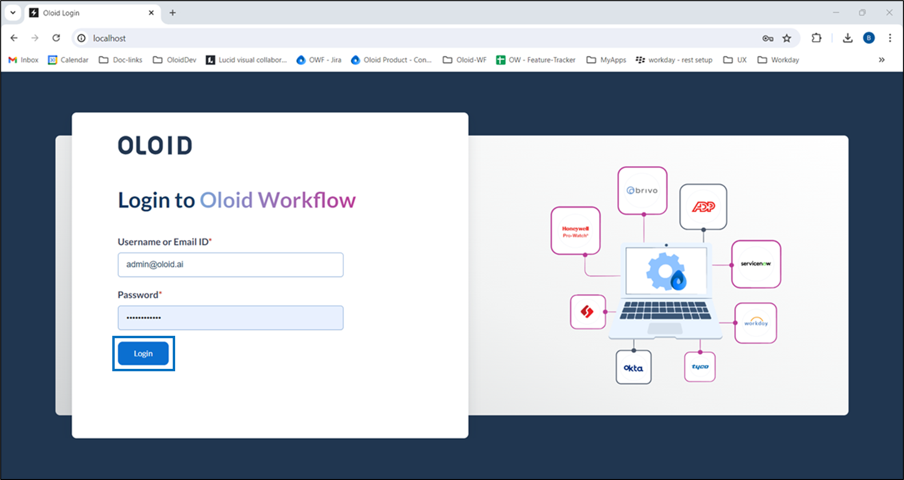
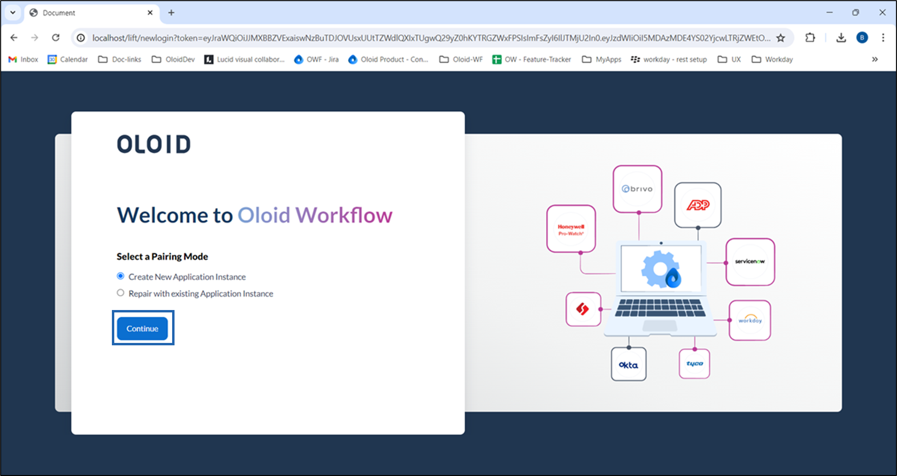
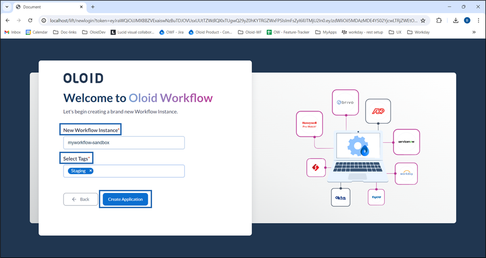
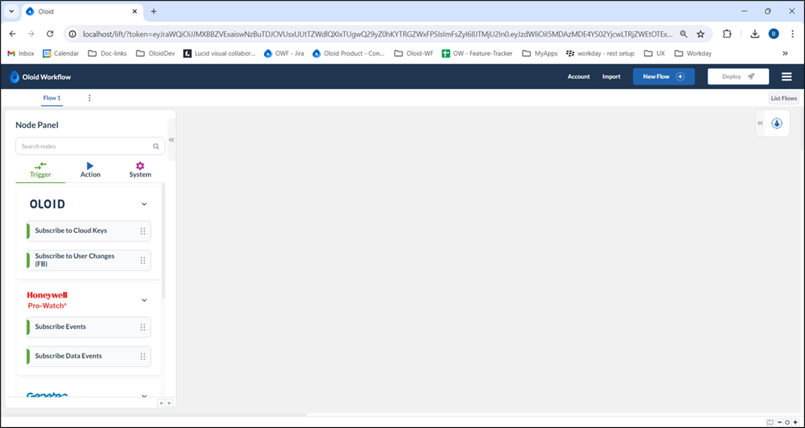

{/* Source: Intercom article 9674352 - https://oloid.help/en/articles/9674352-how-to-pair-oloid-workflow-instance-with-oloid-cloud-platform */}
{/* Generated by intercom_to_mintlify.py - re-running overwrites this file. */}

To pair Oloid Workflow instance:

1. Open your web browser and navigate to – http://localhost.
2. Enter **Tenant Admin Username** and **Password**, then Click **Login**.

   

3. Select **Create New Application Instance**, thenClick **Continue**.

   

   The Welcome page is displayed.
4. Do the following:
   1. Enter name for workflow application instance in **New Workflow Instance** field.
   2. Select appropriate tag in the **Select Tags** field
   3. Click **Create Application**.

      

      You are logged in the application.

      
