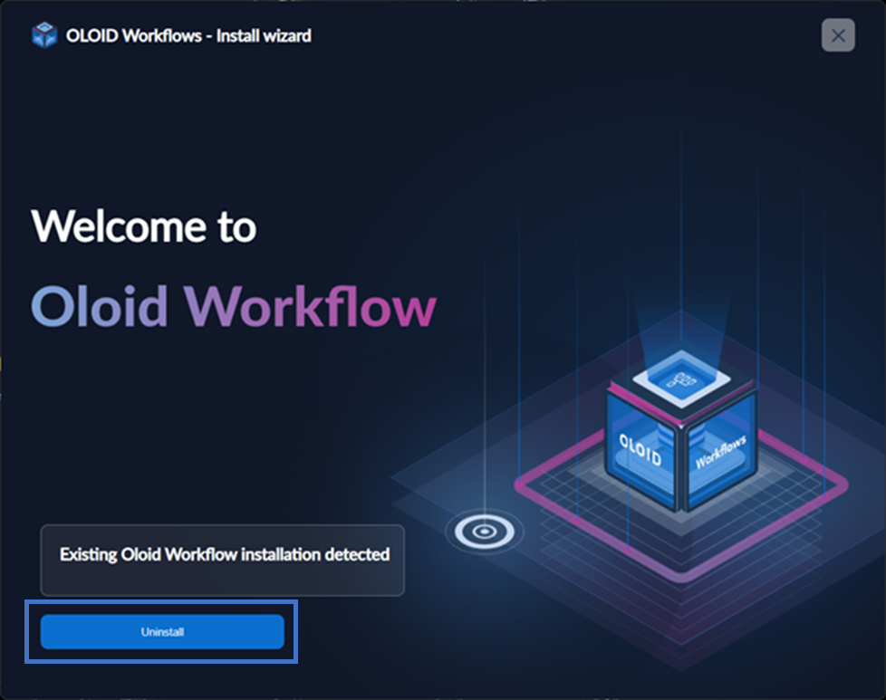
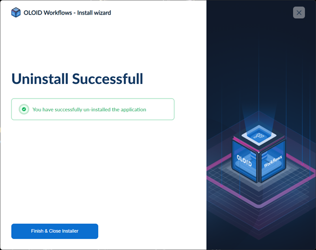
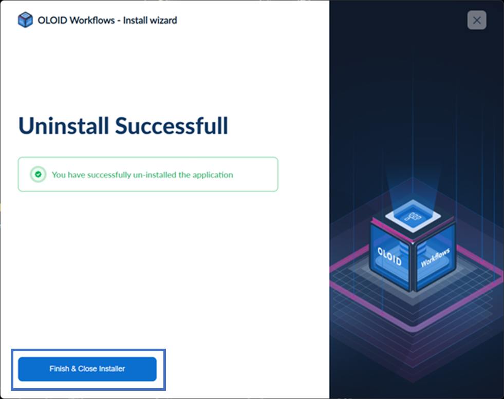

{/* Source: Intercom article 9674338 - https://oloid.help/en/articles/9674338-how-to-uninstall-oloid-workflow */}
{/* Generated by intercom_to_mintlify.py - re-running overwrites this file. */}

To uninstall:

1. Right click & open **Oloid Workflow Installer** with **Run as Administrator** option.
   The installer will auto detect existing installation and requests for **Uninstall**.
2. Click **Uninstall** to proceed.

   

3. A windows pops up to show the uninstallation progress.

   

4. Once the installation is complete, a confirmation message will appear. To close the installer, click **Finish & Close Installer**.

   
