{/* Source: Intercom article 9717036 - https://oloid.help/en/articles/9717036-how-to-upgrade-oloid-workflow */}
{/* Generated by intercom_to_mintlify.py - re-running overwrites this file. */}

**To upgrade Oloid Workflow, follow the below steps:**

1. Take a back up of **Flows** via export feature. See, [How to export Flows](#how-to-export-flows)
2. Stop the Oloid Workflow Service. See, [How to stop the Service](#how-to-stop-the-service)
3. Uninstall the Oloid Workflow Software. See, [How to uninstall Oloid Workflow](#how-to-uninstall-oloid-workflow)
   Do not delete the folder C:\Oloid
4. Install new version of Oloid workflow. See, [How to install Oloid Workflow](#how-to-install-oloid-workflow)
5. Restart Oloid Workflow Services.
6. Import the Flows that were taken as backup. See, [How to import Flows](#how-to-import-flows)

<Note>
  **Note:**

  **Windows Upgrades** :
</Note>

- Oloid Workflow application is supported across Windows Server upgrades. Windows upgrades typically occur once every 3-5 years. The application is designed to maintain compatibility through these upgrades with minimal disruptions.

**Integration Application Upgrades :**

- Oloid Workflow application is supported across integration application upgrades, including systems like **ProWatch**, **Lenel OnGuard**, **S2 NetBox** and others. The application manages forward and backward compatibility to ensure seamless operation across different versions of these integrated systems.

## Reference Documents

### How to export Flows

#### Steps to export a Flow

1. Launch the workflow on prem machine.
2. Navigate to the localhost URLin your browser address bar. Then, press Enter on your keyboard.
   The Workflow Login page is displayed.

   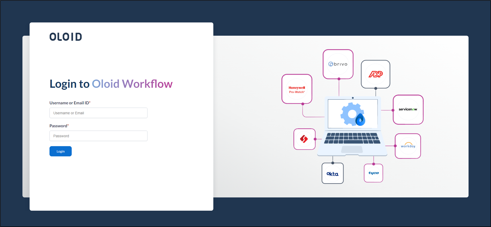

3. Enter username and password in the appropriate fields.
4. Click **Login**.
   The Oloid Workflow application page is displayed.

   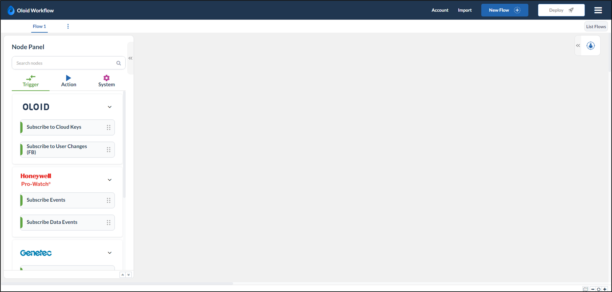

5. Click navigation menu  icon on the top right corner.
   The list of options is displayed.
6. Select **Export** to export the flows.

   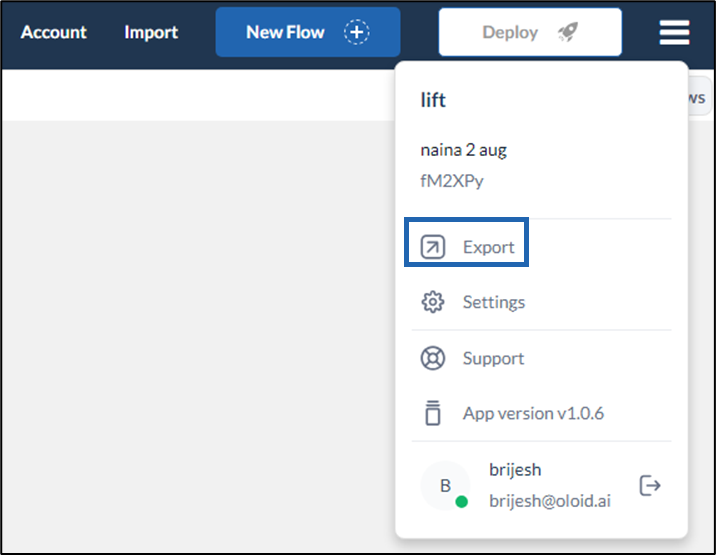

   The **Export Nodes** pop-up box is displayed.

   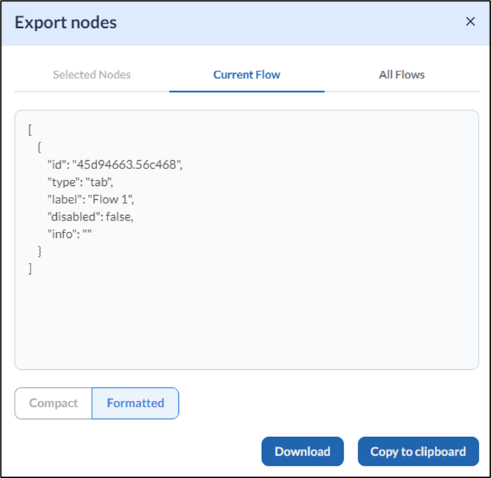

7. Select **All Flows** tab, then click **Download**.

   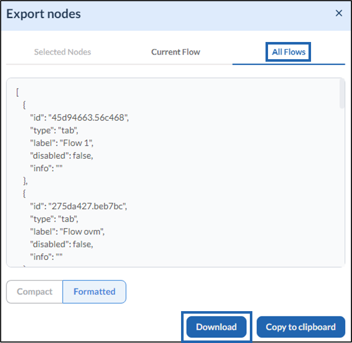

   The json flow is downloaded to your local device.

---

### How to stop the Service

#### Steps to stop the Service

1. Search **Services** in the Start menu and select it from the corresponding result.
   The Services window is displayed.
2. Select Oloid Workflow.
3. Then right-click on the service, select **Stop**, and wait for the service to stop.

   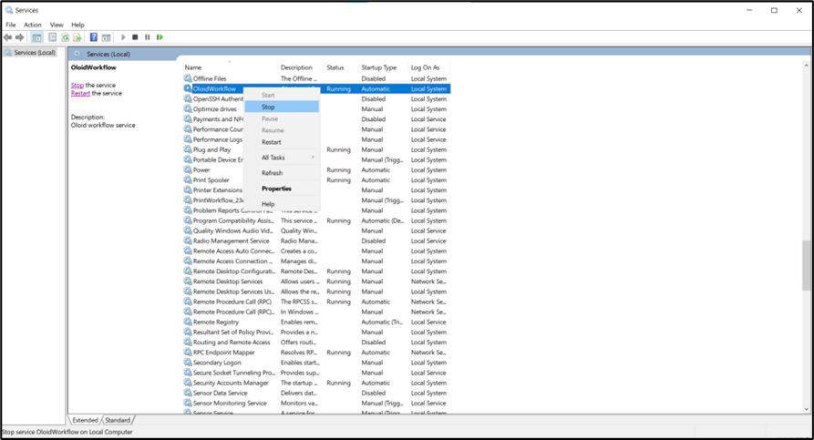

   The Oloid Workflow Services will be stopped.

---

### How to uninstall Oloid Workflow

#### To uninstall

1. Right click & open **Oloid Workflow Installer** with **Run as Administrator** option.
   The installer will auto detect existing installation and requests for **Uninstall**.
2. Click **Uninstall** to proceed.

   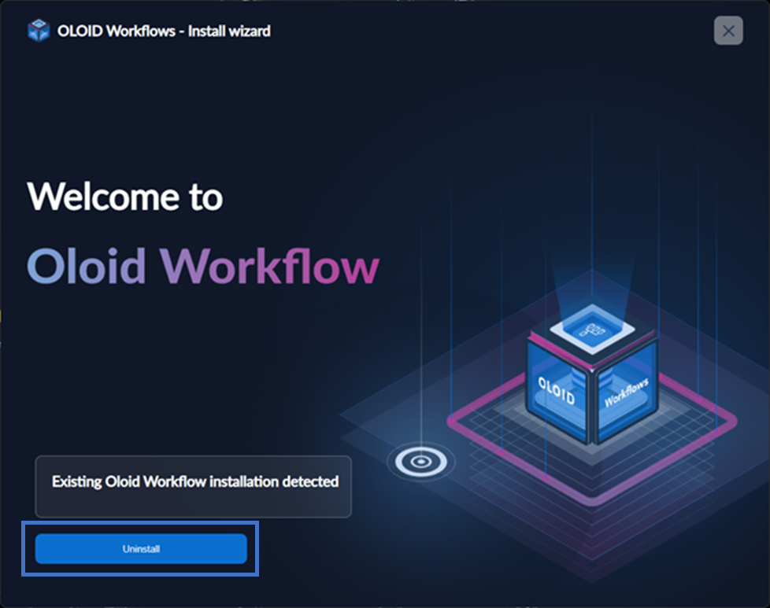

3. A windows pops up to show the uninstallation progress.

   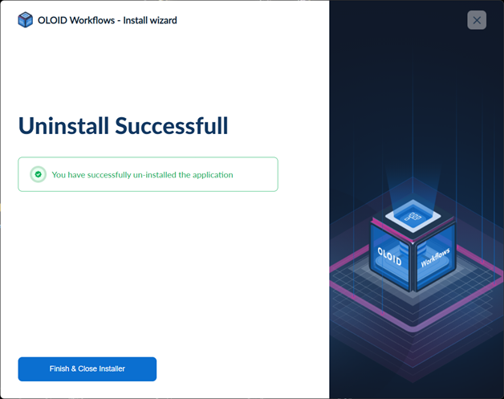

4. Once the installation is complete, a confirmation message will appear. To close the installer, click **Finish & Close Installer**.

   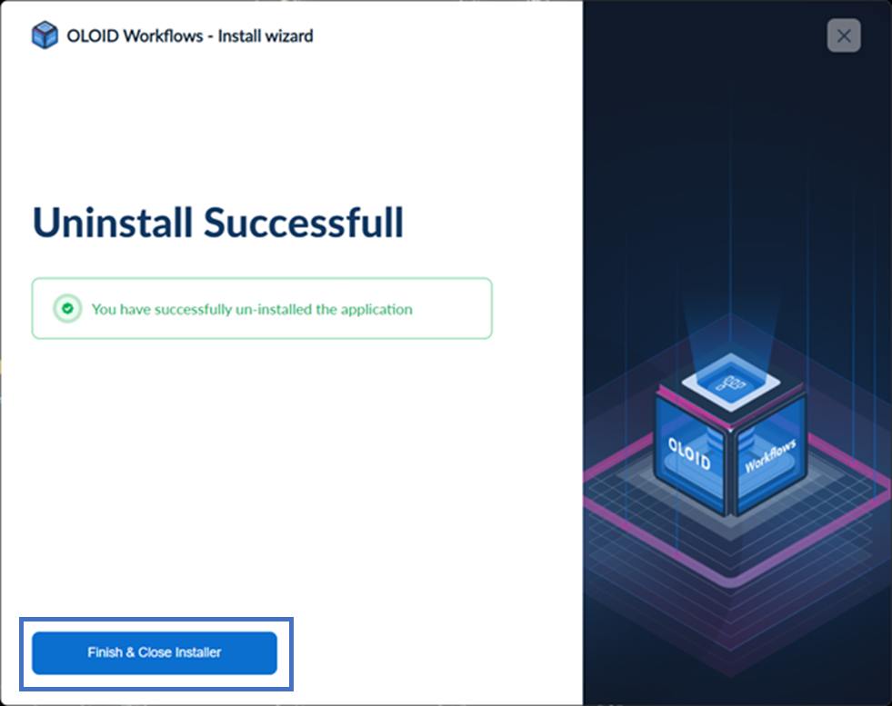

---

### How to install Oloid Workflow

#### Steps to Install Oloid-Workflow

1. Right-click & open **Oloid Workflow Installer** with **Run as Administrator** option.
2. Select **Installation mode** and click **Initiate Installation**.
   (In Online mode, the installer will fetch necessary install files from internet)
   (In Offline mode, the installer will fetch necessary install files from build.zip file shared by Oloid executive)

   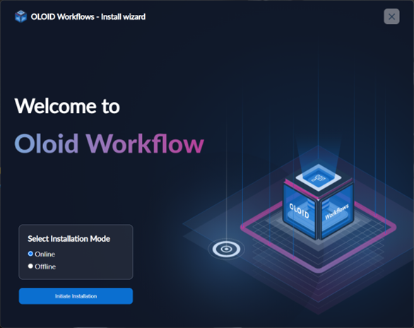

3. Click **Continue**.

   <Note>
     **Note:** The installer will do various checks and show the status here. In case, installer detects any failure, please contact Oloid executive with screenshot.
   </Note>

   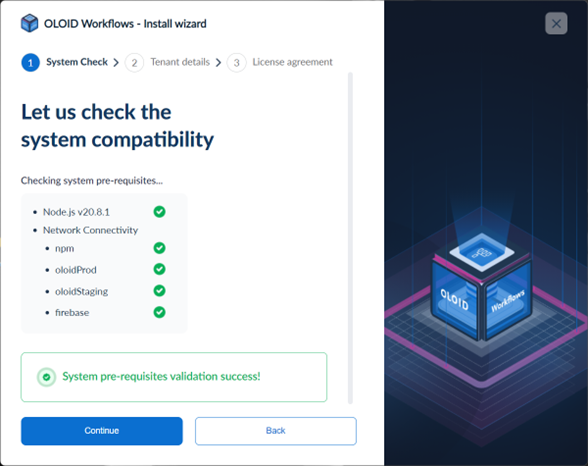

4. Fill in the required details – Please talk to Oloid executive for this information.
   1. Tenant Name – Please talk to Oloid executive for this information
   2. Tenant ID – Please talk to Oloid executive for this information
   3. Choose Installer version – Please talk to Oloid executive for this information
   4. Installation Path – local path where application will be installed
   5. Port – default is 80
   6. Installation environment – UAT for sandbox, Prod for Production

      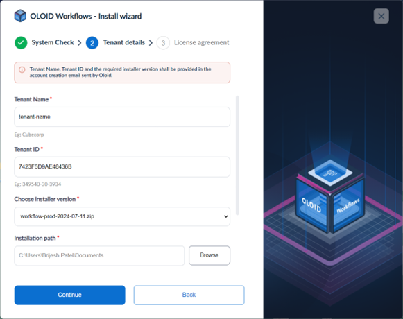

      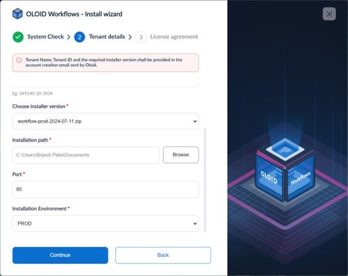

5. Check the license agreement and Click **Install**.

   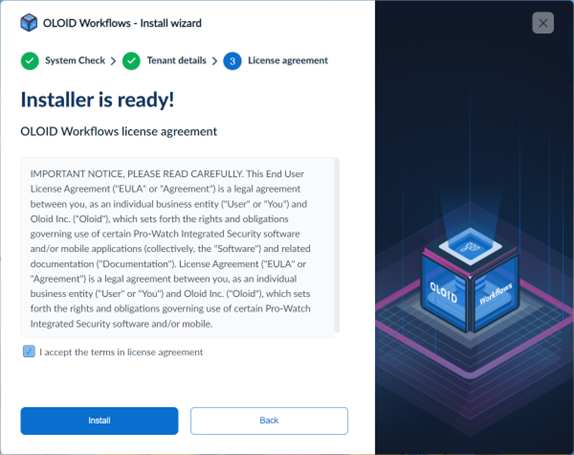

6. Wait till the installation is complete.

   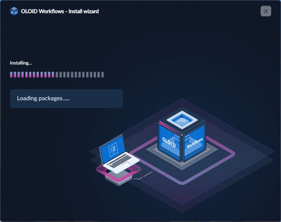

7. Installation Progress will be shown here.

   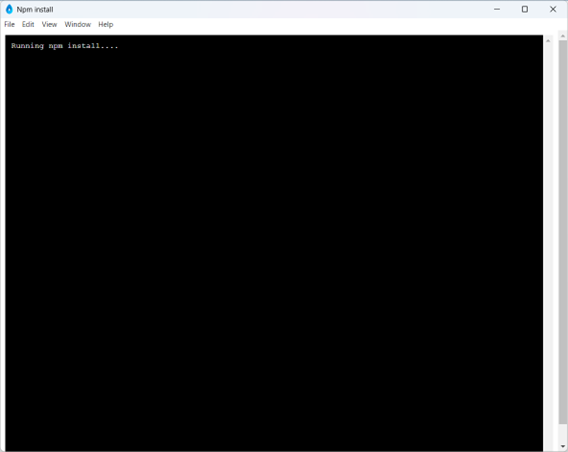

8. Installation is complete.
9. Click **Finish and Open Application**.

   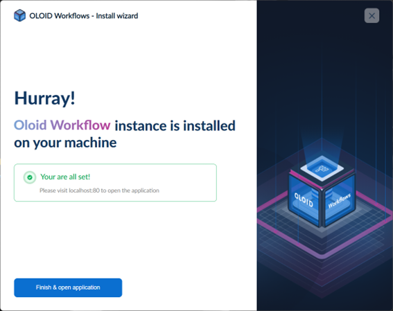

Post Installation

To pair Oloid Workflow instance with Oloid Cloud Platform, refer [How to pair Oloid Workflow instance with Oloid Cloud Platform](/more/workflow/how-to-pair-oloid-workflow-instance-with-oloid-cloud-platform)

---

### How to import Flows

#### Steps to import a Flow

1. Launch the workflow on prem machine.
2. Navigate to the localhost URLin your browser address bar. Then, press Enter on your keyboard.
   The Workflow Login page is displayed.

   

3. Enter username and password in the appropriate fields.
4. Click **Login**.
   The Oloid Workflow application page is displayed.

   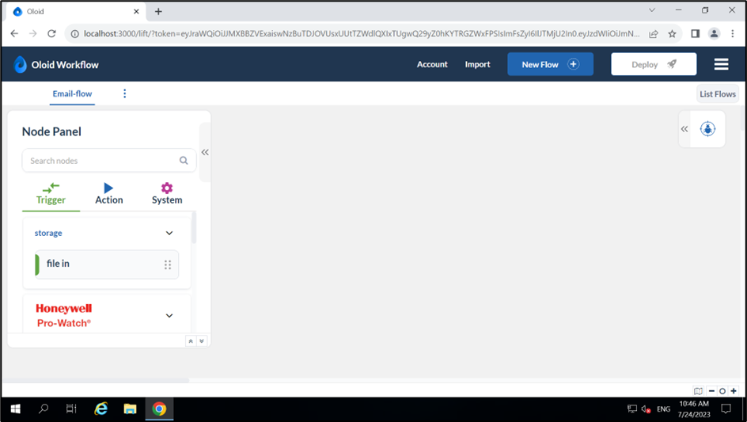

5. Click **Import** on the top menu.
   The **Import Nodes** pop-up box is displayed.
6. Click **Import from file** in the pop-up box.

   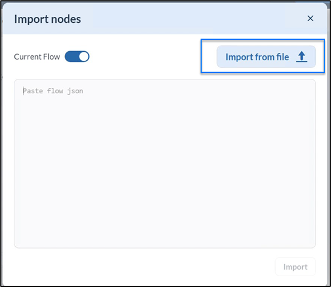

7. Select the json file to be imported from your system.

   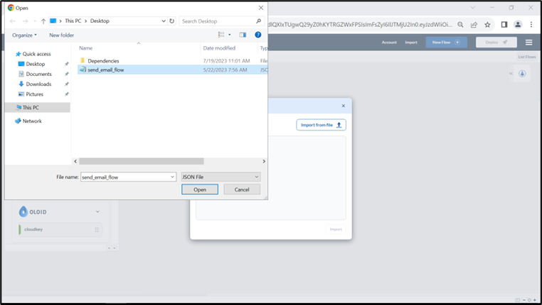

   The json flow data is displayed in the **Import Nodes** window.
8. Verify the json flow data and Click **Import.**
   The file import success message is displayed. It shows the number of flows and nodes imported.

   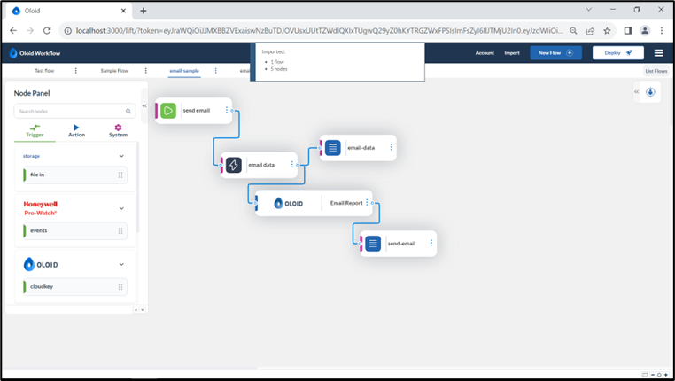

9. Click Deploy.
   The file is successfully deployed and displayed as a tab in the Workflow Application.

   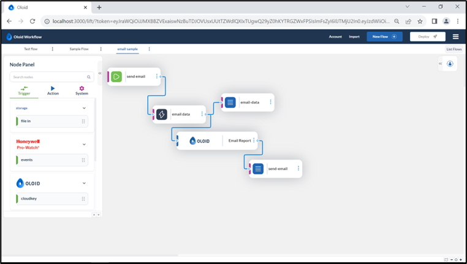
