{/* Source: Intercom article 8052890 - https://oloid.help/en/articles/8052890-instruction-for-workflow-instance-setup */}
{/* Generated by intercom_to_mintlify.py - re-running overwrites this file. */}

## Applications to be installed

1. Node JS v22.18.0 (prerequisite)
2. Oloid Workflow application

## Installation Procedure

### Steps to Install Node JS

1. Double-click on **node-v22.18.0** and click **Next** on the pop-up screen to continue with the installation.

   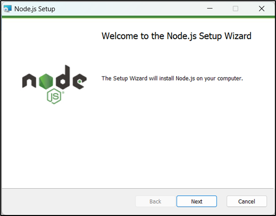

2. Accept the license agreement and click **Next**.

   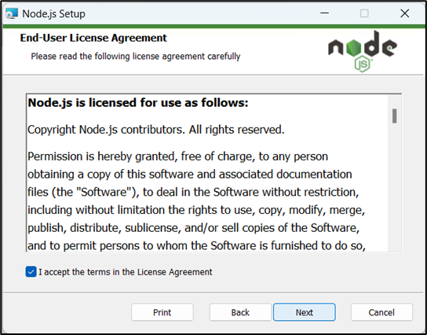

3. Click **Next** on **Destination Folder** screen.

   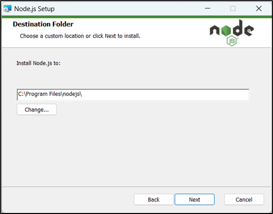

4. Click **Next** on **Custom Setup** screen.

   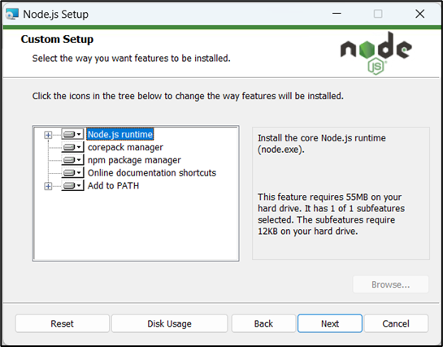

5. Click **Next**.

   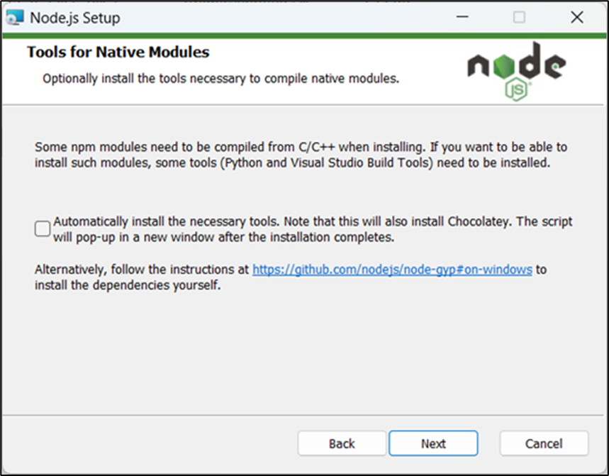

6. Click **Install**.

   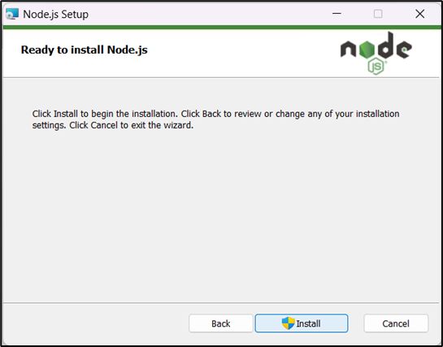

7. Click **Finish**.

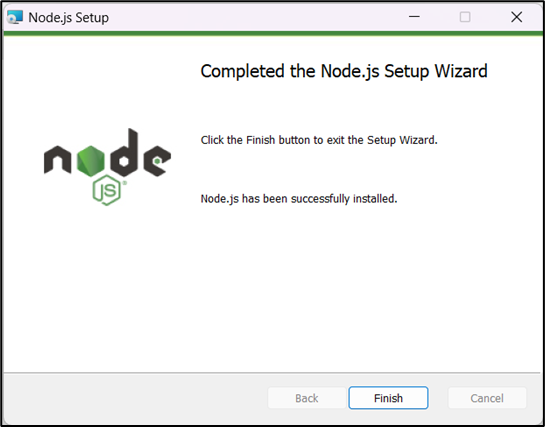

### Steps to Install Oloid-Workflow

1. Right-click & open **Oloid Workflow Installer** with **Run as Administrator** option.
2. Select **Installation mode** and click **Initiate Installation**.
   (In Online mode, the installer will fetch necessary install files from internet)
   (In Offline mode, the installer will fetch necessary install files from build.zip file shared by Oloid executive)

   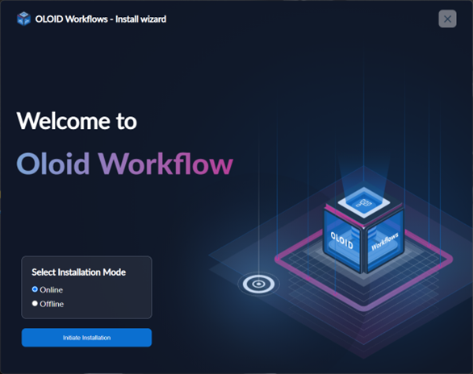

3. Click **Continue**.

   <Note>
     **Note:** The installer will do various checks and show the status here. In case, installer detects any failure, please contact Oloid executive with screenshot.
   </Note>

   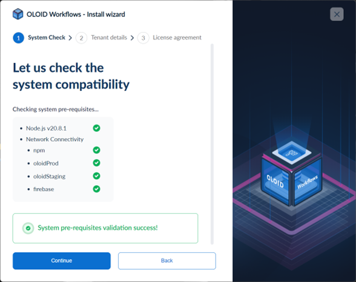

4. Fill in the required details – Please talk to Oloid executive for this information.
   1. Tenant Name – Please talk to Oloid executive for this information
   2. Tenant ID – Please talk to Oloid executive for this information
   3. Choose Installer version – Please talk to Oloid executive for this information
   4. Installation Path – local path where application will be installed
   5. Port – default is 80
   6. Installation environment – UAT for sandbox, Prod for Production

      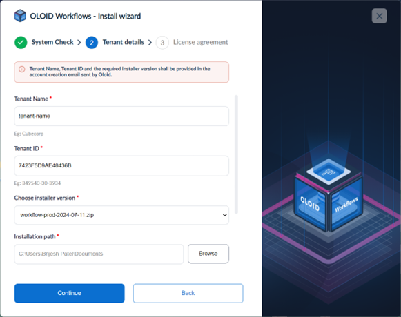

      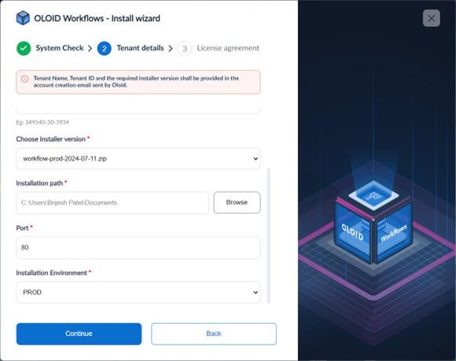

5. Check the license agreement and Click **Install**.

   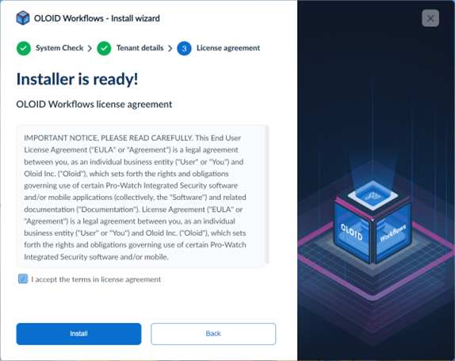

6. Wait till the installation is complete.

   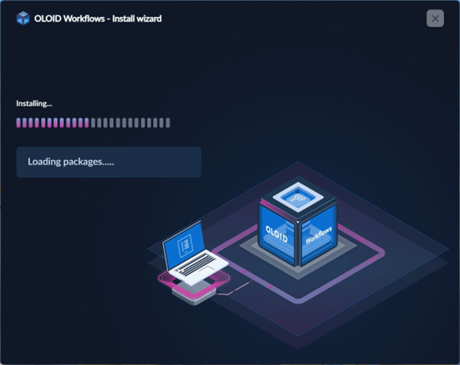

7. Installation Progress will be shown here.

   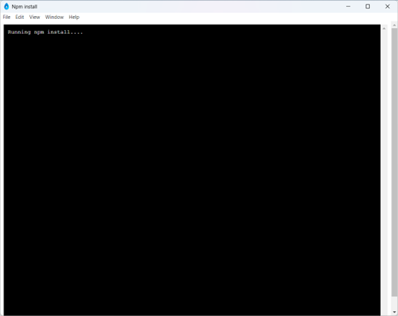

8. Installation is complete.
9. Click **Finish and Open Application**.

   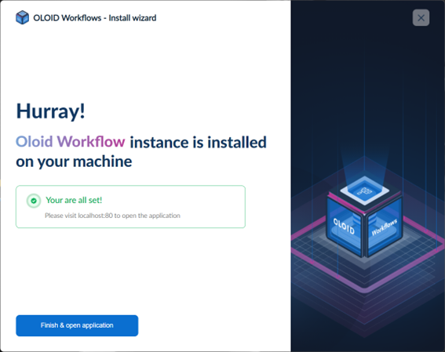

## Post Installation

To pair Oloid Workflow instance with Oloid Cloud Platform, refer [How to pair Oloid Workflow instance with Oloid Cloud Platform](/more/workflow/how-to-pair-oloid-workflow-instance-with-oloid-cloud-platform)

## Related Document

### Uninstalling Oloid Workflow

To uninstall oloid workflow, refer [How to uninstall Oloid Workflow](/more/workflow/how-to-uninstall-oloid-workflow)
