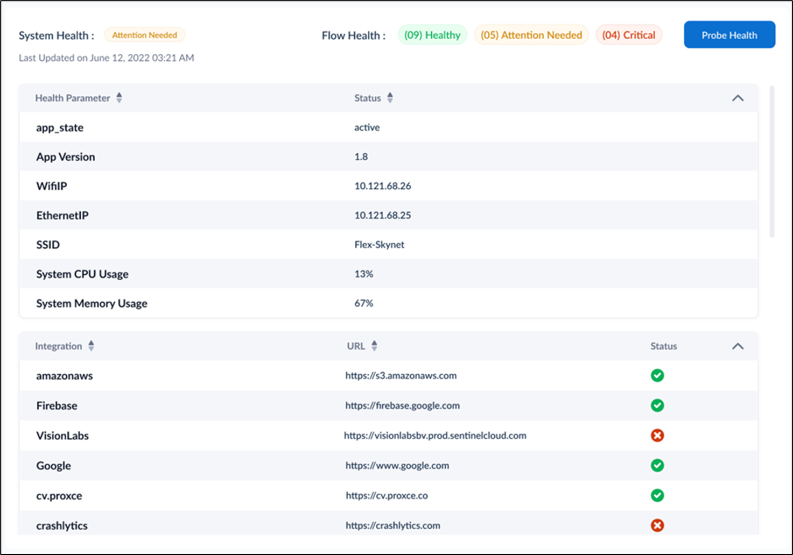

{/* Source: Intercom article 7041126 - https://oloid.help/en/articles/7041126-monitoring-health-status */}
{/* Generated by intercom_to_mintlify.py - re-running overwrites this file. */}

Based on the health parameters evaluation, the application's health status is decided among – Healthy, Needs attention, Offline, Critical, and Unknown. Also, the detailed health response is available to view on the platform.

Users can also **Probe health** to trigger a real-time health check.

## Health Response UI

