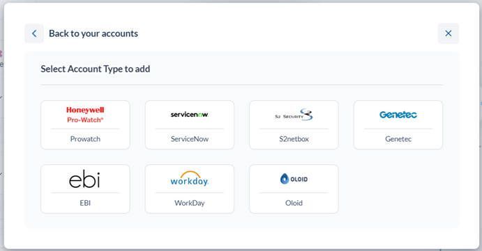
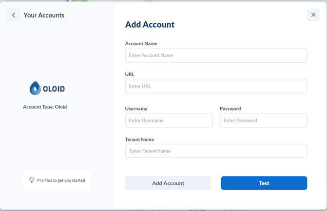
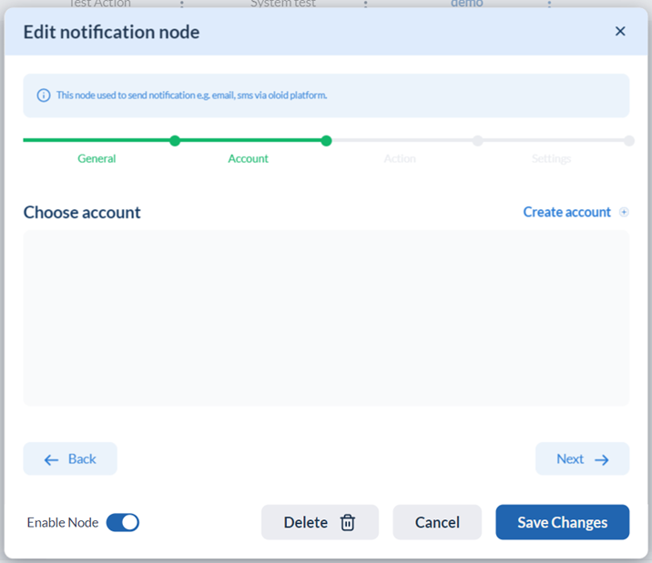

{/* Source: Intercom article 7044331 - https://oloid.help/en/articles/7044331-oloid-account */}
{/* Generated by intercom_to_mintlify.py - re-running overwrites this file. */}

Oloid account will help users to invoke certain utility actions. To add an Oloid account, you will need the following information.

## Steps to add Oloid Account

1. Click **Accounts** on top right of main page.

The Accounts pop-up box is displayed.

2. Select **Oloid** from the displayed accounts.

The **Add Account** pop-up screen is displayed.

3. To add an Oloid account, you will need the following information.

| Field | Description |
| --- | --- |
| Account Name | A unique name that identifies which Oloid account it is connected to. |
| URL | A Oloid tenant URL. |
| Username | Username to connect to Oloid tenant. |
| Password | Password to connect to Oloid tenant. |
| Tenant Name | Name of the Oloid tenant |

4. Click **Test to test for connectivity & validating the credentials** (optional but recommended)

5. Click **Add Account**.

The Account is created and listedonn the Accounts page.

## How to associate Oloid Account to a Trigger/Action Node

While creating a flow, whenever you are using ProWatch action/trigger node, you can associate Oloid account in the second tab of node config pop-up box.

