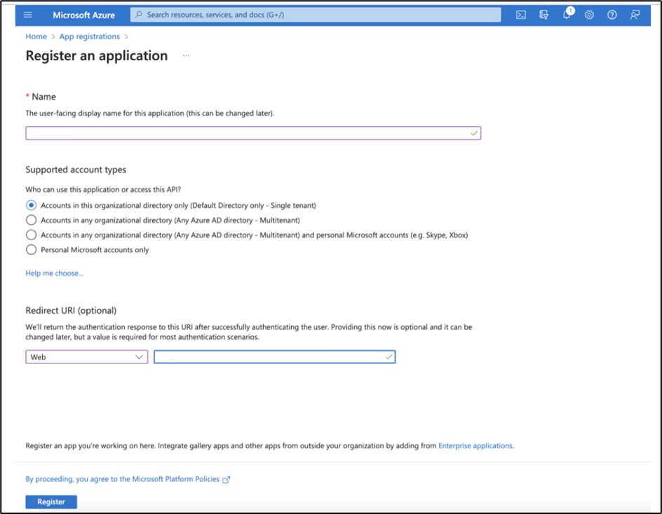
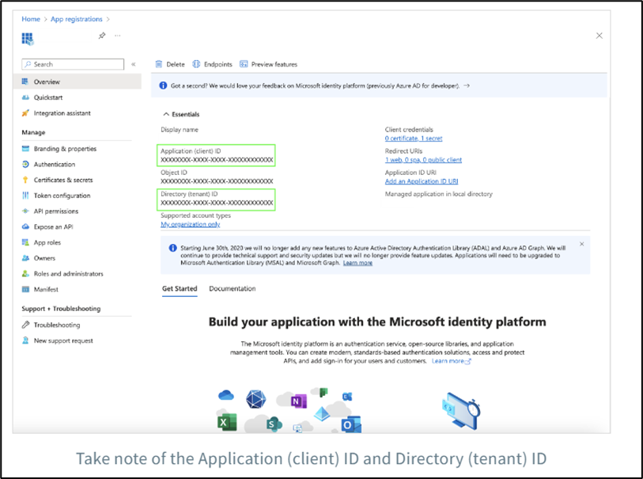
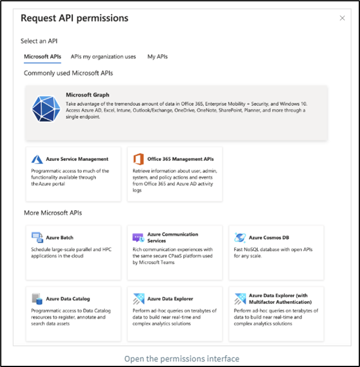
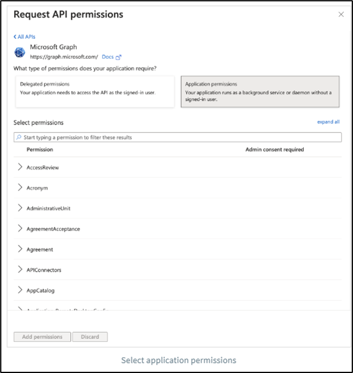
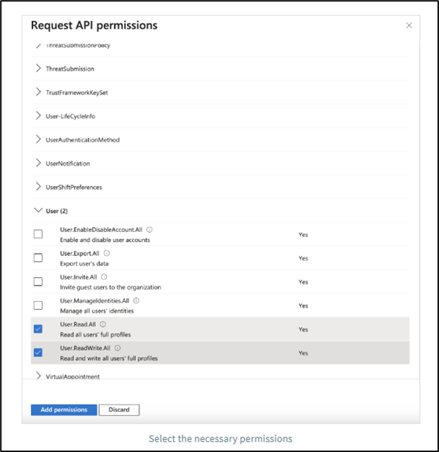
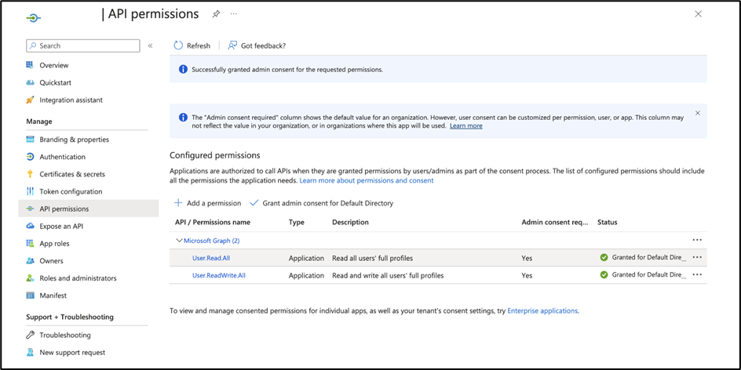
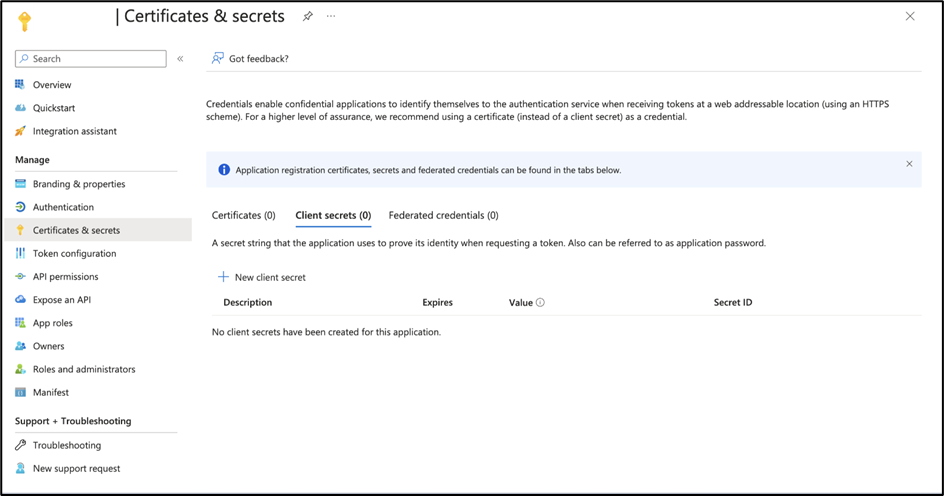

{/* Source: Intercom article 8559826 - https://oloid.help/en/articles/8559826-set-up-microsoft-entra-id-for-oloid-workflow-integration */}
{/* Generated by intercom_to_mintlify.py - re-running overwrites this file. */}

Connecting to Microsoft Entra ID on Oloid Workflow is a multistep process involving configuration steps in the Microsoft Active Directory and Oloid Workflow.

## Steps to create Oloid Workflow on Microsoft Entra ID

Creating Oloid Workflow Application on Microsoft Entra ID consists of the following steps:

- [Step 1: Register your application](#step-1-register-your-application)
- Step 2: Grant your application permissions
- [Step 3: Generate a client secret for your application](#step-3-generate-a-client-secret-for-your-application)

### Step 1: Register your application

Register your Oloid Workflow application with Microsoft Entra ID

.

1. Log in to the [Microsoft Azure](https://portal.azure.com/)
2. Select **App registrations**.
3. On the resulting page, click **+ New registration**.
4. Name your application. This is the user-facing display name for this application. Microsoft allows you to change this name later.

   

5. In **Supported account types**, select the first option, **Accounts in this organizational directory only**.
6. In the **Redirect URI** field, set the platform type to **Web** and provide the redirect URI.
7. The next page displays the details of the newly-created application. Pay attention to the **Application (client) ID** and the **Directory (tenant) ID**. You will need these values later to authenticate in Oloid Workflow.

   

### Step 2: Assign permissions to your application

Now it's time to assign permissions to our Oloid Workflow application.

These instructions demonstrate how to grant the minimum permissions necessary to establish a connection with Oloid Workflow. The permissions you need are variable and based on your use case.

1. Select **API permissions** from the left navigation sidebar.
2. Click **+ Add a permission**.
3. Click **Microsoft Graph** to open the permissions interface.

   

4. Select **Application permissions**.

   

5. Scroll to **User**. Add the `User.Read.All `and `User.ReadWrite.All` permissions, along with any other necessary [permissions](https://docs.workato.com/connectors/azure-ad/connection-setup.html#permissions).

   

6. Click **Add permissions**.
7. You will see these permissions added to **Microsoft Graph**. However, you will need admin approval to grant them to your application officially.
   If you are logged in with an administrator account, click **Grant admin consent for Default Directory**.
8. Once admin consent is granted, Microsoft updates the **Status** column to **Granted**.

   

### Step 3: Generate a client secret for your application

1. Select **Certificates & secrets** from the left navigation sidebar.
2. Click **+ New client secret**.

   

3. In the interface that appears, provide a description of the secret and determine when the secret will expire.
4. Copy and save the **Value** in a safe place. This is the only time Microsoft Entra ID
   displays this value.
