{/* Source: Intercom article 7978577 - https://oloid.help/en/articles/7978577-set-up-prowatch-for-oloid-workflow-integrations */}
{/* Generated by intercom_to_mintlify.py - re-running overwrites this file. */}

Here are the steps to set up ProWatch for Oloid workflow integrations.

## Step 1 : Install license to use ProWatch Web API

Please get in touch with official Honeywell representative to acquire license to use ProWatch Web API.

## Step 2 : Install ProWatch Web API

### Configure ProWatch Web API

- Open ‘PW-DTU-WinService.exe.config’ file.
- Make below changes to the file.

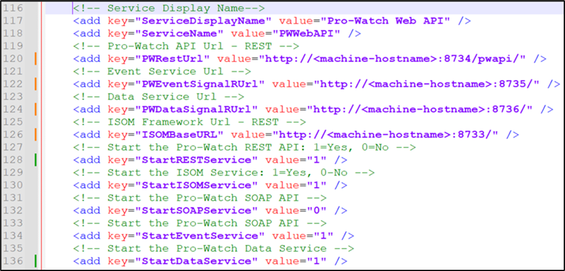

- Save the file.

### Install ProWatch Web API as a Windows Service

- Open **Command** window in administrator mode.
- Go to **ProWatch Web API** installation folder.
- Run this command – **Install_PW_API_Service.bat**

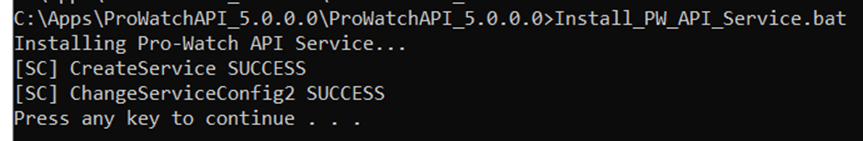

### Configure ProWatch Web API Service

- Open **Windows Services** application (type “services.msc” in RUN window).

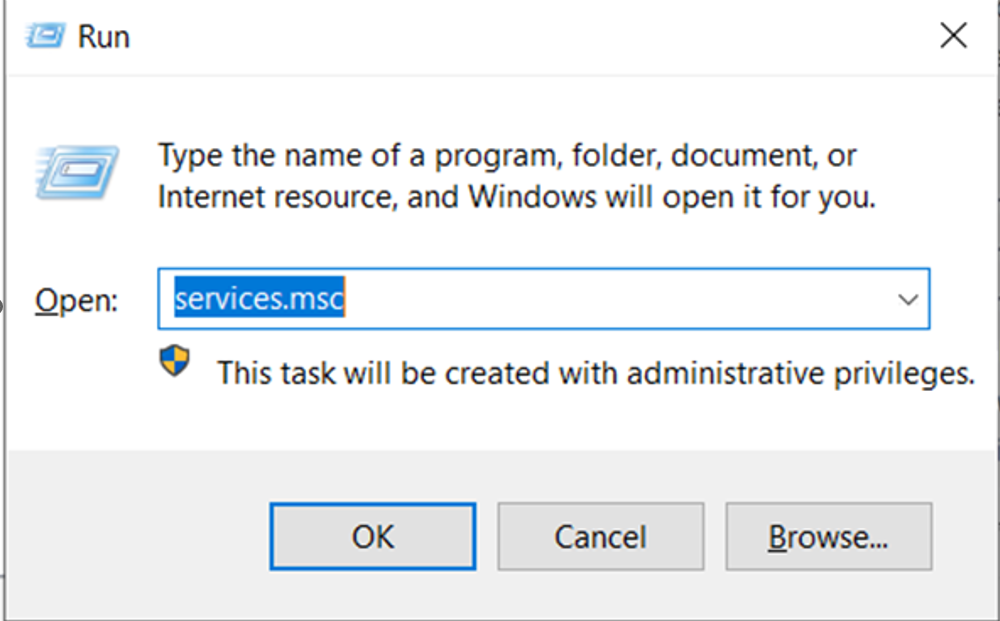

- Search for “**ProWatch Web API**” service.

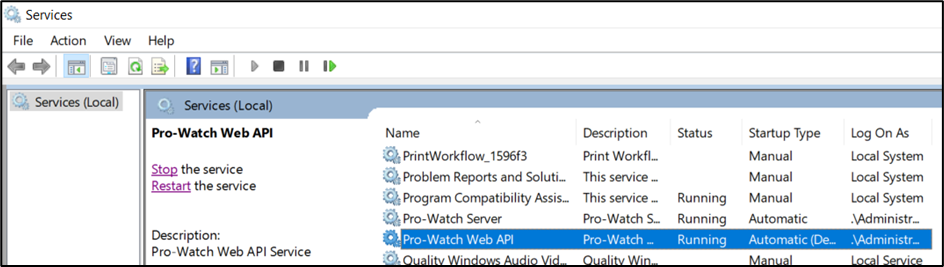

- Right click the entry and select **Properties**.

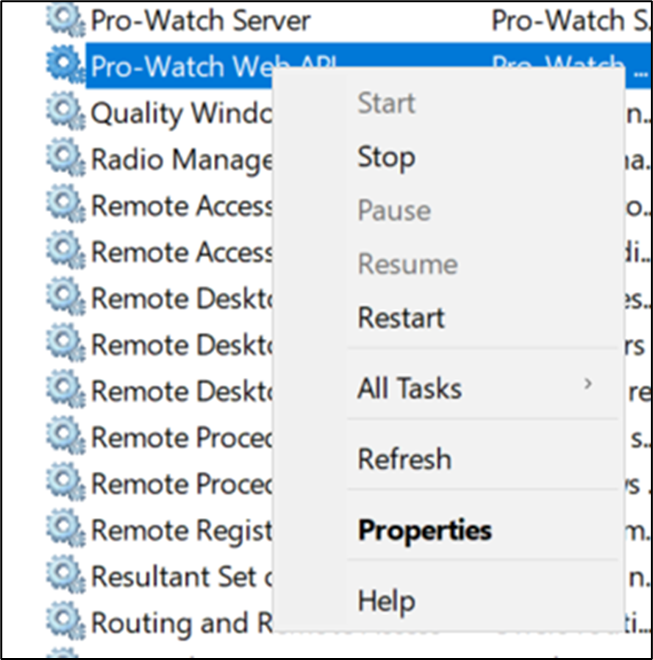

- Go to **Log On** tab and set windows admin user for “**This account**” option.

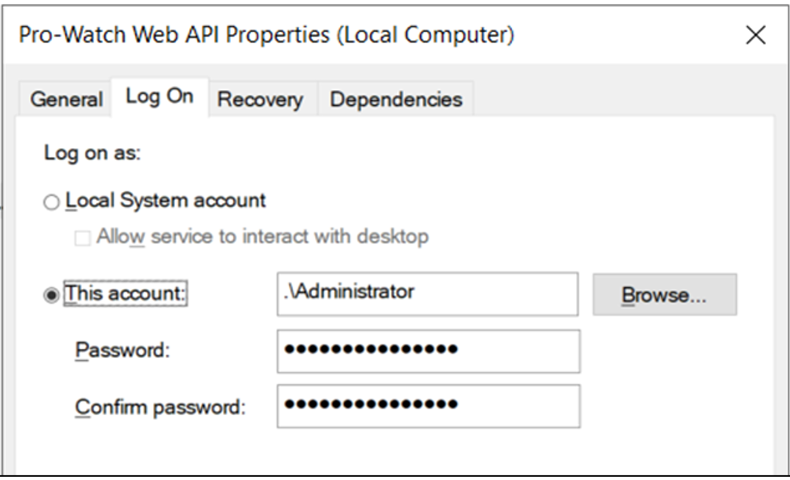

- Start the service.

## Step 3 Create ProWatch User for Web API Access

- Open **ProWatch** application.
- Go to **Administration > Users.**
- Right click and select **New Users.**

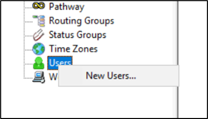

- Fill up user form as shown below.

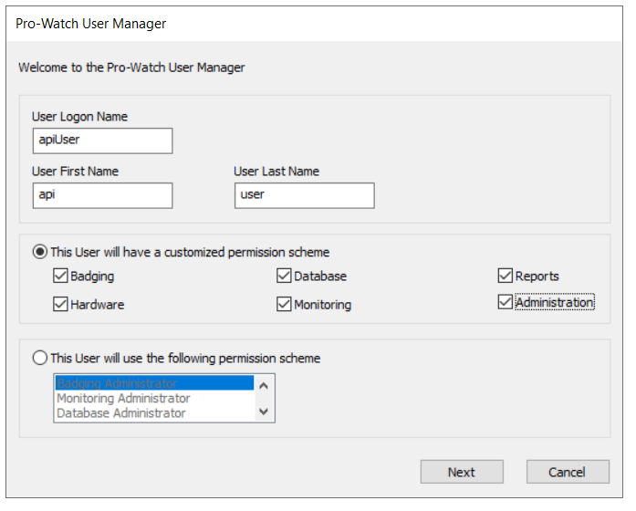

- Select “**Add All**” to add all available workstations and click **Finish.**

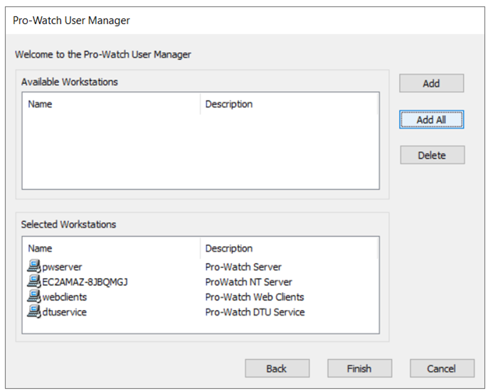

- Right click on the user entry and select **Properties.**

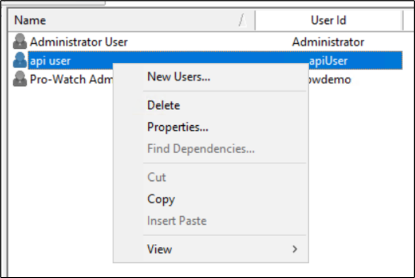

- Set “**Web Password**” in User Information tab.

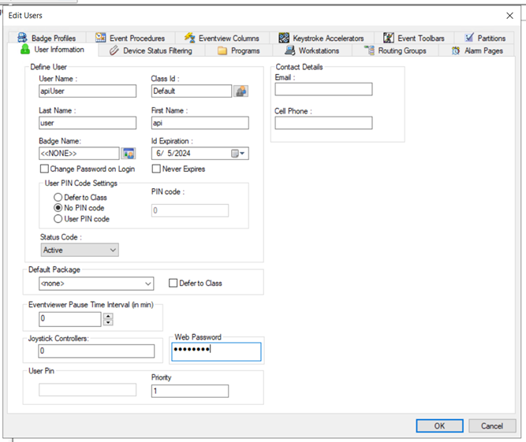

- Click **OK**.
