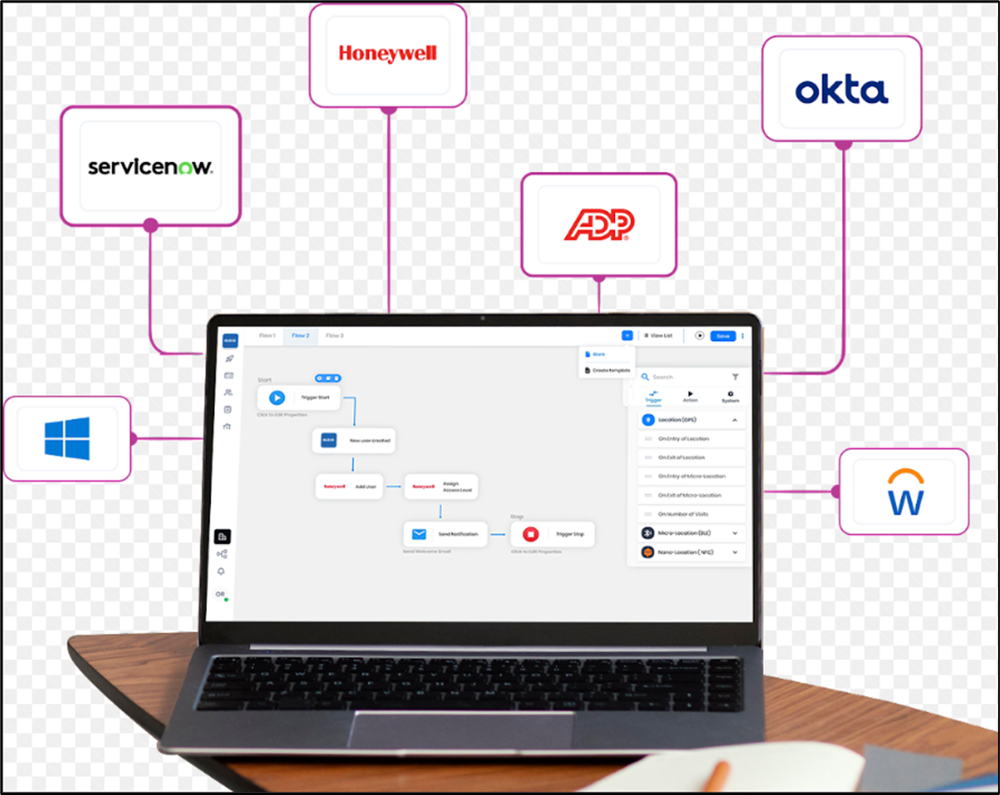

{/* Source: Intercom article 7983465 - https://oloid.help/en/articles/7983465-what-is-oloid-workflow */}
{/* Generated by intercom_to_mintlify.py - re-running overwrites this file. */}

Oloid Workflow is an application that runs as a cloud application and also as an on-prem application. A tenant can have at most one Workflow cloud application and any number of Workflow on-prem applications.

It supports automation of business workflows across cloud and on-premises applications.

## Benefits of Oloid Workflow

- Manage multiple integrations
- Browser-Based Editor
- Versatile and Flexible
