# Plan: Getting Started guides (future)

Status: **not started** - parked on 2026-11-18 so the Intercom migration runs
first. Nothing in this plan is in `navigation.json` or on the site yet.

## Goal

A separate **Getting Started** tab with hand-written, end-to-end setup guides:
one guide per product, one page per step, in setup order. These are new pages,
not Intercom articles - the migration script never writes or deletes them.

## Navigation tree

```
Getting Started
├── Windows Login V2
│   ├── Before You Begin: Requirements & Prerequisites
│   ├── Download & Install Windows Login V2        <- reference page (below)
│   ├── First-Time Configuration
│   ├── Onboard Users & Enroll Credentials
│   └── Your First Windows Login
├── Supervisor App
│   ├── Before You Begin: Access & Requirements
│   ├── Download & Install Supervisor App
│   ├── First Login as a Supervisor
│   ├── First-Time Setup & Endpoint Pairing
│   └── Add Your First User & Enroll Credentials
├── Android DeviceLock
│   ├── Before You Begin: Device Requirements
│   ├── Install Android DeviceLock
│   ├── Configure Your First Device
│   ├── Onboard Users & Enroll Credentials
│   └── Your First Device Unlock
├── WebKey
│   ├── Before You Begin: Access & Requirements
│   ├── Initial Administrator Configuration
│   ├── Add Users & Assign Access
│   ├── Enroll Your Authentication Credentials
│   └── Your First WebKey Login
├── OLOID Connect for Passwordless
│   ├── Before You Begin: Device & Access Requirements
│   ├── Download & Install OLOID Connect
│   ├── First Administrator Login
│   ├── Configure & Pair Your First Endpoint
│   ├── Onboard Users & Enroll Credentials
│   └── Your First Application Login
├── OLOID Vault
│   ├── Web Vault (Chrome)
│   │   ├── Before You Begin: Browser & Access Requirements
│   │   ├── Install the Chrome Extension
│   │   ├── First-Time Setup & Login
│   │   ├── Set Up Your First Credentials
│   │   └── Use Your Saved Credentials
│   ├── Android Vault
│   │   ├── Before You Begin: Device & Access Requirements
│   │   ├── Download & Install Android Vault
│   │   ├── First-Time Setup & Login
│   │   ├── Set Up Your First Credentials
│   │   └── Use Your Saved Credentials
│   └── iOS Vault
│       ├── Before You Begin: Device & Access Requirements
│       ├── Download & Install iOS Vault
│       ├── First-Time Setup & Login
│       ├── Set Up Your First Credentials
│       └── Use Your Saved Credentials
├── Time Clock
│   ├── OLOID Verify
│   │   ├── Before You Begin: Device & Access Requirements
│   │   ├── Download & Install OLOID Verify
│   │   ├── Administrator Login & First-Time Setup
│   │   ├── Onboard Users & Enroll Credentials
│   │   └── Your First Time Clock Authentication
│   └── OLOID Connect
│       ├── Before You Begin: Device & Access Requirements
│       ├── Download & Install OLOID Connect
│       ├── Administrator Login & First-Time Setup
│       ├── Configure & Pair Your Time Clock Endpoint
│       ├── Onboard Users & Enroll Credentials
│       └── Your First Clock-In & Clock-Out
├── OLOID Platform
│   ├── Tenant Admin Portal
│   │   ├── Access the Portal & Log In for the First Time
│   │   ├── Configure Your Organization
│   │   ├── Add Administrators & Supervisors
│   │   ├── Add Your First Users & Groups
│   │   └── Set Up Your First Application & Connection
│   ├── Supervisor Portal
│   │   ├── Before You Begin: Supervisor Access
│   │   ├── Access the Portal & Log In for the First Time
│   │   ├── Find & Manage Users
│   │   └── Enroll Your First User's Credentials
│   └── User Portal
│       ├── Access the Portal from Your Invitation
│       ├── Log In for the First Time
│       ├── Complete Your Enrollment
│       └── View & Manage Your Credentials
└── Device-Specific Setup
    ├── Zebra
    │   ├── Supported Devices & Deployment Prerequisites
    │   ├── Install & Configure the OLOID Application
    │   ├── Onboard Your First Device & User
    │   └── Complete Your First Authentication
    └── Linux & Thin Clients
        ├── Supported Configurations & Prerequisites
        ├── Installation & Deployment
        ├── First-Time Configuration
        ├── User Onboarding
        └── Your First Login
```

74 pages in 14 guides.

## How to add it

1. Write the pages under `getting-started/<guide>/<step>.mdx`, e.g.
   `getting-started/windows-login-v2/first-time-configuration.mdx`. Slugs are
   the title in lower case with `&` -> `and`; every "Before You Begin: ..."
   page is `before-you-begin`.
2. Start each page with the comment
   `{/* Getting Started guide - hand-written. Not touched by intercom_to_mintlify.py or build_nav.py. */}`
   and do **not** add the "Generated by intercom_to_mintlify.py" marker, so
   the migration's stale-page cleanup never deletes it.
3. Add a tab to `navigation.json`, before Platforms & Solutions or after More Resources:
   `{"tab": "Getting Started", "icon": "rocket", "slug": "getting-started", "groups": [...]}`.
   Give each group an explicit `pages` list, so the sidebar follows the setup
   order instead of the alphabet. Nested guides (OLOID Vault, Time Clock,
   OLOID Platform, Device-Specific Setup) use nested `groups`.
4. Run `python build_nav.py`, then `mint dev` and `mint broken-links`.
5. Point oloid.help links in the pages at their Mintlify pages (the
   `--polish` pass does this for migrated articles: `python intercom_to_mintlify.py --polish`).

Publish a guide only once all of its steps exist; an unfinished guide is
better left out of the tab than shipped with "coming soon" pages.

## Page shape

Every step page follows the same order:

1. One-sentence intro: where the reader starts and ends, and how long it takes.
2. `<Info>` - "This is step N of M in the **<guide>** setup", linking the previous step.
3. `## What you need` - bullet list.
4. `## Watch the walkthrough` - optional Vimeo embed in `<Frame>`.
5. `## Step 1: ...`, `## Step 2: ...` - each a `<Steps>` block, one screenshot per step.
6. `## Check that it worked` - what the reader should see.
7. `## Next step` - a horizontal `<Card>` to the next page.

## Reference page (draft, kept from the removed folder)

`getting-started/windows-login-v2/download-and-install-windows-login-v2.mdx`,
built from Intercom articles 15069295, 13670102 and 15653468. The images it
uses come from the migration (`/images/intercom/<id>/`). Re-check them after
the migration runs.

````mdx
---
title: "Download & Install Windows Login V2"
description: "Download the Windows Login V2 installer from the Tenant Admin Portal, install it on a Windows device, and pair the device."
keywords:
  - "Windows Login V2 install"
  - "download Windows Login installer"
  - "auto-pair Windows Login"
  - "Oloid Passwordless Login setup"
---

{/* Getting Started guide - hand-written. Not touched by intercom_to_mintlify.py or build_nav.py. */}
{/* Reference guide: the shape every other Getting Started page should follow. Built from Intercom articles 15069295, 13670102 and 15653468. */}

This guide takes you from a Windows device with nothing installed to a device that is paired with your OLOID tenant and ready for its first passwordless login. It takes about 15 minutes.

<Info>
  This is step 2 of 5 in the **Windows Login V2** setup. Complete [Before You Begin: Requirements & Prerequisites](/getting-started/windows-login-v2/before-you-begin) first.
</Info>

## What you need

- A **Tenant Admin** account for the Tenant Admin Portal.
- Local administrator access on the Windows device.
- A device that meets the [Windows Login V2 hardware and software requirements](https://oloid.help/en/articles/13670511-windows-login-v2-0-hardware-and-software-requirements).
- Network access to OLOID services. See [Windows Login V2 network whitelisting requirements](https://oloid.help/en/articles/14730405-windows-2-0-network-whitelisting-requirements).

## Watch the walkthrough

<Frame>
  <iframe
    className="w-full aspect-video rounded-xl"
    src="https://player.vimeo.com/video/1200684101?h=ed98c35226"
    title="How to download the Windows Login V2 installer"
    allowFullScreen
  />
</Frame>

{/* TODO: add a GIF of the installer wizard (Step 3) once one is recorded. */}

## Step 1: Download the installer

<Steps>
  <Step title="Open Tenant Settings">
    Log in to the **Tenant Admin Portal**. Click the **User profile** icon in the bottom-left corner of the menu panel, then select **Tenant Settings**.

    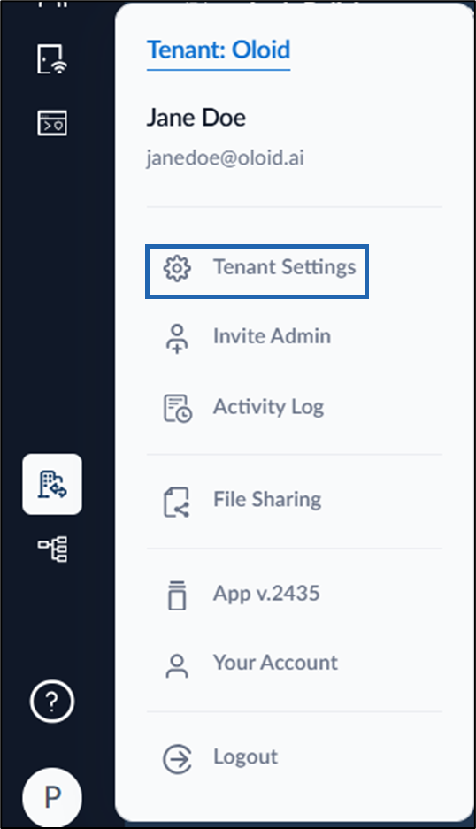
  </Step>
  <Step title="Find the Windows app">
    Go to the **Oloid Apps** tab and open **Windows Authenticator App V2 Login**.

    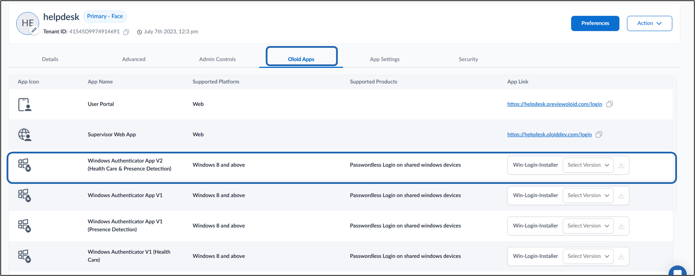
  </Step>
  <Step title="Download the installer">
    Select a version from the **Win-Login-Installer** list and click **Download**. The installer file downloads to your device.

    
  </Step>
</Steps>

## Step 2: Generate the auto-pair string

Auto-pairing registers the device with your tenant during installation, so you don't have to pair each device by hand afterwards. Skip this step if you plan to pair manually with the Supervisor App.

<Steps>
  <Step title="Open the auto-pair config generator">
    In the Tenant Admin Portal, open the auto-pair config file generator. For details, see [How to generate an auto-pair config file for Windows Login](https://oloid.help/en/articles/10441578-windows-login-how-to-generate-auto-pair-config-file-for-windows-login-in-tenant-admin-portal).
  </Step>
  <Step title="Choose the application">
    Set **Application Type** to **Passwordless - Windows Login**, then choose the application the device should pair with from **Select Application**.

    <Tip>
      Select **Skip user confirmation for pairing** to pair devices without a confirmation prompt.
    </Tip>
  </Step>
  <Step title="Copy the config text">
    Select **TEXT** as the download format and click **Copy Config Text**. Keep it handy for the installer.

    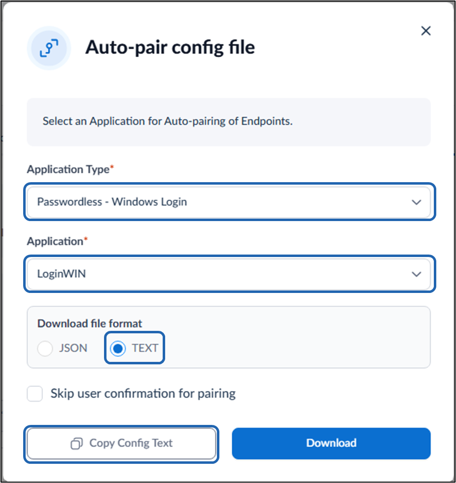
  </Step>
</Steps>

## Step 3: Install Windows Login V2

<Steps>
  <Step title="Start the installer">
    Double-click the **Oloid Passwordless Login** file you downloaded, then click **Start**.

    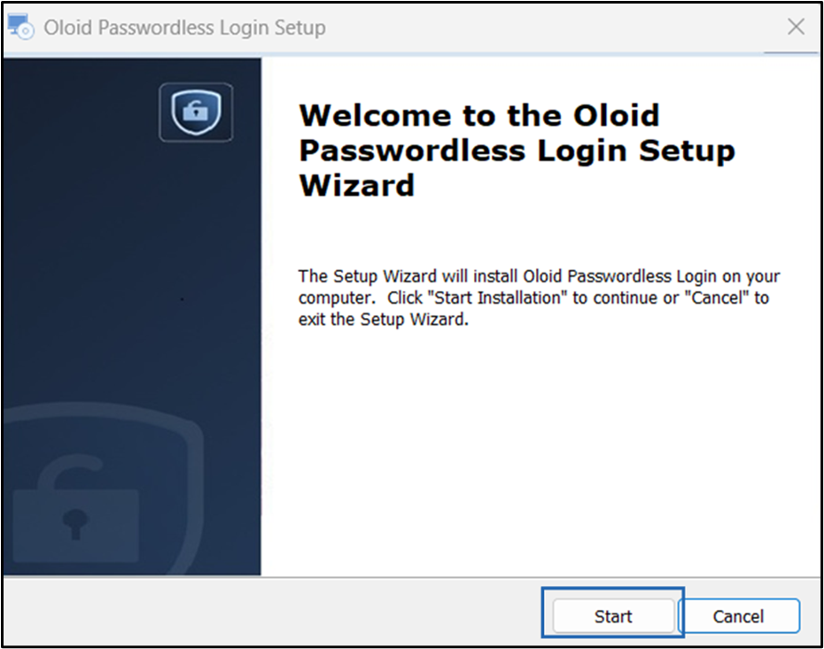
  </Step>
  <Step title="Accept the license and choose a folder">
    Select the **License Agreement** checkbox and click **Next**. Keep the default destination folder and click **Next** again.

    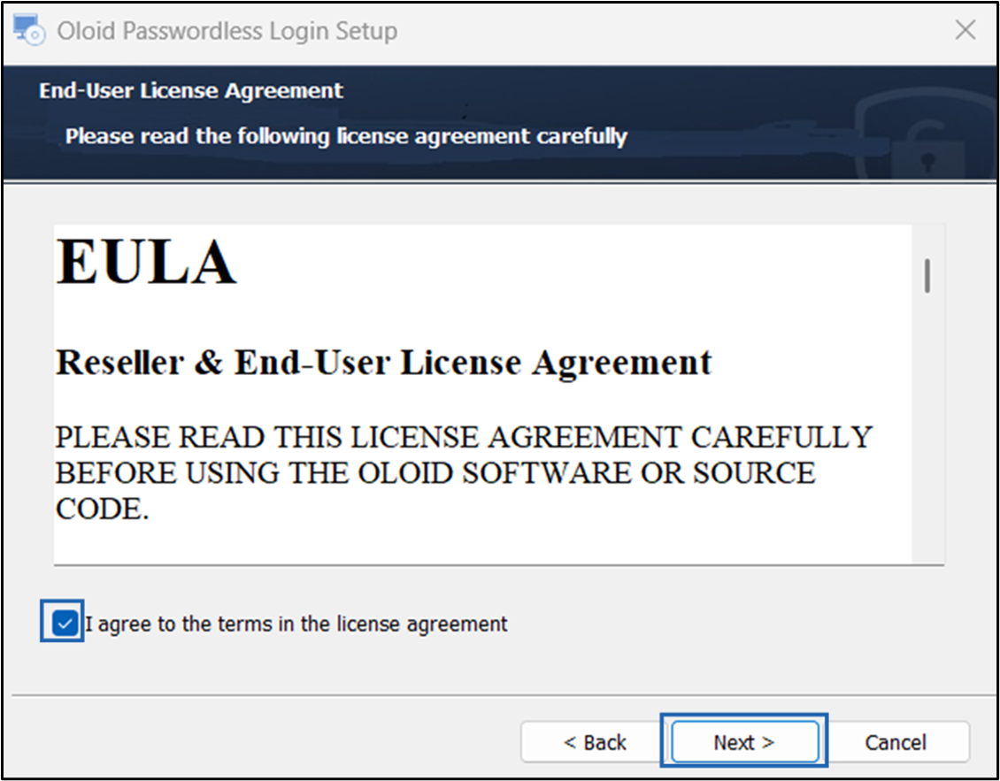
  </Step>
  <Step title="Choose capabilities">
    Select the capabilities you need and click **Next**:

    - **On-device Face Recognition:** authenticates users locally, even when the device is offline.
    - **Local Cache Server:** lets users log in with locally stored data when the network is unavailable. Selected by default.
    - **Presence Detection:** enables hands-free login and locks the device when the user walks away.
    - **Oloid Launcher:** a central place to open apps and workflows after login.
    - **EPIC Integration:** passwordless access to Epic workflows.

    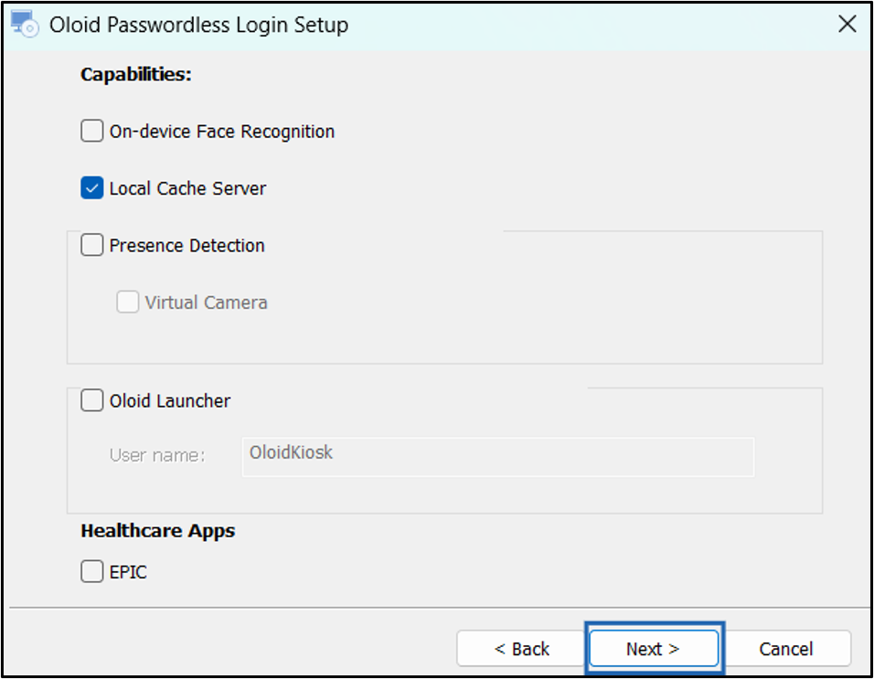
  </Step>
  <Step title="Set the proxy">
    Choose how the device reaches OLOID services, then click **Next**:

    - **None:** connect directly.
    - **Use Local System Proxy:** use the proxy already configured on the device.
    - **Use Explicit Proxy:** enter a proxy server address in the **URL** field.

    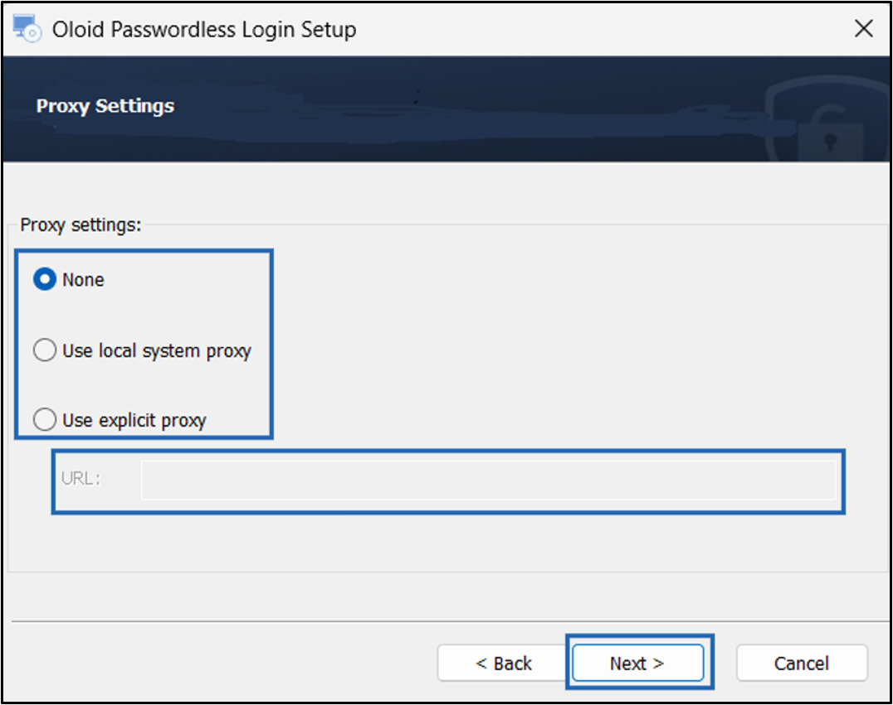
  </Step>
  <Step title="Pair the device">
    On the **Autopair Settings** screen, select **Automatic**, paste the config text from Step 2 into **Encoded String**, and click **Next**.

    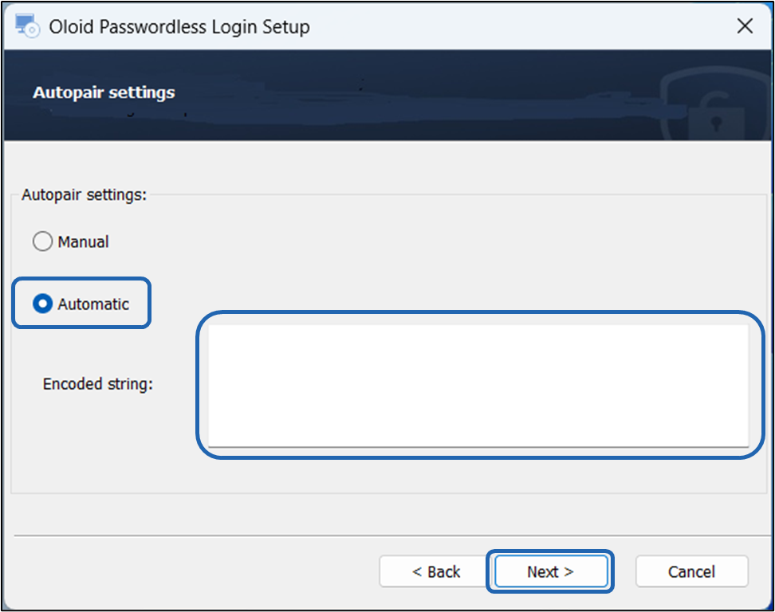

    <Note>
      To pair later instead, select **Manual**. You can then pair with the [Supervisor App](https://oloid.help/en/articles/9059601-windows-login-how-to-manually-pair-the-supervisor-app) or an [auto-pair config file](https://oloid.help/en/articles/9637781-windows-login-how-to-pair-supervisor-app-using-auto-pair-config-file-option).
    </Note>
  </Step>
  <Step title="Install">
    Click **Install**. If the installer asks for **Microsoft Visual C++**, **Microsoft ASP.NET** or **Windows Desktop Runtime**, accept each license and click **Install**, then **Close**.

    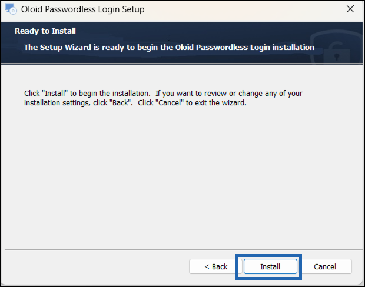
  </Step>
  <Step title="Finish and restart">
    Click **Finish**, then click **Yes** to restart the device. Pairing completes after the restart.

    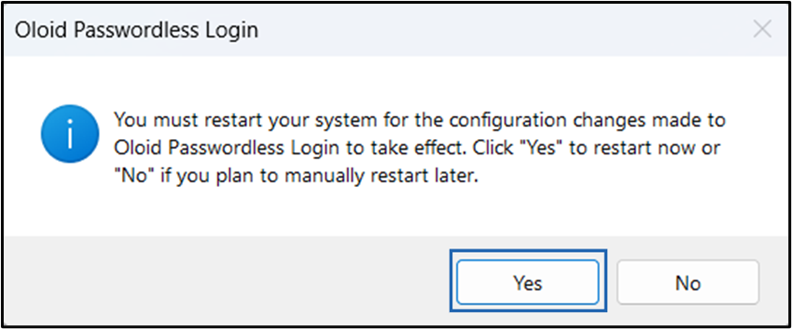
  </Step>
</Steps>

## Check that it worked

After the restart:

- The OLOID app icon 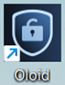 is on the desktop.
- The device appears under **Endpoints** in the Tenant Admin Portal.

<Note>
  The installer also installs **Apache CouchDB**, which Windows Login uses for its local cache.
</Note>

## Next step

<Card title="First-Time Configuration" icon="arrow-right" href="/getting-started/windows-login-v2/first-time-configuration" horizontal>
  Configure Windows Login for your users.
</Card>
````
