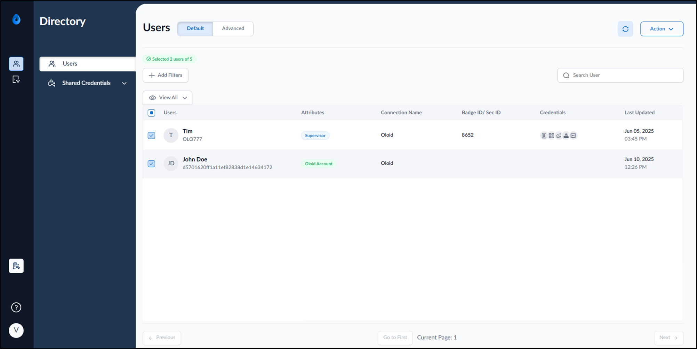
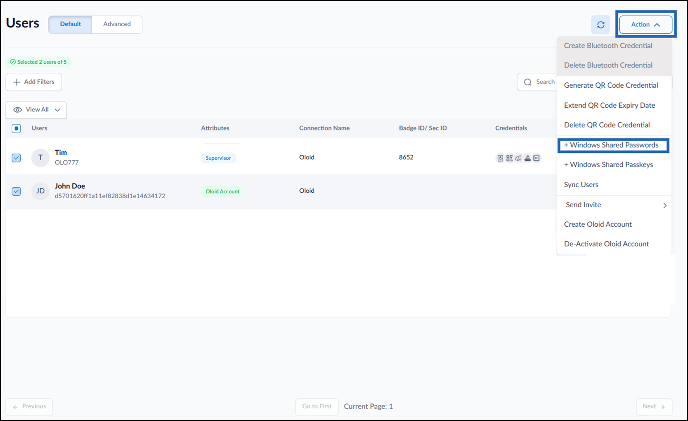
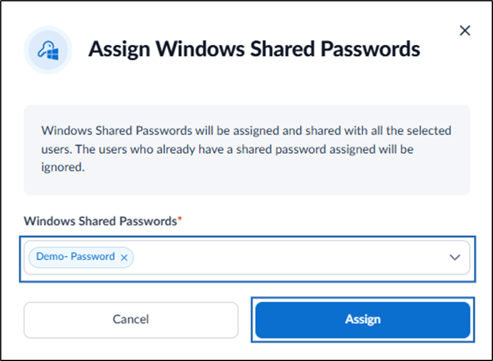
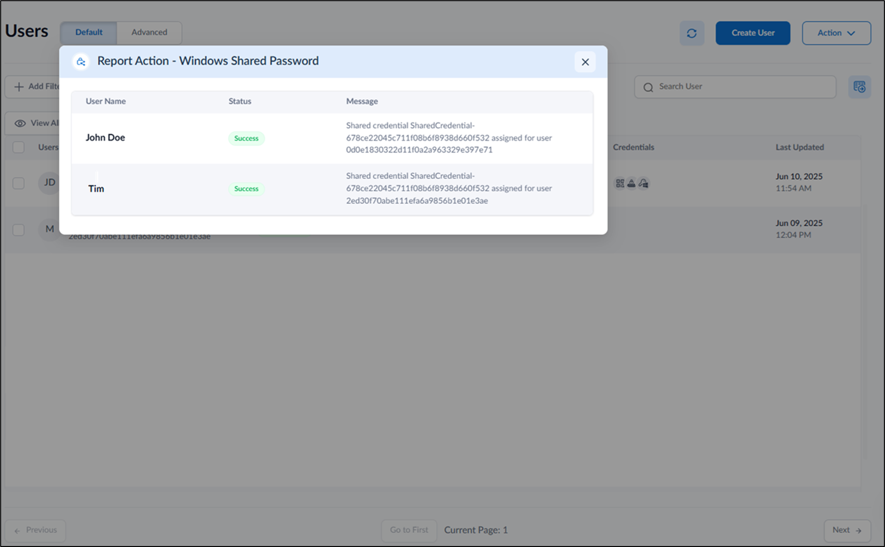

{/* Source: Intercom article 9706862 - https://oloid.help/en/articles/9706862-how-to-assign-windows-shared-passwords-to-multiple-users-in-supervisor-portal */}
{/* Generated by intercom_to_mintlify.py - re-running overwrites this file. */}

**Prerequisite:**

A shared windows password must be created in Tenant Admin Portal/Supervisor Portal.

**Steps to assign windows shared Passwords:**

1. Log in to the **Supervisor Portal**.
   The **Users** page is displayed.
2. On the Users page, select user(s) to assign Windows Shared Passwords.

   

3. Go to **Action** > **+ Windows Shared Passwords**.

   

   The **Assign Windows Shared Passwords** pop-up box is displayed.

   

4. On the pop-up box, do the following:
   1. Select Windows Shared Password(s) from **Windows Shared Passwords** dropdown list.
   2. Click **Assign**.

The Windows Shared Password is successfully assigned for the selected user(s).

## Related Document

   [How to Assign Windows Shared Passwords to Multiple Users in Tenant Admin Portal](/platform/tenant-admin-portal/how-to-assign-windows-shared-passwords-to-multiple-users-in-tenant)
