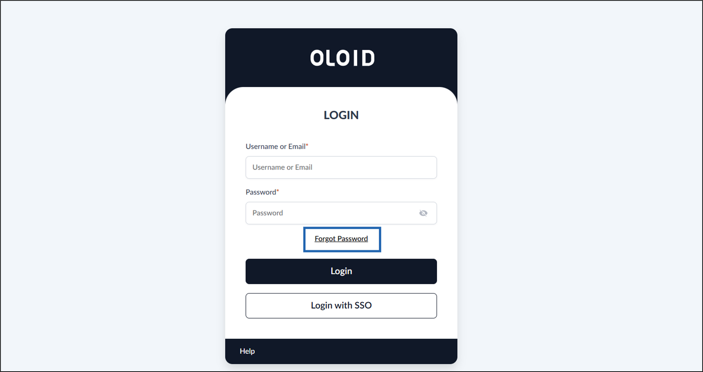
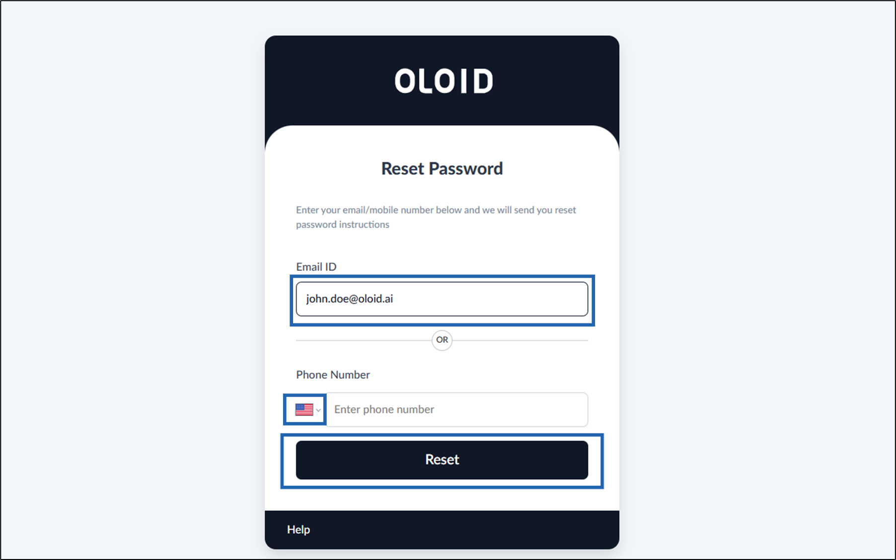
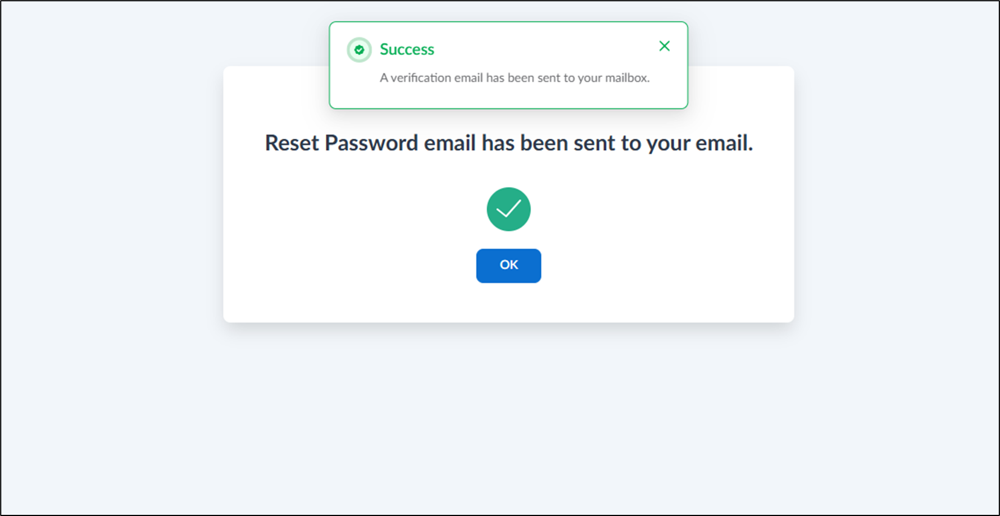
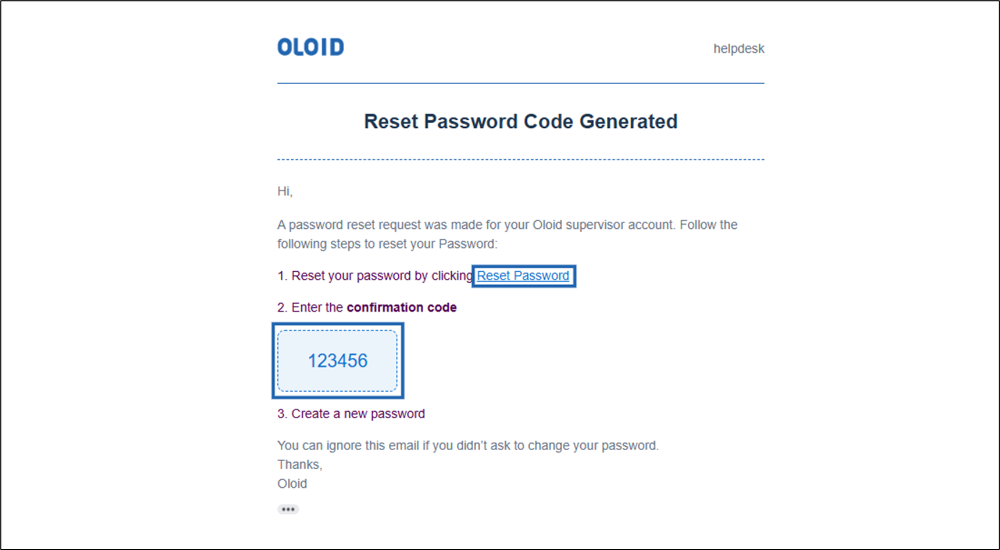
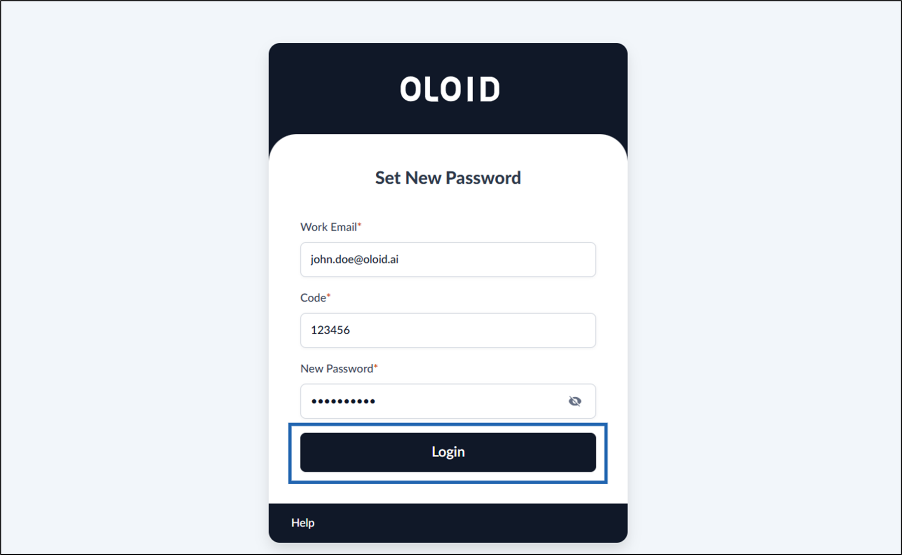
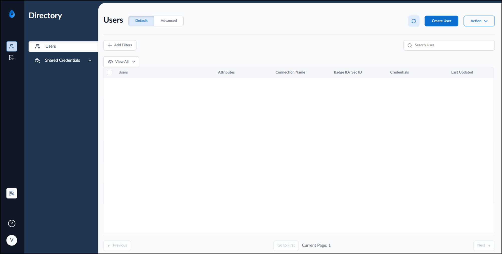

{/* Source: Intercom article 11456250 - https://oloid.help/en/articles/11456250-how-to-reset-password-in-supervisor-portal */}
{/* Generated by intercom_to_mintlify.py - re-running overwrites this file. */}

Resetting your password in the Supervisor Portal allows you to create a new password if you've forgotten the current one or need to update it for security. The process includes verifying your identity, receiving a reset link or code, setting a new password, and logging in securely.

**Pre-requisite**

- You should be a user in the Tenant Admin Portal with **Supervisor** role.

**Follow the below steps to reset password :**

1. Launch your browser.
2. Enter the URL provided for you in the browser’s address bar > press **Enter** on your keyboard.
   The Oloid LOGIN page is displayed.
3. Click **Forgot Password.**

   

   The reset password pop-up box is displayed.
4. Do any one of the following:
   1. Enter your registered **Email ID**.
      OR
   2. Select **Country** from drop down menu > Enter your registered **phone number**.
5. Click **Reset**.

   

   A reset password email is sent to the provided email ID.

   

6. Go to your email **inbox >** open the **Oloid Password Reset** email.
7. Click **Reset Password** link.

   

   The Set New Password pop-up box is displayed.
8. Enter your **Email ID**.
9. Enter **Confirmation Code** received on the same email.
10. Enter **New Password**.
11. Click **Login**.

    

    The password is successfully reset in the Supervisor Portal. The Supervisor Portal home page is displayed.

    

<Note>
  **Note:** If you are unable to reset your password using the above steps, you may also contact your **Support team** to request a reset password link. Once received, click the link and follow the on-screen instructions to complete the reset process.
</Note>
