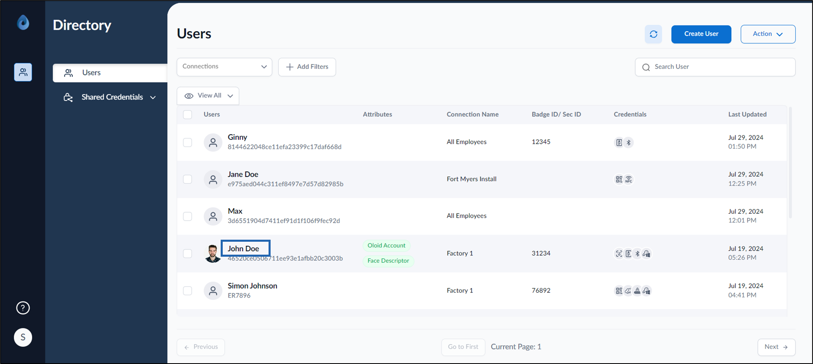
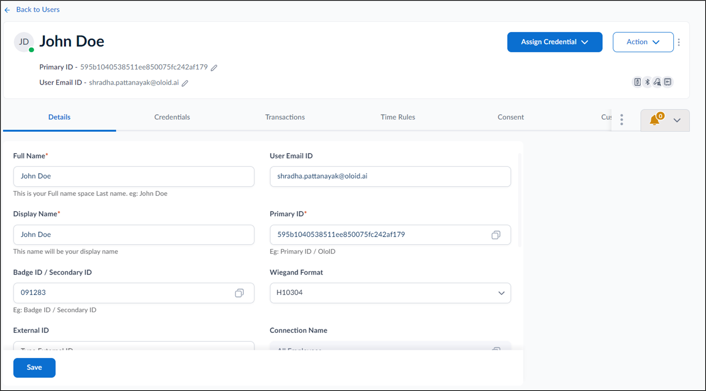
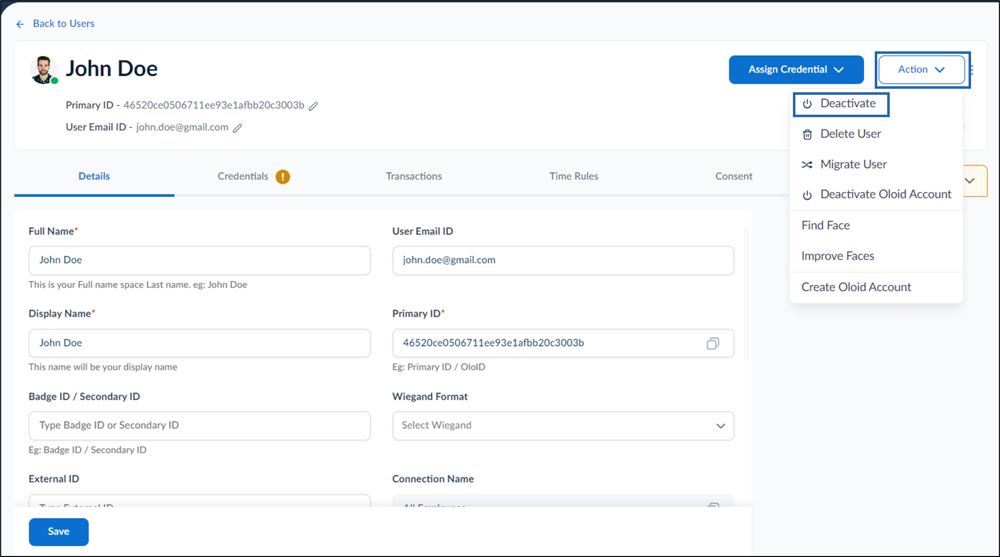
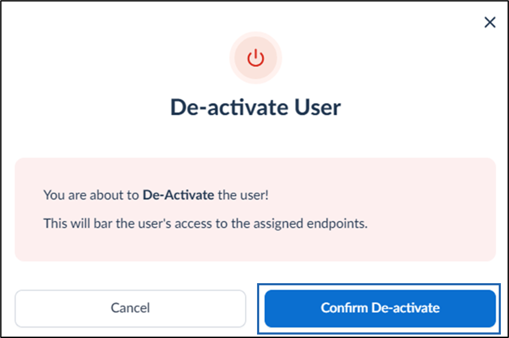
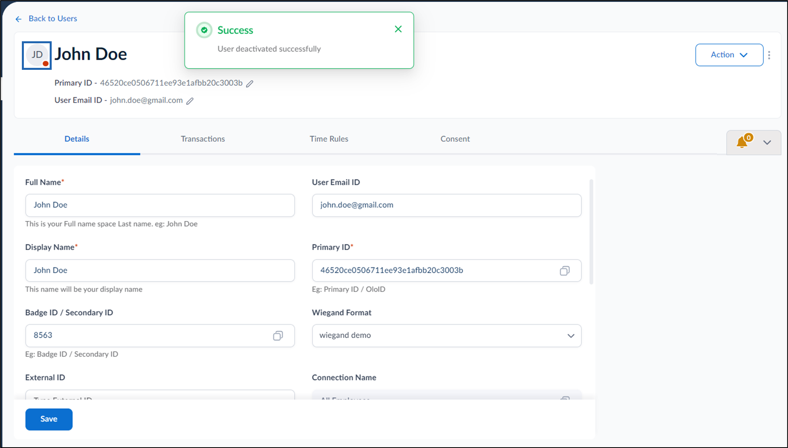
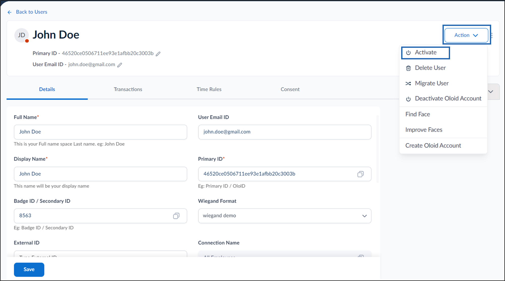
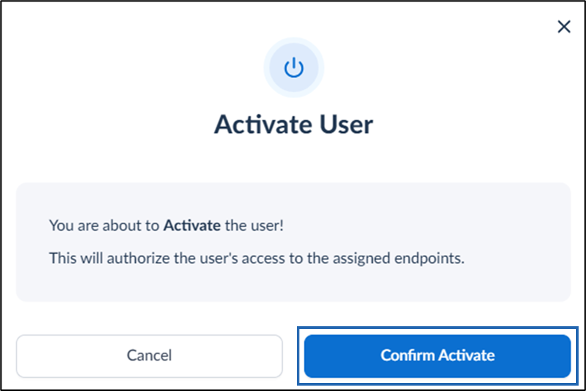
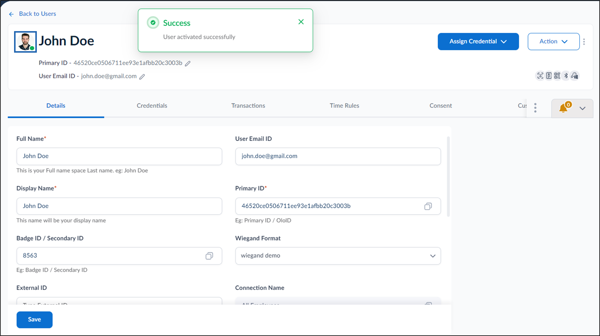

{/* Source: Intercom article 9673602 - https://oloid.help/en/articles/9673602-supervisor-portal-how-to-activate-or-deactivate-user */}
{/* Generated by intercom_to_mintlify.py - re-running overwrites this file. */}

Steps to Activate or Deactivate User:

1. Log in to the **Supervisor Portal**.
   The **Users** page is displayed.
2. Click username to edit.

   

   The user details page is displayed.

   

3. Do one of the following on **Action** dropdown:
   1. Select **Deactivate**.

      

      <Note>
        **Note:**

        **Deactivate** button is visible for active users in the action dropdown.
      </Note>

      The **De-activate User** pop-up box is displayed.
      1. Click **Confirm De-activate**.

         

         The user status is changed from active to inactive.

         

   2. Select **Activate**.

      

      The **Activate User** pop-up box is displayed.
      1. Click **Confirm Activate**.

         

         The user status is changed from inactive to active.

         

## Video Tutorial

Watch the video[How to activate or deactivate user in Supervisor Portal - Video Tutorial](/platform/supervisor-portal/videos/how-to-activate-or-deactivate-user-in-supervisor-portal-video-tutorial)
