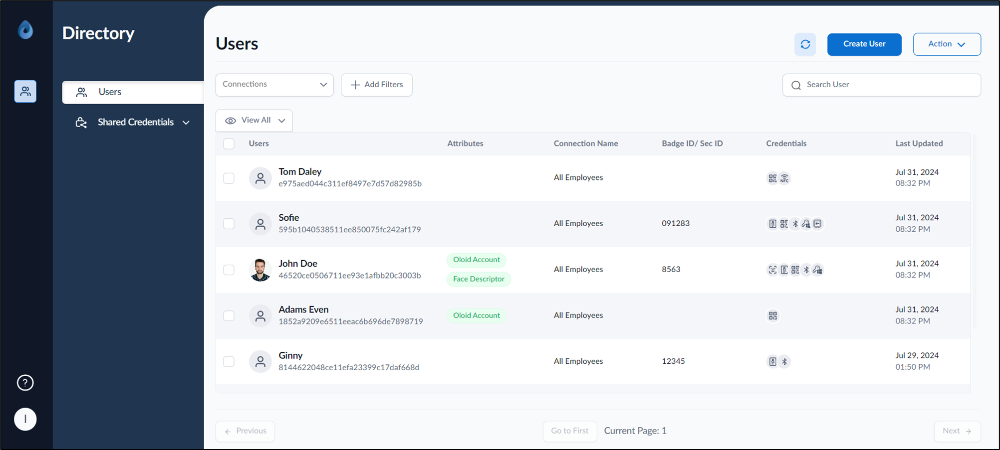
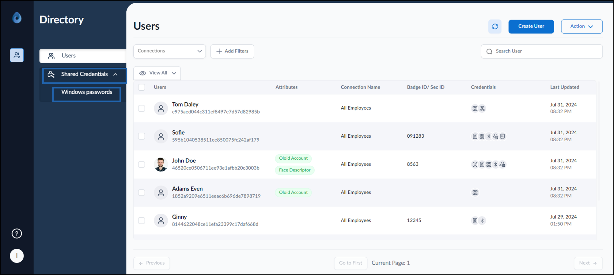
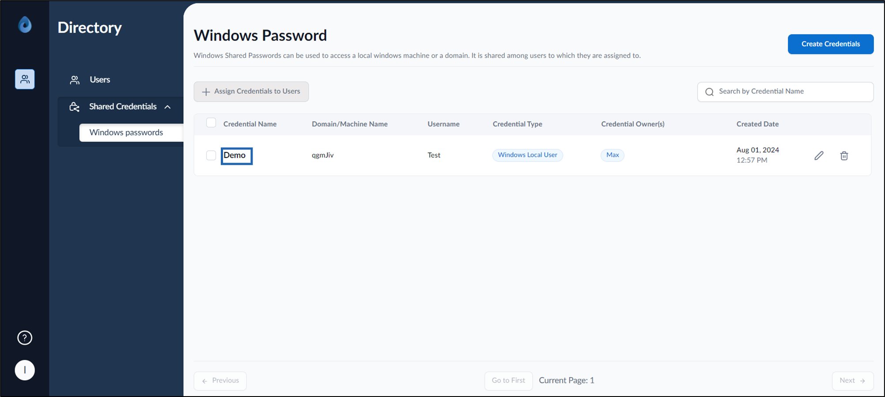
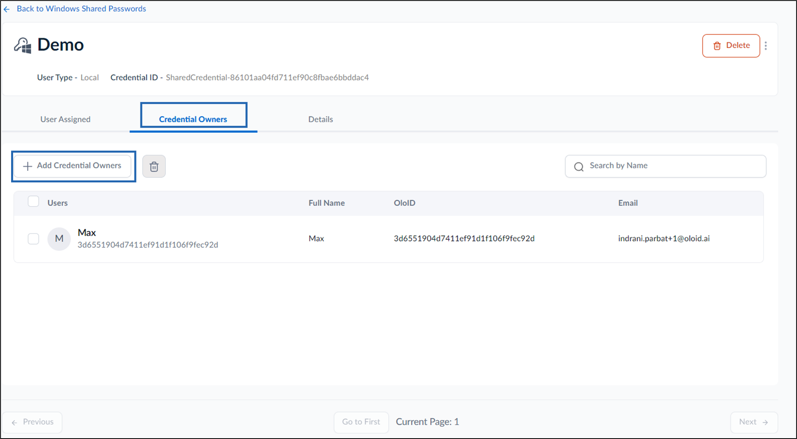
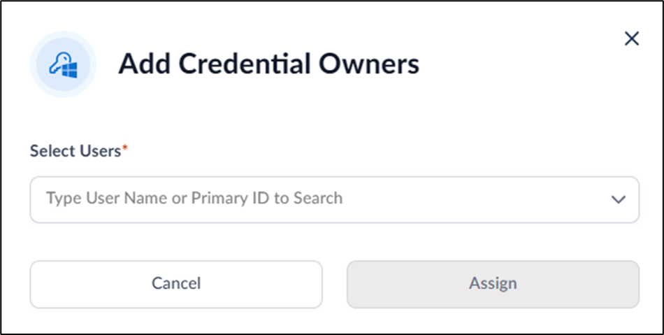
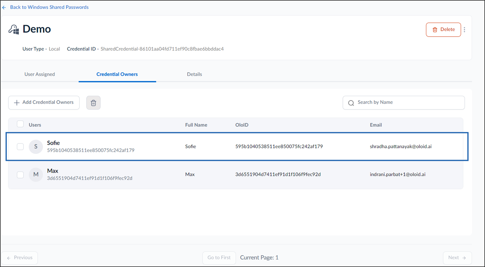

{/* Source: Intercom article 9684955 - https://oloid.help/en/articles/9684955-supervisor-portal-how-to-add-credential-owners */}
{/* Generated by intercom_to_mintlify.py - re-running overwrites this file. */}

Steps to add Credential Owners:

1. Log in to the **Supervisor Portal.**
   The Users page is displayed.

   

2. Click **Shared Credentials** > **Windows Passwords**.

   

   The Windows Passwords page is displayed.
3. Select credential name to edit.

   

4. Select **Credential Owners** tab > **+ Add Credential Owners**.

   

   The **Add Credential Owners** pop-up box is displayed.

   

5. On the pop-up box, enter user name(s) or primary ID(s) in the **Users** dropdown list.
6. Select **Assign**.
   The credential owners are successfully assigned.

   

## Video Tutorial

Watch the video [How to add credential owners in the Supervisor Portal- Video Tutorial](/platform/supervisor-portal/videos/how-to-add-credential-owners-in-the-supervisor-portal-video-tutorial)
